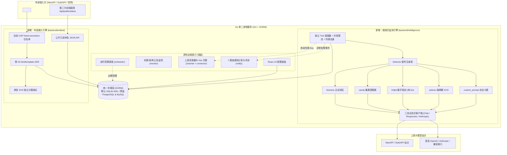

# 运维监控 + 插拔式模型降智监测 + 外部嵌入组件 架构设计与分阶段开发计划

> **项目底座**：基于 `bejix/upstream-ops`（基准版本 `v0.0.10`，Git Tag：`base-upstream-ops-v0.0.10`）二次开发  
> **技术栈**：Go 1.23 (Gin + GORM + Pure-Go SQLite) / React 19 + TypeScript + Vite 6 + Tailwind CSS v4 + Radix UI (shadcn/ui)  
> **核心定位**：外挂式纯运维监控面板 + 主动测活与可插拔模型降智监测 + 零 JS 高安全外部嵌入组件（`/embed`）  
> **创建日期**：2026-11-21

---

## 1. 背景、目标与架构约束

### 1.1 业务目标（第一期范围）
1. **外挂式纯运维监控**：保留 `upstream-ops` 成熟的 NewAPI / Sub2API 多上游运维能力（余额、消费、倍率变动追踪、公告同步、API Key 管理、订阅监控、打码平台监控、7 通道告警通知），不强制业务流量经过自带转发网关。
2. **主动测活与性能采集**：独立于转发网关，支持对任意监控渠道/分组或直连端点发起轻量级流式主动测活，采集 **TPS、首字延迟（TTFT）、平均总延迟、24 小时成功率、近 90 分钟逐分钟可用率趋势**。
3. **插拔式模型降智/智力监测引擎**：后台内置并统一注册全部监测插件（`liveness`、`candy`、`lmfpd`、`pelican`、`custom_prompt`，未来可扩展 `juice`/`meow` 等），用户可按**目标粒度**自由勾选开启哪些检测项、独立配置模型/推理强度/执行周期。
4. **第一期处置策略**：检测异常仅做**历史留存 + 推送告警（复用现有 7 渠道通知与去抖体系）+ 管理面板与外部 Embed 展示**，不做自动禁用/修改上游路由联动。
5. **外部可导入嵌入组件**：完整实现类似 `pilot.bothyouandme.com/embed?site=ooioo` 的**零 JS 纯服务端渲染（SSR）+ 严格 CSP 白名单**嵌入体系，日后外部任意站点（NewAPI / Sub2API 首页或独立官网）仅需粘贴一行 `<iframe sandbox ...>` 即可安全导入。

### 1.2 关键约束与工程原则
- **数据库策略**：默认 **SQLite（WAL 模式，纯 Go 无 CGO `glebarez/sqlite`）**单机零依赖启动；所有新增表结构和查询严格遵循 GORM 跨方言标准 SQL，确保后续平滑兼容 MySQL 与 **PostgreSQL**（预留 `DBDriverPostgres` 扩展位）。
- **KISS 与低侵入**：不破坏 `upstream-ops` 现有测试与核心模块；完整保留原 `backend/gateway` 后端代码与前端 `/gateway` 导航入口（不做删减或隐藏，便于后续按需使用）。
- **绝对不耦合转发网关**：监测引擎独立维护自己的目标表 `probe_targets` 与多协议流式客户端 `backend/intelligence/llmclient`，不要求用户先创建 `GatewayGroup`/`GatewayRoute`。
- **安全边界**：外部 `/embed` 与 AI 生成的 Pelican SVG 必须执行零 JS + 严格 CSP + 双层 `<iframe sandbox="">` 隔离，杜绝 XSS 和凭据泄漏。
- **Git 与测试纪律**：每个开发阶段走独立特性分支 + TDD（先写单元测试/Mock 测试，再写实现），全量测试与前端构建通过后再合并主干。

---

## 2. 总体系统架构



---

## 3. 核心模块详细设计

### 3.1 领域模型与数据库表设计（SQLite 优先，兼容 PG / MySQL）

遵循 `backend/storage/model.go` 现有规范（显式 `TableName()`、AES-GCM 加密敏感字段、明确长度与跨方言索引），新增 **5 张表**（全部加入 `storage.AutoMigrate`）：

#### 表 1：`probe_targets`（监测目标）
每个监测目标对应面板和 Embed 表格中的“一行渠道”（例如 `cc-max`、`codex-plus`、`国产模型-余额`）。

| 字段 | 类型 | 说明 |
| :--- | :--- | :--- |
| `id` | `uint` PK | 主键 |
| `name` | `varchar(128)` unique | 展示名称（如 `codex-plus`） |
| `slug` | `varchar(128)` unique | URL 安全标识（用于 `/embed/candy?target=<slug>`） |
| `family` | `varchar(32)` | 模型家族标签（`claude`/`codex`/`grok`/`domestic`/`other`，用于着色） |
| `source_kind` | `varchar(16)` | `channel`（绑定已有监控渠道）或 `direct`（直连 BaseURL+Key） |
| `channel_id` | `uint` index | `source_kind=channel` 时关联 `channels.id` |
| `source_group_id` | `*int64` | 绑定的上游分组 ID（Sub2API） |
| `source_group_name` | `varchar(256)` | 绑定的上游分组名（NewAPI/Sub2API） |
| `base_url` | `varchar(512)` | 直连地址，或覆写监控渠道的 `site_url` |
| `api_key_source` | `varchar(32)` | `manual`（手动填 Key）或 `auto_channel_key`（自动在监控渠道托管专用 Key） |
| `api_key_id` | `int64` | 自动托管时的上游 Key ID |
| `api_key_cipher` | `text` | AES-GCM 加密保存的 API Key |
| `api_key_hint` | `varchar(64)` | 脱敏预览（如 `sk-ab...89`） |
| `protocol` | `varchar(32)` | `openai_chat` / `openai_responses` / `anthropic` |
| `auth_style` | `varchar(16)` | `bearer` / `x-api-key` / `both` |
| `proxy_enabled` | `bool` | 是否走全局系统代理 |
| `user_agent` | `varchar(512)` | 自定义 UA（空则使用系统默认上游 UA） |
| `extra_headers_json` | `text` | 额外自定义请求头 JSON |
| `sort_order` | `int` index | 排序权重 |
| `enabled` | `bool` index | 总开关 |
| `embed_visible` | `bool` | 是否允许对外 Embed 展示 |
| `created_at` / `updated_at` | `time.Time` | 时间戳 |

#### 表 2：`probe_detector_configs`（目标 × 插件插拔配置表）
实现“**后台支持全部类型，用户按目标自由勾选开启**”的核心关系表，联合唯一索引 `(target_id, detector_key)`。

| 字段 | 类型 | 说明 |
| :--- | :--- | :--- |
| `id` | `uint` PK | 主键 |
| `target_id` | `uint` uniqueIndex(target_detector) | 关联 `probe_targets.id` |
| `detector_key` | `varchar(64)` uniqueIndex(target_detector) | 插件键：`liveness` / `candy` / `lmfpd` / `pelican` / `custom_prompt` |
| `enabled` | `bool` index | 该检测项是否开启 |
| `model_name` | `varchar(256)` | 本项测试使用的模型 ID（如 `claude-opus-4-6`、`gpt-5.3-codex`） |
| `reasoning_effort` | `varchar(32)` | `omit` / `none` / `minimal` / `low` / `medium` / `high` / `xhigh` / `max` |
| `interval_seconds` | `int` | 定时执行间隔（秒），如 `liveness` 默认 180s（3 分钟），`candy` 默认 3600s，`lmfpd` 默认 10800s |
| `timeout_seconds` | `int` | 单次超时（秒），默认按插件设定（如测活 30s、画鹈鹕 120s） |
| `alert_enabled` | `bool` | 异常时是否推送通知 |
| `alert_threshold` | `int` | 连续异常 N 次触发告警（默认 `liveness=3`, `candy=3`, `lmfpd=2`） |
| `params_json` | `text` | 插件专属参数 JSON（如 `custom_prompt` 的题目与判定规则、`lmfpd` 的声称模型别名等） |
| `embed_visible` | `bool` | 该检测项结果是否暴露在外部 Embed 中 |
| `last_run_at` | `*time.Time` | 最近执行时间 |
| `next_run_at` | `*time.Time` index | 下次计划执行时间（供调度器扫描） |
| `created_at` / `updated_at` | `time.Time` | 时间戳 |

#### 表 3：`probe_liveness_samples`（主动测活与性能时间序列）
用于计算 24h 性能指标（TPS、平均 TTFT、平均延迟、成功率）及近 90 分钟逐分钟热力条。

| 字段 | 类型 | 说明 |
| :--- | :--- | :--- |
| `id` | `uint` PK | 主键 |
| `target_id` | `uint` index(target_observed) | 关联 `probe_targets.id` |
| `model_name` | `varchar(256)` | 实际探测模型 |
| `success` | `bool` | 是否成功收到有效流式内容并正常终结 |
| `http_status` | `int` | HTTP 状态码（网络错误为 0） |
| `error_class` | `varchar(32)` | `ok` / `timeout` / `rate_limit` / `auth` / `upstream` / `network` / `config` |
| `error_message` | `text` | 脱敏错误摘要 |
| `first_token_ms` | `int64` | 首 Token 延迟（毫秒，不含失败样本） |
| `latency_ms` | `int64` | 总耗时（毫秒） |
| `output_tokens` | `int` | 输出 Token 数（优先取上游 usage，缺失时按字符数保守估算并标注） |
| `tps` | `float64` | 生成速率：`output_tokens / ((latency_ms - first_token_ms) / 1000.0)` |
| `observed_at` | `time.Time` index(target_observed) | 采样时间戳 |

#### 表 4：`probe_intelligence_runs`（智力与降智检测记录表）
统一记录所有智力监测插件的执行结果，同时支持同源结果复用追踪。

| 字段 | 类型 | 说明 |
| :--- | :--- | :--- |
| `id` | `uint` PK | 主键 |
| `run_uuid` | `varchar(64)` uniqueIndex | 对外 UUID（用于 `/embed/pelican/:run_uuid`，避免暴露自增 ID） |
| `target_id` | `uint` index(target_det_time) | 关联 `probe_targets.id` |
| `detector_key` | `varchar(64)` index(target_det_time) | 插件键 |
| `model_name` | `varchar(256)` | 测试模型 |
| `reasoning_effort` | `varchar(32)` | 推理强度 |
| `status` | `varchar(32)` index | `normal`（通过/正常） / `suspected`（未通过/疑似降智） / `error`（探测调用失败） |
| `summary` | `varchar(512)` | 一句话展示摘要（如 `答案为 21`、`最像 gpt-5.3-codex`、`已生成画面`） |
| `claimed_rank` | `int` | `lmfpd` 专属：声称模型在参考库中的排名（1 表示排第一） |
| `top_candidate` | `varchar(128)` | `lmfpd` 专属：得分最高的候选模型名 |
| `latency_ms` | `int64` | 总耗时（毫秒） |
| `first_token_ms` | `int64` | 首字耗时（毫秒） |
| `output_tokens` | `int` | 输出 Token 数 |
| `detail_json` | `text` | 结构化详情（Candy 原始回答、lmfpd 完整 Top-K 排名与相似度、CustomPrompt 匹配详情） |
| `artifact_svg` | `text` | Pelican 生成的完整 HTML/SVG 文档（大字段，列表查询时通过 `Select` 排除） |
| `error_message` | `text` | 探测报错原因（已脱敏） |
| `shared_cache_key` | `varchar(64)` index | 同源共享键 SHA-256 |
| `reused_from_run_id` | `*uint` | 复用同源结果时指向源 `id` |
| `observed_at` | `time.Time` index(target_det_time) | 检测完成时间 |

#### 表 5：`embed_sites`（外部嵌入组件站点配置）
支持配置 1 个或多个对外 Embed 实例（如 `?site=default`、`?site=ooioo`），每个实例拥有独立的样式、目标筛选与防盗链白名单。

| 字段 | 类型 | 说明 |
| :--- | :--- | :--- |
| `id` | `uint` PK | 主键 |
| `slug` | `varchar(64)` uniqueIndex | URL 参数标识（`/embed?site=<slug>`） |
| `title` | `varchar(128)` | 页面主标题（默认 `渠道性能`） |
| `eyebrow` | `varchar(128)` | 顶标文字（默认 `CHANNEL PERFORMANCE`） |
| `enabled` | `bool` | 是否启用 |
| `refresh_seconds` | `int` | 自动刷新间隔（默认 `15`，0 表示关闭自动刷新） |
| `allowed_origins_json` | `text` | 允许嵌入的父站点 Origin 列表 JSON（生成 CSP `frame-ancestors`） |
| `cors_origins_json` | `text` | 允许跨域调用 `/api/public/status` 的 Origin 列表 JSON |
| `theme` | `varchar(32)` | `paper`（暖纸风，复刻 `ooioo`）/ `light` / `dark` |
| `target_ids_json` | `text` | 指定展示的 `probe_targets.id` 有序数组（空则展示全部 `embed_visible=true`） |
| `show_identity_column` | `bool` | 是否展示“模型检测”列 |
| `created_at` / `updated_at` | `time.Time` | 时间戳 |

---

### 3.2 插拔式检测框架（`backend/intelligence/`）

#### 统一插件接口设计
```go
package intelligence

type DetectorMeta struct {
    Key                 string       `json:"key"`
    Name                string       `json:"name"`
    Category            string       `json:"category"` // "liveness" | "intelligence"
    Description         string       `json:"description"`
    DefaultIntervalSec  int          `json:"default_interval_seconds"`
    DefaultTimeoutSec   int          `json:"default_timeout_seconds"`
    DefaultAlertThresh  int          `json:"default_alert_threshold"`
    SupportsEmbed       bool         `json:"supports_embed"`
    SupportsReasoning   bool         `json:"supports_reasoning"`
    ParamsSchema        []ParamField `json:"params_schema,omitempty"`
}

type Detector interface {
    Key() string
    Meta() DetectorMeta
    ValidateParams(rawJSON string) error
    Run(ctx context.Context, client LLMClient, req RunRequest) (*RunOutput, error)
}
```
* **插件热插拔/高扩展性**：通过 `Registry.Register(d Detector)` 注册，新增检测类型只需实现该接口并在初始化时注册，无需改动调度器、存储表结构和前端开关页面（前端通过 `GET /api/intelligence/detectors` 动态渲染配置项）。

#### 内置 5 款插件规范
1. **`liveness`（主动测活与速率探针）**
   - 请求内容：轻量级受控生成提示词（要求流式输出约 20~40 tokens 固定结构短语），强制 `stream: true` + `stream_options.include_usage: true`。
   - 采集指标：首字节/首个内容 Delta 到达时间记为 `first_token_ms`，流结束记为 `latency_ms`，按 `output_tokens / ((latency_ms - first_token_ms)/1000)` 计算 `tps`。
   - 写入：`probe_liveness_samples`。
2. **`candy`（Candy 糖果逻辑题）**
   - 题目与判定：采用社区标准糖果逻辑题（标准答案 `21`），严格校验最终输出文本（剥离 `reasoning_content` / `<think>` 思考过程），仅接受独立整数 `21`，拒绝 `121`、`21.0`、`21 或 22` 及流式截断响应。
   - 写入：`probe_intelligence_runs`（`status = normal | suspected | error`）。
3. **`lmfpd`（数字指纹检测 · 纯 Go 实现）**
   - 核心算法：集成 MIT 协议 `Ikaleio/lm-detector` 校准参考库与纯 Go 特征提取/SVD 投影打分逻辑（参考 `haowang02/cpa-plugin-codex-candy-eval/internal/fingerprint`），完全零 Node.js 运行时依赖。
   - 流程：随机抽取 3 条挑战提示词，让模型分别生成约 300 个 `1–355` 整数，聚合计算分布特征并与参考库比对，输出 `top_candidate`、`claimed_rank` 和 Top-K 排名明细 JSON。
   - 状态口径：`claimed_rank == 1` 为 `normal`，非第一或指向异家族记 `suspected`（并在页面与 Embed 中显式注明“排名仅作参考，不是身份证明”）。
4. **`pelican`（画鹈鹕 SVG 测试）**
   - 请求模型生成“鹈鹕骑自行车”独立 SVG/HTML（要求包含 `<svg ...>...</svg>`），最大输出 4096 tokens，捕获体上限 2 MiB。
   - 校验：提取有效 `<svg>` 或独立 HTML 片段存入 `artifact_svg`；无有效 SVG 记 `suspected` 或 `error`。
   - 安全隔离：无论在管理后台还是外部 `/embed`，一律通过独立端点输出并强制 `CSP: default-src 'none'; style-src 'unsafe-inline'; img-src data:; font-src data:; sandbox` + 前端 `<iframe sandbox="">` 双重隔离。
5. **`custom_prompt`（自定义智力题插件）**
   - 通过 `params_json` 配置：`prompt`（题目）、`match_mode`（`exact_number` / `contains` / `regex`）、`expected`（期望匹配值）、`forbid`（可选禁止词），方便用户自行沉淀私有验真题库。

#### 统一三协议流式客户端（`backend/intelligence/llmclient/`）
- 支持 3 种协议：`openai_chat`（`/v1/chat/completions`）、`openai_responses`（`/v1/responses`）、`anthropic`（`/v1/messages`）。
- 统一开启流式 `stream: true`，同时兼容部分上游直接返回非流式 JSON 的兜底解析。
- 复用 `backend/gateway/usage_parse.go` 的成熟 Token 解析能力与系统全局代理配置（`config.ProxyConfig`）。
- 严格区分最终回答（`Content`）与思考过程（`Reasoning`），严格检测流终态（`[DONE]` / `message_stop` / `response.completed`），防止半截流被误判通过。

#### 后台调度、并发控制与同源去重（`backend/intelligence/runner.go`）
- **Tick 调度**：每 10 秒扫描 `probe_detector_configs` 中 `enabled = true AND (next_run_at IS NULL OR next_run_at <= now)` 的到期项，提交至有界 Worker 池（默认并发 2~4，可配置，保护 SQLite 单写连接与上游限流）。
- **防雪崩与退避**：单目标内同插件串行互斥（避免上一次慢请求未结束又叠一次）；网络/429/5xx 探测错误采用独立退避而不刷爆上游。
- **同源结果共享去重**：
  - 构造共享键：`SHA256(base_url | sha256(api_key) | protocol | model | reasoning_effort | detector_key | canonical_params)`；
  - 正在执行的同源请求通过 `singleflight` 合并为 1 次 HTTP；
  - 若其他目标在自己配置的 `interval_seconds` 有效期内已有同源新鲜记录，则直接复用并记录 `reused_from_run_id`，大幅节省检测 Token 成本（手动点击「立即检测」跳过已完成的旧缓存，强制重测）。

---

### 3.3 告警通知复用设计（第一期策略：只记录 + 告警 + 展示）

完全复用 `backend/notify/dispatcher.go` 与 `notification_cooldowns` 表，在 `backend/storage/model.go` 扩展 4 个通知事件：
- `probe_down`：某目标主动测活连续失败达到 `alert_threshold` 次；
- `probe_recovered`：此前处于 `probe_down` 的目标恢复成功；
- `intelligence_suspected`：某目标智力检测连续异常达到阈值（如 Candy 连续 3 次未通过、或 lmfpd 连续 2 次指向其他家族）；
- `intelligence_error`：某目标智力检测调用本身连续报错达到阈值（如密钥失效/模型下线/超时）。

> 注：通知冷却键支持按 `(channel_id_or_target_id, event)` 去抖，并在 `notify.Policy` 中增加 `IntelligenceAlertCooldownMinutes`（默认 120 分钟），避免告警轰炸；所有通知均支持现有 7 种通道（Telegram / 飞书 / 钉钉 / 企业微信 / 邮件 / Webhook / ServerChan3）。

---

### 3.4 外部嵌入组件设计（`backend/embed/`）

完全借鉴 `pilot.bothyouandme.com/embed` 的零 JS 极简安全架构：

| 路由（公开免管理台鉴权） | 返回类型 | 核心特性 |
| :--- | :--- | :--- |
| `GET /embed?site=<slug>` | `text/html` (SSR) | 渠道性能总表：TPS、首 Token 延迟、平均延迟、24h 成功率、模型检测（Candy 通过率 + 指纹最像 + `40×30` 缩放 Pelican 缩略图）、90 分钟纯 CSS Grid 热力条、数据鲜度页脚、`<meta http-equiv="refresh" content="15">` |
| `GET /embed/candy?site=<slug>&target=<t>` | `text/html` (SSR) | 最近 48 次 Candy 检测条 + 纯 HTML `<details>` 展开查看历史回答（零 JS） |
| `GET /embed/fingerprint?site=<slug>&target=<t>` | `text/html` (SSR) | 最近 48 次 lmfpd 指纹排名条 + 每次 Top-K 候选明细（零 JS） |
| `GET /embed/pelican?site=<slug>&target=<t>` | `text/html` (SSR) | 最近 12 张鹈鹕画横向画廊（CSS `scroll-snap-type`），每张内嵌沙箱 iframe |
| `GET /embed/pelican/:run_uuid?site=<slug>` | `text/html` (SSR) | 单张隔离沙箱输出 AI 生成的 SVG/HTML，强制 `CSP: default-src 'none'; style-src 'unsafe-inline'; img-src data:; font-src data:; sandbox` |
| `GET /api/public/status?site=<slug>` | `application/json` | 结构化只读状态数据（供外部自定义前端调用，按 `cors_origins_json` 控制 CORS） |

**安全与路由隔离**：
- 所有 `/embed` 页面均附带 `Cache-Control: no-store` 与动态 `Content-Security-Policy: default-src 'none'; style-src 'unsafe-inline'; frame-src 'self'; base-uri 'none'; form-action 'none'; frame-ancestors 'self' <白名单域名...>`。
- 在 `backend/api/api.go` 的 `registerFrontend` SPA Fallback 拦截列表中加入 `/embed` 和 `/api/public/`，避免被前端 `index.html` 劫持；在 `runtimeconfig.AuthMiddleware` 中将公开端点放行。

---

### 3.5 管理端 API 与前端页面规划

#### 后端新增管理 API（全部挂载在 `/api` 下受管理台鉴权保护）
- `GET /api/intelligence/detectors` — 获取后台已注册的所有监测插件元信息与参数 Schema
- `GET / POST / PUT / DELETE /api/intelligence/targets` — 监测目标 CRUD
- `POST /api/intelligence/targets/:id/ensure-key` — 监控渠道目标一键托管/刷新上游 API Key
- `GET / PUT /api/intelligence/targets/:id/detectors` — 批量保存某目标的插拔式插件开关与配置
- `POST /api/intelligence/targets/:id/run` — 手动立即执行指定插件（或全部已启用插件）
- `GET /api/intelligence/targets/:id/overview` — 单目标 24h 性能汇总 + 90 分钟可用率桶 + 各检测项最新状态
- `GET /api/intelligence/targets/:id/runs?detector=<key>&limit=48` — 查询某目标某检测项的历史记录
- `GET /api/intelligence/runs/:run_uuid/artifact` — 管理台安全预览单张 Pelican SVG（带同等严格沙箱 CSP）
- `GET / POST / PUT / DELETE /api/embed-sites` — 外部嵌入站点配置 CRUD

#### 前端新增页面与导航调整
- 顶部导航（`monitor-header.tsx`）：保留原有入口并新增两项——`运维监控 (/)`、`智力监测 (/intelligence)`、`外部嵌入 (/embed-admin)`、`请求网关 (/gateway)`、`系统设置 (/settings)`。
- **`/intelligence` 智力监测面板**：
  - 顶部总览 KPI（监测目标数、24h 平均可用率、正常/疑似降智目标数）+ 全部目标状态列表（带 90 分钟迷你可用率条、TTFT/TPS、模型检测徽章、手动「立即测」按钮）；
  - 目标编辑抽屉：选择来源（已有监控渠道+分组 / 直连端点）、一键托管 Key、协议与代理设置；
  - 插件矩阵配置抽屉：动态渲染后台所有插件卡片，逐个开关配置模型/推理强度/周期/告警阈值/是否对外 Embed；
  - 历史详情抽屉：Tab 切换查看测活趋势、Candy 回答记录、lmfpd 指纹排名、Pelican 沙箱画廊。
- **`/embed-admin` 外部嵌入管理页**：
  - 嵌入站点列表与配置表单（Slug、标题、主题、刷新周期、允许嵌入的白名单域名、勾选展示目标与列）；
  - 页面右侧内置实时 `<iframe>` 预览 + 一键复制 `<iframe sandbox ...>` 接入代码（直接贴进 NewAPI 自定义首页即可使用）。

---

## 4. 数据库扩展性（SQLite → PostgreSQL 平滑演进）

1. **第一期（SQLite 优先）**：沿用现有 `glebarez/sqlite`（WAL + `busy_timeout=5000` + `MaxOpenConns=1`），并在写入高频表（`probe_liveness_samples`、`probe_intelligence_runs`）时控制并发写入与批量读聚合，避免 `SQLITE_BUSY`。
2. **PostgreSQL 兼容红线**（所有代码评审与测试强制检查）：
   - 禁止使用 SQLite 独有语法（如 `INSERT OR REPLACE`、反引号 `` ` `` 硬编码列名、非标准日期函数）；统一使用 GORM `clause.OnConflict` 与标准参数化查询；
   - 时间范围筛选统一传 Go `time.Time` 参数，聚合在应用层按分钟桶计算（90 分钟桶数据量极小，Go 内存聚合不仅 100% 跨库无关，而且比 SQL 分组更快、更易单测）。
3. **后续接入 PostgreSQL**：仅需在 `go.mod` 引入 `gorm.io/driver/postgres`，在 `backend/storage/storage.go` 的 `Open()` 增加 `case DBDriverPostgres:` 与 `PostgresDSN()`（支持 `sslmode`），零业务 SQL 改动即可切换。

---

## 5. Git 管理与测试质量规约

### 5.1 Git 规范
- `upstream` 指向原仓库 `https://github.com/bejix/upstream-ops.git`（已禁用 push 防误操作），已打基准标签 `base-upstream-ops-v0.0.10`。
- 每个开发阶段从 `main` 切出独立分支（如 `feat/phase1-probe-liveness`、`feat/phase2-intelligence-plugins`），遵循 Conventional Commits（`feat:`/`fix:`/`test:`/`docs:`/`refactor:`），阶段验收测试全绿后合并回 `main` 并打里程碑 Tag（如 `v0.1.0-phase1`）。

### 5.2 测试策略（严格要求：代码写完必须测试）
- **后端单元测试**：每个新增包强制配齐 `*_test.go`：
  - `storage`：使用临时 SQLite 文件（`t.TempDir()`）验证全部新增表的迁移、CRUD、去重键索引、过期清理与 24h/90m 聚合查询；
  - `llmclient`：基于 `httptest.NewServer` 构造 OpenAI Chat / Responses / Anthropic 正常流、思考链流、非流式 JSON、截断流、429/500/超时等全量场景测试；
  - `detectors`：Candy 边界答案表驱动测试（`21`、`121`、`21.0`、`21或22`、思考链含 21 但最终答案错误）、lmfpd 固定样本特征与排名回归测试、Pelican SVG 提取与非法内容拦截测试、CustomPrompt 各匹配模式测试；
  - `runner`：同源去重（验证 2 个同源目标只触发 1 次上游 HTTP）、并发限流、连续失败达到阈值触发告警与恢复告警测试；
  - `embed`：验证 0 个 `<script>` 标签、CSP `frame-ancestors` 动态注入、Pelican 单张端点强制 `sandbox` CSP、XSS 注入转义测试。
- **前端验证**：每次前端改动运行 `npx tsc --noEmit` + `npm run build` + `npm run lint`。
- **全量回归**：每阶段合并前执行 `go test ./...`（覆盖原有全部测试 + 新增全部测试）。

---

## 6. 分阶段开发计划（Roadmap）

| 阶段 | 分支名 | 核心交付内容 | 验收标准（DoD） |
| :--- | :--- | :--- | :--- |
| **Phase 0**<br>基线与配置整理 | `main`（已完成克隆与 tag） | 1. 克隆 `bejix/upstream-ops`、重命名 `upstream` 并禁推、打基准 tag；<br>2. 确认基线 `go test ./...` 全绿；<br>3. 落盘架构设计文档并提交。 | `git status` 干净，原项目全量测试通过。 |
| **Phase 1**<br>存储层 + 三协议流式客户端 + 主动测活 | `feat/phase1-probe-liveness` | 1. 新增 5 张 GORM 模型与 `AutoMigrate` + 仓储层 (`storage/intelligence.go`, `storage/embed.go`)；<br>2. 实现 `backend/intelligence/llmclient`（Chat/Responses/Anthropic 流式解析、TTFT/TPS、剥离思考链）；<br>3. 实现 `ProbeTarget` CRUD + 自动托管渠道 Key；<br>4. 实现 `liveness` 主动测活插件 + 90 分钟桶/24h 性能聚合 API。 | 新增存储/客户端/测活单测全通过；可通过 API 创建目标并跑通主动测活与指标聚合。 |
| **Phase 2**<br>插拔式引擎 + Candy / Pelican / CustomPrompt | `feat/phase2-intelligence-plugins` | 1. 实现 `Detector` 插件接口与 `Registry`；<br>2. 实现独立 Tick 调度器 + 并发信号量 + 同源 SHA-256 去重缓存 (`singleflight`)；<br>3. 实现 `candy`、`pelican`、`custom_prompt` 三款插件；<br>4. 暴露插件清单、目标插件配置、手动立即执行、历史查询与 Pelican 沙箱预览 API。 | 插件表驱动单测 + 同源去重单测 + 并发调度单测全通过；手动/定时触发均可落库查看。 |
| **Phase 3**<br>纯 Go `lmfpd` 数字指纹 + 告警联动 + 数据清理 | `feat/phase3-lmfpd-and-alerts` | 1. 集成 MIT 协议 `lm-detector` 纯 Go 特征提取/打分（支持 `./data/lmfpd/` 外挂目录优先加载 + 内置/一键拉取默认权重库）；<br>2. 扩展 `notify` 4 类监测事件（`probe_down`/`probe_recovered`/`intelligence_suspected`/`intelligence_error`）与冷却去抖；<br>3. 在 `scheduler.runRetention` 接入测活样本（默认 14 天）与智力记录（默认 90 天）自动清理。 | `lmfpd` 回归单测通过；告警连续阈值与冷却单测通过；数据清理单测通过。 |
| **Phase 4**<br>零 JS 外部嵌入组件（`/embed`）与公开状态 API | `feat/phase4-embed-ssr` | 1. 实现 `backend/embed`：Go `html/template` 零 JS SSR（主表 + Candy/Fingerprint/Pelican 详情页 + 单张双沙箱 SVG 端点）；<br>2. 动态 CSP `frame-ancestors` 白名单与 `<meta http-equiv="refresh">`；<br>3. 实现 `EmbedSite` 管理 CRUD 与 `/api/public/status` 公开 JSON 接口；<br>4. `api.Register` 与 `AuthMiddleware` 安全放行与 SPA fallback 隔离。 | Embed SSR 单测验证零 `<script>`、XSS 转义、CSP 白名单与双沙箱隔离全通过。 |
| **Phase 5**<br>前端管理面板（智力监测 + 外部嵌入台） | `feat/phase5-frontend-ui` | 1. 新增 `/intelligence` 页面（总览、目标管理、动态插件开关配置矩阵、一键检测、历史详情抽屉与 Pelican 沙箱预览）；<br>2. 新增 `/embed-admin` 页面（站点配置、白名单域名、实时预览与一键复制 `<iframe>` 代码）；<br>3. 更新导航栏（保留原 `/gateway` 入口）、通知订阅事件选项、系统设置保留天数配置；<br>4. 端到端联调与本地编译嵌入验证。 | `tsc --noEmit`、`npm run build`、`go test ./...` 全通过；本地实机可演示全流程与外部 iframe 嵌入。 |
| **Phase 6**（后续按需）<br>PostgreSQL 驱动适配 | `feat/phase6-postgres` | 在 `storage.Open` 接入 `gorm.io/driver/postgres`、`config` 补充 `sslmode`、`docker-compose.postgres.yml` 与 PG 集成测试。 | SQLite / MySQL / PostgreSQL 三库 AutoMigrate 与核心查询全部通过。 |

---

## 7. 已确认决策记录（Decision Record）

以下 3 项关键设计细节已由项目负责人审阅定稿，作为 Phase 1–5 开发的既定约束：

1. **`lmfpd` 指纹参考库加载策略**：采用**外挂目录 `./data/lmfpd/` 优先加载 + 内置/一键拉取默认权重库**方案，确保后续新模型发布时无需重新编译即可更新指纹权重。
2. **原 `/gateway` 请求转发网关保留策略**：**完整保留**原有后端转发网关与前端顶部 `/gateway` 导航入口，不做隐藏或删除；同时新增的监测模块保持与转发网关完全解耦（独立 `probe_targets` 与 `llmclient`）。
3. **主动测活默认开关策略**：新建监测目标时，默认**不自动开启定时测活**（避免未配置就绪时误消耗 Token），由用户在目标的插拔式插件面板中显式勾选开启，默认检测间隔 **180 秒（3 分钟）**。
