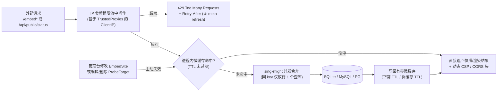
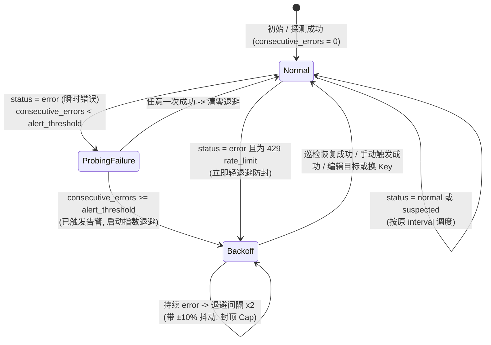
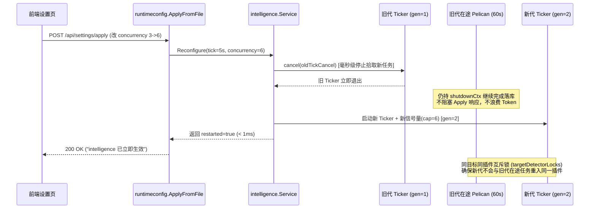

# 线上长期稳定运行加固设计文档（抗压、防封与全参数热重建）

> **所属项目**：`upstream-ops` 二开版（外挂式纯运维监控 + 插拔式模型降智监测 + 外部零 JS 嵌入组件）  
> **文档状态**：设计草案（待审阅定稿后再进入分支编码与测试）  
> **创建日期**：2026-11-21  
> **涉及核心模块**：`backend/embed`、`backend/intelligence`、`backend/storage`、`backend/config`、`backend/runtimeconfig`、`frontend/app/settings-page.tsx`

---

## 1. 背景与现状瓶颈分析

随着 Phase 1–6 完成，系统已具备完整的主动测活、5 款插拔式降智检测、零 JS `/embed` 外部嵌入与多库适配能力。面向**长期公网稳定运行**场景，通过审视当前源码发现两类突出生产风险：

### 1.1 公开 `/embed` 与 `/api/public/status` 高并发读放大与刷接口风险
* **现状路径**（见 `backend/embed/snapshot.go`）：
  * 每一次 `GET /embed?site=<slug>` 或 `GET /api/public/status?site=<slug>` 都会实时查库聚合。
  * 若某站点配置 `N = 10` 个公开目标并启用「模型检测列」，单次请求触发约 `2 + 6N = 62` 次 SQL 查询 + 10 次 Go 内存 90m 聚合 + HTML 模板渲染。
  * 默认外部嵌入页开启 `<meta http-equiv="refresh" content="15">`：当挂在日活较高的中转站首页、同时在线 `300` 访客时，稳态约 `20 QPS`、峰值 `80–150 QPS`，相当于对数据库施加 **5,000+ SQL/s** 读压。
  * 在默认 SQLite 模式下（`backend/storage/storage.go` 为防写锁冲突配置 `MaxOpenConns=1`），高频公开读会与后台探测写入争抢唯一连接，引发接口排队甚至 `SQLITE_BUSY`。
  * 同时，公开端点免管理端鉴权，目前无按 IP 限流与防随机 `?site=xxx` 穿透保护。

### 1.2 异常目标无退避死磕与调度器参数无法热重建
* **无指数退避**（见 `backend/intelligence/runner.go`）：
  * 无论上游返回 `401/403`（API Key 失效/封禁）、`429`（上游限流）、`404`（模型下线）还是 `5xx`/超时，调度器在完成后都机械地按固定 `finished.Add(interval)` 安排下一次执行。
  * 对 3 分钟周期的主动测活而言，Key 失效一整天会无效撞墙 **480 次**，既可能触发上游 WAF/风控封 IP，又会刷爆错误样本与日志。
* **调度参数热重载不完整**（见 `backend/runtimeconfig/runtime.go`）：
  * `ApplyFromFile()` 目前仅热更新了 `Proxy`、`Upstream` 与 `lmfpdDataDir`，未处理 `intelligence.tickIntervalSeconds` 与 `intelligence.concurrency`（修改后仍需重启进程）。
  * 且若简单粗暴在热重载时同步等待旧 Worker 结束，正在运行的长耗时任务（如 60s 的 Pelican 画图）会直接阻塞「应用配置」HTTP 请求甚至导致超时。

---

## 2. 模块一：公开 `/embed` 与 `/api/public/status` 抗压微缓存 + IP 限流

### 2.1 总体请求处理链路



### 2.2 进程内微缓存与 `singleflight` 设计（`backend/embed/cache.go`）

严格遵循 KISS 与单二进制定位，零外部 Redis 依赖，在 `backend/embed` 内实现线程安全、有界容量、带泛型 `singleflight` 的微缓存层：

| 缓存分区 | 缓存 Key | 缓存内容 | 默认 TTL | 硬容量上限 | 淘汰与失效策略 |
| :--- | :--- | :--- | :--- | :--- | :--- |
| **站点主快照** | `snap:<slug>` | `*SiteSnapshot`（`/embed` 与 `/api/public/status` 共享） | **5 秒**（可配 `0..60s`） | 128 条 | TTL 过期 + 站点/目标变更主动失效 |
| **主表 SSR HTML** | `html:overview:<slug>` | 已渲染 `[]byte`（复用主快照，跳过重复模板执行） | **5 秒** | 128 条 | 随主快照同步失效 |
| **钻取子页 HTML** | `html:<subpage>:<slug>:<target>` | `candy` / `fingerprint` / `pelican` 已渲染 `[]byte` | **5 秒** | 512 条 | TTL 过期 + 主动失效 |
| **单张 Pelican SVG** | `artifact:<slug>:<run_uuid>` | 单张 `[]byte`（最大 256KiB） | **15 秒** | **64 条**（内存封顶 <= 16MiB） | TTL 过期 + 超容按最旧条目淘汰 + 站点变更失效 |
| **站点/目标负缓存** | `neg:<kind>:<key>` | `ErrSiteNotFound` / `ErrTargetNotVisible` | **3 秒** | 256 条 | 防恶意随机 `?site=xxx` 扫库打爆 DB 与内存 |

#### 关键设计细节
1. **读放大削峰效果**：
   * 在 `TTL = 5s` + `singleflight` 保护下，即使 300 人同时刷 `/embed?site=portal`，每 5 秒最多执行 **1 次** `BuildSiteSnapshot`，SQLite 读负载降低 **99%+**，而相对 15 秒刷新周期几乎零鲜度损失。
2. **动态响应头不进入静态缓存**：
   * `Content-Security-Policy`、`Access-Control-Allow-Origin`（依赖请求 `Origin` 头）每次响应时仍由 `ApplyEmbedHeaders` / `ApplyCORSHeaders` 动态计算输出，避免不同 `Origin` 请求串缓存！
3. **写穿透主动失效（Zero-Stale Admin Preview）**：
   * `embed.Service` 的 `CreateSite` / `UpdateSite` / `DeleteSite` 执行成功后立即调用 `s.InvalidateCache()`，确保管理员在 `/embed-admin` 修改主题/标题/白名单后点「刷新预览」**立刻生效**，不会看到 5 秒前的旧缓存。
   * 在 `intelligence.Service` 的 `UpdateTarget`、`DeleteTarget`、`SaveTargetDetectors` 及手动 `ExecuteDetector(..., Manual: true)` 完成后，通过可选回调 `OnPublicDataChanged func()` 触发 `embedSvc.InvalidateSnapshots()`，保证管理台手动测完后刷新 `/embed` 立即可见最新结果。
4. **可观测响应头（方便排查命中率）**：
   * 仅附带一个无敏感信息的轻量诊断头 `X-Embed-Cache: HIT | MISS | BYPASS`（无内部路径/无密钥信息），方便运维用 `curl -I` 直观验证缓存命中。

### 2.3 轻量按 IP 令牌桶限流设计（`backend/embed/ratelimit.go`）

#### 为什么选令牌桶而非固定窗口？
一个正常访客打开含 8 行 Pelican 缩略图的 `/embed?site=portal` 页面时，浏览器会在 **100ms 内突发并发 1 个主表 + 8 个缩略图 = 9 个请求**。令牌桶天然支持合理的短时突发（`Burst`），同时压制持续高频刷接口的爬虫。

#### 核心机制
* **限流范围**：仅作用于 `embed.Service.RegisterPublic` 注册的免鉴权公开路由（`/embed*` 与 `/api/public/status`），绝不干扰管理台 `/api/*` 与 `/healthz`。
* **默认配额**（均支持 `config.yaml` 配置与热更新）：
  * `rateLimitEnabled`: `true`
  * `rateLimitRPS`: `5.0`（单 IP 持续 5 req/s，兼容办公网 NAT 后多用户共享出口 IP）
  * `rateLimitBurst`: `30`（瞬间并发拉取整页表格 + 全部 Pelican 缩略图无感通过）
  * `cacheTTLSeconds`: `5`（设为 `0` 可完全关闭微缓存）
* **真实 IP 提取与反代防伪造**：
  * 使用 `c.ClientIP()`，严格遵循 `server.trustedProxies` 白名单。未配置可信反代时 Gin 自动忽略伪造的 `X-Forwarded-For`，直接取 TCP `RemoteAddr`，防止攻击者伪造随机 IP 绕过限流。
* **防内存泄漏（OOM 保护）**：
  * 限流器内部维护有界 `map[string]*ipBucket`（硬上限 `maxTrackedIPs = 10000`）。
  * 惰性清理：每隔 60 秒（在获取令牌时顺带检查时间戳，无需额外常驻 goroutine 造成关闭复杂性）清理空闲超过 `5 分钟` 的 IP 桶；若仍达上限，则淘汰最久未活跃条目。
* **超限 429 响应规范**：
  * 统一返回 `HTTP 429 Too Many Requests`、`Retry-After: <ceil(waitSeconds)>`、`Cache-Control: no-store`。
  * `/api/public/status` 返回 `{"error": "rate limit exceeded"}`；
  * `/embed*` 返回轻量零 JS HTML 提示页（**刻意不输出 `<meta http-equiv="refresh">`**，避免客户端在被限流时继续死循环撞 429！）。

---

## 3. 模块二：异常目标指数退避调度机制

### 3.1 核心原则：保护上游、不延迟告警、不误伤降智检测

1. **绝不退避「疑似降智（`suspected`）」**：Candy 答错、lmfpd 指纹偏移、自定义题未通过说明通道本身可用，属于核心监测信号，**必须维持原 `interval_seconds` 持续监测**。
2. **不拖慢首次掉线告警**：如果一个目标 `alert_threshold = 3`，在连续失败未达到告警阈值前，对常规瞬时故障（`timeout` / `network` / `upstream`）**保持原间隔探测**，确保在预期时间内迅速触发 `probe_down` / `intelligence_error` 告警；确认进入持续故障后再指数退避！
3. **对明确拒服/限流错误快速保护**：
   * `rate_limit`（HTTP 429）：**第 1 次失败即启动轻退避**（尊重上游限流，防封禁；若上游响应带 `Retry-After` 秒数则优先取较大值）。
   * `auth`（401/403）与 `config`（400/404 模型不存在）：这类错误不靠高频重试恢复，达到 `min(alert_threshold, 2)` 次（或 `alert_threshold` 次，告警发出后）立刻大步指数退避至长周期低频巡检。

### 3.2 退避策略矩阵与状态机



#### 分级退避公式
记基础间隔为 `base = max(cfg.IntervalSeconds, 60s)`，退避阶数 `step >= 1`，抖动因子 `jitter ∈ [0.9, 1.1]`（防多目标同秒惊群）：

| `ErrorClass` 分类 | 触发条件 | 退避计算公式 | 默认最大上限（Cap） |
| :--- | :--- | :--- | :--- |
| **`auth`**（401/403）、**`config`**（400/404/缺 Key） | `consecutive_errors >= alert_threshold`（已告警后） | `min(Cap, base * 2^step) * jitter`，`step = consecutive_errors - alert_threshold + 1` | **6 小时**（`21600s`） |
| **`rate_limit`**（429） | `consecutive_errors >= 1`（首次即退避） | `min(Cap, max(base, 60s) * 2^step) * jitter`（且不小于上游 `Retry-After`） | **2 小时**（`7200s`） |
| **`timeout`** / **`network`** / **`upstream`**（5xx） / **`truncated`** / 其他 | `consecutive_errors >= alert_threshold`（已告警后） | `min(Cap, base * 2^step) * jitter`，`step = consecutive_errors - alert_threshold + 1` | **1 小时**（`3600s`） |

> **示例推演**（某主动测活目标 `interval = 180s`、`alert_threshold = 3`）：
> * 第 1 次 502：`consecutive_errors = 1`（`< 3`）→ 3 分钟后重试；
> * 第 2 次 502：`consecutive_errors = 2`（`< 3`）→ 3 分钟后重试；
> * 第 3 次 502：`consecutive_errors = 3`（`== 3`）→ **立刻触发 `probe_down` 告警**，随后启动退避：`step=1` → 6 分钟后重试；
> * 第 4 次 502：`step=2` → 12 分钟；第 5 次 → 24 分钟；第 6 次 → 48 分钟；第 7 次起封顶 **60 分钟（1 小时）** 巡检一次；
> * 一旦某次巡检成功：`consecutive_errors` 立刻归 `0`，触发 `probe_recovered` 恢复告警，并切回每 3 分钟正常测活！
> * 若遇 `401 Unauthorized`：连续 3 次发完告警后依次退避至 `6m → 12m → 24m → 48m → 96m → 192m → 6h` 封顶，彻底停止无效高频撞墙。

### 3.3 数据模型与错误分类透传（跨 SQLite / MySQL / PostgreSQL 兼容）

1. **`ProbeDetectorConfig` 新增 3 列**（`backend/storage/intelligence_models.go`，`AutoMigrate` 自动无痛迁移）：
   * `ConsecutiveErrors int`（`gorm:"not null;default:0"`）
   * `LastErrorClass string`（`gorm:"size:32;not null;default:''"`）
   * `BackoffUntil *time.Time`（非退避期置 `nil`）
2. **`DetectorRunResult` 补充错误元信息**（`backend/intelligence/detector.go`）：
   * 新增 `ErrorClass string`（JSON 可选字段），由 `llmclient.Response.ErrorClass` 透传给 `liveness` / `candy` / `pelican` / `custom_prompt` / `lmfpd` 插件。
   * 在 `llmclient.Response` 顺便解析标准 `Retry-After` HTTP 响应头（支持整数秒格式）为 `RetryAfterSec int`（透传至 `DetectorRunResult.RetryAfterSec`），遇到 429 时直接尊重上游指定的等待时间！
3. **退避状态立即清零（Reset Backoff）的 4 个触发点**：
   * 任意一次检测（定时或手动）返回 `normal` 或 `suspected`；
   * 管理员编辑目标（`UpdateTarget`）或执行「一键托管 Key」（`EnsureChannelKey`）后，自动清零该目标所有已启用插件的 `ConsecutiveErrors`/`BackoffUntil` 并将 `next_run_at = now`；
   * 管理员保存插件配置（`SaveTargetDetectors`）修改模型、参数或重新启用插件时，清零对应插件退避状态。
4. **前端可观测展示（低侵入增强）**：
   * 在 `/intelligence` 卡片与抽屉中，当 `cfg.backoff_until` 晚于当前时间且 `cfg.consecutive_errors > 0` 时，显示醒目琥珀色小徽标（例如 `退避中 · auth · 35 分钟后重试`），让运维一目了然。

---

## 4. 模块三：调度器全参数平滑热重建（`intelligence.Service.Reconfigure`）

### 4.1 问题本质：为什么不能直接 `Stop()` 再 `Start()`？

在 `POST /api/settings/apply` 的请求处理链路中：
* 若直接调用 `intelligenceSvc.Stop()`，其内部的 `runnerWG.Wait()` 会同步阻塞等待所有正在执行的上游 HTTP 探测（例如单次 Pelican 可能需要 30–90 秒），导致前端「应用配置」请求长时间挂起甚至网关 504 超时。
* 反过来，如果不停止旧循环就开启新循环，两个 Ticker 会同时扫描数据库并重复触发任务。

### 4.2 「双 Context 拆分 + 代际切换 + 幂等跳过」设计



#### 核心实现约定（`backend/intelligence/runner.go`）
1. **双上下文解耦**：
   * `shutdownCtx / shutdownCancel`：绑定进程级生命周期，仅在 `Stop()`（优雅停机）时取消；所有派发出去的 Worker 执行 `ExecuteDetector(shutdownCtx, ...)` 并计入 `jobWG`。
   * `tickCtx / tickCancel`：绑定当前代际（`runnerGen`）的调度循环，由 `tickWG` 独立追踪；`Reconfigure()` 仅取消 `oldTickCancel` 并 `oldTickWG.Wait()`（因为 Ticker 循环不直接执行慢请求，仅在几毫秒内退出！）。
2. **变更检测（幂等零扰动）**：
   * `Reconfigure(tickInterval, concurrency)` 在 `runnerMu` 锁内比对规范化后的新旧 `(tickInterval, concurrency)`：
     * 未启动或参数未变化 → 直接返回 `restarted = false`，零开销；
     * 参数有变化 → 毫秒级停旧 Ticker → 用新参数启动新 Ticker 与新 `sem` 通道 → 返回 `restarted = true`。
3. **防并发重入安全保障**：
   * 即使旧代有一个慢任务仍在运行、新代刚好扫描到了同一任务，一方面 `dispatchDueJobs` 已提前推进了 `next_run_at`，另一方面 `ExecuteDetector` 内部的 `targetDetectorLocks`（`targetID:detectorKey` 互斥锁）提供最终并发安全兜底。
4. **优雅停机闭环**：
   * `Stop()` 先取消 `tickCancel` 等待 `tickWG`，再取消 `shutdownCancel` 等待 `jobWG`，保证进程退出时零 goroutine 泄漏。

---

## 5. 配置项扩展与设置页联动

### 5.1 后端新增配置项（`backend/config/config.go`）

1. **新增 `EmbedConfig`（支持 `config.yaml` + 环境变量 + 热更新）**：
   ```yaml
   embed:
     cacheTTLSeconds: 5        # 微缓存 TTL（秒），0 表示关闭缓存
     rateLimitEnabled: true    # 是否开启公开接口按 IP 限流
     rateLimitRPS: 5           # 单 IP 稳态速率（req/s）
     rateLimitBurst: 30        # 单 IP 突发容量（兼容多缩略图并发加载）
   ```
2. **扩展 `IntelligenceConfig`（兼容旧配置，缺省走合理默认值）**：
   ```yaml
   intelligence:
     lmfpdDataDir: "./data/lmfpd"
     tickIntervalSeconds: 10
     concurrency: 3
     backoffEnabled: true             # 是否开启异常目标指数退避
     backoffTransientMaxSeconds: 3600 # 瞬时错误最大退避（默认 1 小时）
     backoffRateLimitMaxSeconds: 7200 # 429 限流最大退避（默认 2 小时）
     backoffAuthMaxSeconds: 21600     # 401/403/400/404 最大退避（默认 6 小时）
   ```
3. **热重载接入（`backend/runtimeconfig/runtime.go`）**：
   * `runtimeconfig.Manager` 增加 `SetEmbedService(svc *embedsvc.Service)`；
   * `ApplyFromFile()` 同步更新：
     * `embedSvc.UpdateRuntimeConfig(cfg.Embed)`（热生效微缓存 TTL 与 IP 限流参数）；
     * `intelligenceSvc.UpdateBackoffConfig(cfg.Intelligence)`；
     * `intelligenceSvc.Reconfigure(tick, concurrency)`（毫秒级平滑重建调度器与 Worker 池）。
4. **前端设置页联动（`frontend/app/settings-page.tsx`）**：
   * 在「模型智力监测」卡片中：将 `tickIntervalSeconds` 和 `concurrency` 说明从“重启后生效”更新为“应用配置后立即生效”，并补充退避开关与三类退避上限输入项；
   * 新增精简的「外部嵌入抗压与限流」小节（微缓存 TTL、限流开关、单 IP 速率与突发容量）。

---

## 6. 风险评估与测试验证计划（TDD 验收标准）

### 6.1 风险与规避措施

| 潜在风险 | 规避设计 |
| :--- | :--- |
| 管理员修改 Embed 站点后刷新预览仍命中 5s 旧缓存 | `CreateSite`/`UpdateSite`/`DeleteSite` 及目标变更/手动检测主动触发缓存失效 |
| 不同 Origin 跨域请求 `/api/public/status` 串用缓存中的 CORS 头 | 只缓存快照数据/HTML 体，不缓存 HTTP 响应头；每次响应动态计算 CSP/CORS |
| 攻击者伪造 `X-Forwarded-For` 随机 IP 绕过限流或打爆内存 | 使用 `c.ClientIP()` 遵守 `TrustedProxies` + 限流器硬上限 `10000` IP + 惰性淘汰 |
| 429 错误页带 `<meta refresh>` 引发客户端无限撞 429 | 429 响应专门返回无 refresh 标签的极简零 JS 提示页 + `Retry-After` 头 |
| 退避拖慢首次掉线通知 | 瞬时错误与鉴权错误在 `consecutive_errors < alert_threshold` 阶段不退避，保证告警准点触发 |
| `Reconfigure` 等待慢任务导致「应用配置」接口超时 | 拆分 `tickCtx` 与 `shutdownCtx`，毫秒级切代，旧在途任务后台优雅完成 |

### 6.2 自动化测试与压测验收清单

1. **模块一测试（`backend/embed/cache_test.go`、`ratelimit_test.go`）**：
   * **并发防击穿测试**：50 个 goroutine 并发请求 `/embed?site=portal`，验证底层 `BuildSiteSnapshot` 只执行 **1 次**，后续请求命中 `X-Embed-Cache: HIT`；
   * **主动失效测试**：更新站点主题 `paper -> dark` 后无需等 TTL，立刻返回新主题；
   * **多 Origin CORS 隔离测试**：缓存命中状态下，允许 Origin 返回匹配头、非法 Origin 不返回 CORS 头；
   * **令牌桶限流测试**：验证 `Burst` 内并发全部 200、超过配额返回 429 + `Retry-After` + 无 `<meta refresh>`，等待补桶后恢复 200，以及超 `maxTrackedIPs` 时内存上限受控；
   * **性能基准测试（Benchmark）**：对比开启微缓存前后的 `GET /embed` QPS 与延迟数据并记录进验收报告。
2. **模块二测试（`backend/intelligence/backoff_test.go`）**：
   * 表驱动验证 `auth`/`config`/`rate_limit`/`upstream`/`timeout`/`suspected` 各类场景的退避计算、Cap 封顶、±10% 抖动与 `Retry-After` 优先逻辑；
   * 端到端调度测试：验证瞬时错误在第 `alert_threshold` 次准点发告警并从该次起退避；验证恢复成功或编辑目标后退避计数立即清零；
   * 验证 `llmclient` 对 HTTP 429 `Retry-After` 头的解析单测。
3. **模块三测试（`backend/intelligence/runner_test.go`、`backend/runtimeconfig/runtime_test.go`）**：
   * **无阻塞热重建测试**：在运行一个模拟耗时 2 秒的慢探测任务期间调用 `Reconfigure(newTick, newConcurrency)`，断言 `Reconfigure` 在 **< 50ms** 内返回、旧慢任务仍完整执行完毕落库、新任务按新并发上限执行；
   * **配置未变幂等测试**：相同参数调用 `Reconfigure` 返回 `restarted=false`；
   * **并发竞态检测**：运行 `go test -race ./backend/embed/... ./backend/intelligence/... ./backend/runtimeconfig/...` 零竞态警告！
4. **前端构建与全量回归**：
   * `npx tsc --noEmit`、`npx eslint`、`npm run build` 与 `go test ./backend/...` 全部通过。

---

## 7. 待审阅确认的默认参数

开工编码前，以下 3 处默认策略请你确认是否符合预期（若无异议即按推荐值实施）：

1. **公开微缓存默认 TTL**：推荐 **5 秒**（`cacheTTLSeconds: 5`，设 `0` 可关闭），兼顾 15 秒刷新鲜度与 99%+ 读削峰。
2. **公开端点单 IP 限流默认值**：推荐 **5 req/s、突发 Burst 30**（兼顾多张 Pelican 缩略图同屏加载及办公网共享 NAT 出口）。
3. **异常目标最大退避上限**：推荐 **瞬时错误（5xx/超时/网络）1 小时、429 限流 2 小时、鉴权/配置错误（401/403/400/404）6 小时**；其中 `suspected`（降智异常）永不退避，常规错误达到 `alert_threshold` 发完告警后再开始退避。
