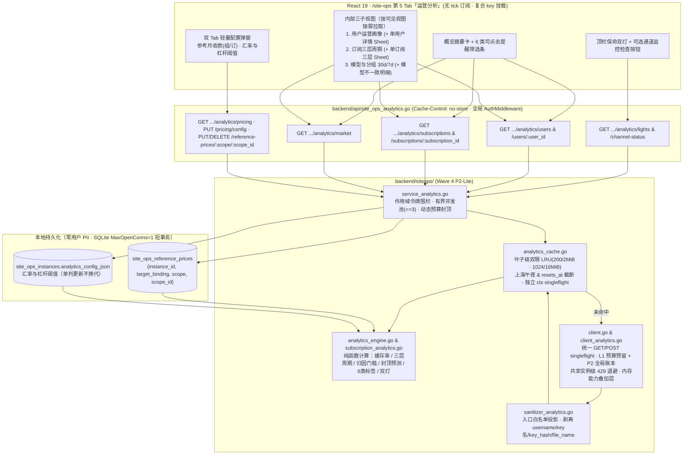

# `/site-ops` 轻量「运营分析」Tab（Wave 4 / P2-Lite）最终架构与开发设计规格书

> **文档状态**：阶段 2 交叉终审定稿（唯一施工与代码审查基准，零未决分歧）  
> **所属仓库**：`D:\AI\upstream-ops`（基线 `main@3865dcd`）  
> **上游契约基线**：Sub2API `v0.2.24` 线上只读实测矩阵（16 端点可用 / 4 端点降级或跳过）  
> **技术栈约束**：Go 1.23+（Gin + GORM + SQLite WAL / MySQL / PostgreSQL，零新增 Go 依赖）+ React 19 + TypeScript + Tailwind CSS v4 + 现有 `frontend/components/ui/*`（零新增 npm 依赖）

---

## 第 0 章：交叉评审对比矩阵与最终裁决记录（Decision Record）

本章汇总 Codex（`sq/gpt-6.2-astra`）与 Neon（`gemini-4-neon`）两份独立设计稿的交叉评审结果，对照 `D:\AI\upstream-ops`（`main@3865dcd`）真实源码逐项查证，并锁定全部 8 项关键架构裁决（**D1–D8**）。后续 Codex 编码实施与 Neon 审查验收均以本章裁决及第 1–8 章正文为唯一准绳。

### 0.1 源码事实核查清单（解决两稿对既有代码认知的偏差）

| 核查项 | 真实源码位置（`main@3865dcd`） | 查证事实 | 对最终设计的影响 |
| :--- | :--- | :--- | :--- |
| 分组元数据缓存 | `backend/siteops/types.go:295-300`、`poller.go:885-894, 1027-1031` | `SanitizedGroupInfo` 当前仅含 `ID/Name/Platform/Status`；`Poller` 每 5m 在 `Concurrency != nil \|\| Availability != nil` 时调用 `FetchGroupsAll` 写入 `p.groupMeta[id]`。 | 向后兼容扩展 `SanitizedGroupInfo`（新增可选指针字段）并在 `Poller` 记录 `groupMetaAt`：热态直接零调用复用，未命中/过期或 Ops 关闭时回落 P2 独立缓存拉取。 |
| 审计预算与并发硬闸 | `backend/siteops/client.go:196, 224, 250`、`config.go:441-449` | 仅有单实例账本 `c.budgets map[uint]*auditWindow`，无全局日/分账本；默认日限 `8000` 对应分钟限 `max(12, dailyLimit/240) = 33 req/min`；并发上限全局 `12` / 单实例 `4` / 队列 `32`。 | 必须为 L1/L2 保留显式分钟/日缓冲及 ≥1 并发槽位，同时补齐 P2 跨实例共享审计账本。 |
| POST 单飞与 429 退避 | `backend/siteops/client.go:634-641, 841-938`、`poller.go:620-629` | `postAdminJSON` 未接入 `c.flights`；`Client` 只解析 `Retry-After`，退避态仅存于 `poller` 的 `collectionRound`，直接经 `Service` 调 `Client` 绕过退避且不写回 `BackoffUntil`；`readAdminResponse` 在 `403` 时直接返回，不读正文。 | 必须将只读 GET/POST 统一至单飞执行路径，将实例级 429 退避收口至 `Client` 并双向同步 DB 与 `Poller`；仅为 `channel-monitor-v2/snapshot` 增加 `403` 限量读体识别禁用态。 |
| 能力矩阵写回与展示 | `backend/siteops/poller.go:1084-1094`、`capability-drawer.tsx:19` | `Poller.probe()` 按静态 `switch endpoint` 白名单覆盖写 `CapabilitiesJSON`；前端抽屉读 `report?.capabilities ?? instance.capabilities`。 | P2 端点采用代际绑定的只读内存能力叠加层，在 `Service.instanceView` 与 `Service.ProbeInstance` 返回前合并，避免与 `Poller` 争写 DB 且不增加手动 Probe 预算。 |
| `UpdateInstance` 与单列更新 | `backend/storage/site_ops.go:103-118`、`service.go:203-219` | `UpdateInstance` 用 `.Select(fields)` 显式列更新；`Service.UpdateInstance` 对任意实质变更递增 `Generation` 并调 `poller.ReconcileInstance` → `stopWorkerLocked` → `Client.ResetInstanceState`。 | `SiteOpsInstance.AnalyticsConfigJSON` 独立列单列更新不递增 `Generation`（不重启 `Poller`），且不被 `UpdateInstance` 误覆写；实例任意换代变更均作废 P2 缓存与在途令牌。 |
| 前端质量徽章与 401 登出 | `frontend/components/site-ops/quality-badge.tsx`、`frontend/lib/api.ts:43-74` | 真实导出为 `FieldQualityBadge`/`MetricValue`/`MetricNote`（无 `QualityBadge`）；`apiFetch` 支持 `RequestInit.signal`，但收到本地 `401` 会触发全局登出。 | 上游 `401` 必须映射为 `502 + SITE_OPS_UNAUTHORIZED`；前端统一复用 `FieldQualityBadge`、`MetricValue`、`MetricNote` 并透传 `AbortSignal`。 |

### 0.2 交叉评审对比矩阵与最终裁决（D1–D8）

| 裁决项 | Codex 稿核心思路与优势 | Neon 稿核心思路与优势 | 终审唯一裁决（落地方案） |
| :--- | :--- | :--- | :--- |
| **D1 请求预算、预算预留与首屏精算** | 冷开页仅 14 次（Top 2 用户 + 订阅详情懒算）；跨实例 P2 共享账本；单站 P2 并发上限 `min(3, cap-1)`；无 `force` 防连点。不足：首屏强制拉市场 3 次且仅补查 2 位用户偏稀疏，修复故障后无法手动提前复检。 | 内部三子视图按需加载；强 L1 预留缓冲 `BudgetHeadroomForAnalytics`（分钟留 25%≥5，日留 10%≥500）；支持刷新。不足：首屏 Top 8 用户（≤22 次）切订阅又批量 Top 8（16–24 次），同分钟易撞穿 33/min 上限；无防抖 `force=1` 易被连点滥用。 | **融合最优**：① 顶部双灯 + 内部三子视图（用户画像 / 订阅周期 / 模型与分组）**按当前可见子视图触发**；② 首次进入默认「用户画像」仅拉双灯（2）+ 共享 Base Snapshot（4，复用 Poller `groups/all` 省 1 次）+ **Top 5** 活跃候选精准统计（≤10）= **典型 12–16 次**；切「订阅周期」命中 Base 缓存 **0 次**（列表直接展示 L1 快照 + L2/L3 账期日历 + 本地参考价），仅点开单条订阅抽屉按需精算（2–3 次）；切「模型与分组」仅 **3 次**；③ 并发限 `max(1, min(3, PerInstanceMaxConcurrency-1))` + **双账本 + L1 安全预留**（单站分钟预留 `min(max(5, perMin/4), perMin/2)`、日预留 `min(max(500, daily/10), daily/2)` + 跨实例 P2 共享账本）；④ 支持 `force=1` 手动刷新，但施加 **30s 最小重刷间隔**且受退避与预算约束。 |
| **D2 `Client` 并发、只读 POST 单飞、共享 429 与在途取消** | 统一 GET/POST 进 `fetchShared`/`runFlight` 且 P2 不碰旧 ETag `c.cache`；共享 429 退避跨重启持久化（`ExtendAdminBackoff`）并与 `Poller` 防迟到成功覆盖；**作用域令牌（scope token）+ 策略 epoch 围栏**彻底拦截换 Key/删站/撤权后的迟到写回。 | `postShared` 在 `flightKey` 加入 `bodyHash`；`Client` 维护 `rateLimitUntil`/`rateLimitStreak`；在 `UpdateInstance`（仅 `credentialTargetChanged`）与 `401` 失效。不足：漏掉停用/改名换代取消与迟到写回围栏，未持久化前台触发的 429 退避。 | **以 Codex 安全底座为核心、融合 Neon 的 `BudgetHeadroomForAnalytics`**：① 统一 `requestSpec` 管线处理旧 ETag GET 与新 P2 GET/POST（POST 规范化排序去重 ID 后算 SHA-256 进 `flightKey`，含 `parserTag` 防碰撞，P2 绝不读写 `c.cache` 也不发 `If-None-Match`）；② 实例级 429 退避下沉至 `Client`（按 `(instanceID, baseURL, credGen)` 绑定，单飞仅记一次，支持 DB `ExtendAdminBackoff` 与 `CommitCollection` 保护）；③ `Service` 维护单调递增 `scopeToken` 与 `policyEpoch`，实例任意实质变更、停用、删站、热更新、停机及远端 `401/403` 即刻作废令牌并取消在途 flight，迟到响应严禁写缓存或返还前端。 |
| **D3 订阅归因边界与三层周期算法** | **重大发现**：`usage/stats` 无 `subscription_id` 筛选，必须校验同 `(user_id, group_id)` 并行/同日交接/目录截断，否则降级 `group_only` 不强行归因；整数纳秒 `ceil` 防浮点越界；`end_date = (b-1ns)` 精确映射闭区间；无 `revoked_at` 不编造撤销终点。不足：为算 `v_fast` 多发第 3 次 `usage/stats`。 | **重大优势**：`v_recent` 直接复用 Layer 1 `progress` 的 `weekly`/`daily` 窗（**零额外上游请求**且天然按 `subscription_id` 隔离！）；提出续费首日 `<24h` 自然日重叠防高估守卫（`max(E_sub, 24h)` + 锁定 `low`）。不足：未识别同组并行订阅归因混账问题；`0.75*v_avg` 下界在流失减速时有偏。 | **全量吸收双方精华**：① 强制执行归因门槛（`unique_group_term` vs `group_only`），`group_only` 仅展示「用户×分组订阅汇总」并保留单订阅 `progress` 滚动窗，关闭专属预测与杠杆；② 固定 `Δ=30×24h` 步进 + `k=int((E-S-1ns)/Δ)` 整倍数保护 + `end_date=dateSH(b-1ns)` + 续费首日 `<24h` 分母 `max(E_sub, 24h)` 守卫；③ `v_recent` 零调用复用 `progress`（优先 `weekly` 权重 0.60/0.40，回退 `daily` 权重 0.35/0.65，无偏不设人为下界）；④ 滚动窗封顶用整数纳秒 `ceil`，支持 `verified`/`partial`/`unlimited`/`unknown` 四态与剩余额度一致性校验。 |
| **D4 本地参考收款与配置表设计** | 单表 `site_ops_reference_prices`：`int64` 分值存储、显式 `0` 赠送 vs `DELETE` 清除继承、`TargetBinding`（规范化 BaseURL SHA-256）防改址串价、**无自由文本备注列**（零 PII 落盘面）、行锁验代。不足：每行重复录汇率繁琐；硬编码 `1.0x` 穿仓红线不符合 1.0 倍率订阅号池常规 3x–4x 杠杆现实。 | `site_ops_ref_prices` + `SiteOpsInstance.AnalyticsConfigJSON` 存站点默认汇率（7.20）与可调杠杆阈值（默认 3.0x/5.0x，0 关闭上色），单列更新**不递增 `generation`、不重启 `Poller`**。不足：用 `float64` 存金额、`0` 与删除混同、缺 `TargetBinding`、保留自由文本 `Note` 增加 PII 误填面。 | **最优融合**：① 新增 `site_ops_reference_prices` 表：采用 Codex 严谨结构（`InstanceID + TargetBinding + Scope + ScopeID` 唯一索引、`int64` `MonthlyMinor`、`CNYPerUSDMicros *int64` 可选行级覆盖、**无 `Note` 列**、`0` 表示显式赠送、`DELETE` 恢复继承）；② 扩展 `SiteOpsInstance.AnalyticsConfigJSON` 存实例级默认 `cny_per_usd`（7.20）与 `leverage_warn_threshold`（3.0）/`leverage_danger_threshold`（5.0），独立极短事务更新**不递增 `generation`**；③ `<30d` 子期均按计划时长比例 `(F-B)/30d` 折算，三口径成本仅在差值 `>= max(0.01, 1e-6*max)` 时展示倍率差提示。 |
| **D5 后端 API 路由与响应契约** | `AnalyticsMeta` + `DomainMeta` 分域质量与时间契约严谨；`cache_only=1` 编辑后零调用重算；严格入参校验、`no-store`、`ErrAnalyticsResourceNotFound` 404。不足：首屏合并 `/analytics` 与 `/users` 耦合度偏高。 | 按子视图拆分清晰（`safety-lights`/`users`/`users/:id`/`subscriptions`/`models-groups`/`pricing`），便于前端按子视图独立按需加载。不足：缺少独立单订阅详情端点与 `cache_only=1` 机制。 | **收口为 10 个正交轻量 REST 端点**（全部挂 `/api/site-ops/instances/:id/analytics`）：`GET /lights`、`GET /channel-status`、`GET /users`、`GET /users/:user_id`、`GET /subscriptions`、`GET /subscriptions/:subscription_id`、`GET /market`、`GET /pricing`、`PUT /pricing/config`、`PUT & DELETE /reference-prices/:scope/:scope_id`。全部采用 `AnalyticsMeta` + `DomainMeta` 规范、`cache_only=0\|1`、`Cache-Control: no-store`、上游 `401 → 502`。 |
| **D6 五输出面隐私白名单与有界 LRU** | **极严格白名单**：丢弃 `username`、Key 名称/提示/密文、备份 `file_name` 与 `triggered_by`、风控 `key_hash`；叶子级双维度有界 LRU（单站 ≤200 条 & ≤2MiB，全局 ≤1024 条 & ≤16MiB，单值 ≤128KiB），TTL 截断于上海午夜与最近 `resets_at`，过期绝不回送旧 PII。 | 分区 LRU（单站 200 / 全局 2000）+ 独立 ctx `singleflight`。不足：允许脱敏用户名、`key_hint`/清洗后 Key `label` 与清洗后 `file_name` 输出，且在 429 时允许回送过期 `stale` 缓存。 | **执行最严五面隐私标准（Codex 标准）+ 独立有界 ctx `singleflight`**：① 丢弃 `username`、Key 名称/提示/密文、备份 `file_name`/`triggered_by`、风控 `key_hash` 及一切自由错误正文；用户仅显 `U#ID` + `email_masked`，Key 仅显 `Key #ID`；② 叶子级双限 LRU（单站 ≤200 条 / ≤2MiB，全局 ≤1024 条 / ≤16MiB，单值 ≤128KiB），TTL 3m/5m/10m 并截断至上海午夜与 `resets_at`，**过期用户/订阅 PII 严禁 stale-if-error 回送**。 |
| **D7 能力矩阵与降级语义** | P2 端点采用内存代际叠加层（不改 `DefaultProber.ProbeInstance`），在 `instanceView`/`ProbeInstance` 合并展示；仅 `channel-monitor-v2/snapshot` 403 限量读 4KiB 匹配精确关闭文案；风控关闭绝不报绿灯；跳过 3 个废弃/无用端点。 | 同样跳过 3 个废弃/无用端点与精确识别 `channel-monitor-v2` 403 关闭；风控灯区分 `errors` 累计占比（≥5% 红、>0 黄）避免历史单次错误永久红灯。不足：修改 `DefaultProber` 与 `poller.go` 写 DB 易争用且加重手动 Probe。 | **采用内存代际叠加层 + 精准红黄绿灰规则**：① 不改 `DefaultProber` 探测步骤，P2 观察态写入 `Client` 内存代际叠加层（普通负能力 5m、通道关闭 6h），经 `Service.instanceView` 与 `Service.ProbeInstance` 合并输出；② 严格跳过 `data-management/backups`、`upstream-billing-rates`、`payment/dashboard`；③ 风控引擎关闭一律映射 **灰灯（`level="unknown"`, `quality="disabled"`）**；`dropped>0` 直接红，`errors`/`pre_block_errors` 累计按 `≥5%` 红、`>0` 黄并注明「自引擎启动累计」；缺关键字段严禁亮绿灯。 |
| **D8 前端 `/site-ops` Tab 信息架构与组件拆分** | 第 5 个 Tab，复合 key `[id,generation,cred_gen]` 挂载且脱离 `tick`/`reload`；`sequence + AbortController` 双重防竞态；组件内 TTL 倒计时到点**仅清屏不联网**；精确对齐 `FieldQualityBadge`/`MetricValue`/`MetricNote`。 | 顶部双灯 + 概览卡 + 可点击提醒条 + 内部三子视图（用户画像 / 订阅三层周期 / 模型与分组），交互清晰直观；定价弹窗双 Tab 整合单价与汇率阈值。 | **前端架构融合定型**：① 在 `site-ops-page.tsx` 增加第 5 个 Tab「运营分析」，仅在选中时挂载 `<AnalyticsPanel key={`${id}:${generation}:${cred_gen}`} />`，零订阅 `tick`；② 内部保留清晰的三子视图 + 独立「单用户抽屉」与「单订阅三层详情抽屉」+ 双 Tab「参考定价与汇率阈值弹窗」；③ 全部 8 条异步通道采用 `sequence + AbortController` 防竞态，加前端 TTL 到期静默清屏守卫与零伪绿灯纪律。 |

---

## 第 1 章：架构定位、范围边界与数据流

### 1.1 与 Wave 1–3（`siteops`）的演进关系

`D:\AI\upstream-ops` 已落地 Wave 1（安全底座、多实例轮询、能力矩阵、去重并发与分组容量）、Wave 2（零广播直投告警、事件流、异常账号状态、24h 运维日报）与 Wave 3（M4 被动号池周期预测、M5 单号成本效率、`site_ops_account_costs`）。

本期 **Wave 4（P2-Lite「运营分析」）** 严格遵守以下边界：
1. **零侵入既有外部监控模块**：绝不修改 `backend/connector/sub2api/`、`backend/monitor/`、`backend/intelligence/`、`backend/embed/`、`backend/gateway/` 的任何逻辑与接口。
2. **零破坏接口扩展**：沿用 `P1AClient`/`P1BClient` 与 `EventStore`/`P1BStore` 范式，新增 `P2AnalyticsClient`、`BackoffAwareClient`、`AnalyticsStore` 可选接口，由真实 `*Client` 与 `storageStore` 实现，在 `NewService` 中类型断言自动装配；不改动 `NewDefaultService` 对外签名，不破坏既有 Mock 单测。
3. **分组限额零冗余复用**：向后兼容扩展 `SanitizedGroupInfo`（新增 `SubscriptionType`、`RateMultiplier`、`DailyLimitUSD`、`WeeklyLimitUSD`、`MonthlyLimitUSD` 五个 `omitempty` 可选字段）并在 `Poller` 记录 `groupMetaAt`；运营分析在 `Poller` 5m 缓存新鲜时零调用复用，否则回落 P2 独立缓存查询 `/groups/all`。
4. **鉴权与通知隔离**：入站沿用 `/api` 全局 `runtimeconfig.Manager.AuthMiddleware()`；运营提醒与保命灯仅作用于管理台视图，**绝不写入** `site_ops_events`、`site_ops_alert_deliveries`、`site_ops_snapshots` 或每日运维简报。

### 1.2 明确做什么 & 明确不做什么

| 类别 | 唯一确定的边界 |
| :--- | :--- |
| **明确要做** | 1. **顶栏两盏保命状态灯**：风控引擎灯（`risk-control/status`）与数据备份灯（`backups`），以及手动触发的可选「通道监控（`channel-monitor-v2/snapshot`）」优雅降级检查；<br>2. **用户运营画像 + 单用户详情抽屉**：列表基于 `users` + `users-usage` + `user-concurrency` + `subscriptions` 共享基础快照初筛，默认自动对前 5 名高优先候选按需补拉显式 UTC+8 全时段与近 7d `usage/stats`；点击任意行打开抽屉按需补拉全时段/30d/7d、归一化缓存率、名下订阅及分页 API Key 消耗拆解；<br>3. **订阅三层周期表 + 单订阅详情抽屉**：列表零新增调用展示 Layer 1 滚动用量快照、Layer 2/3 账期日历与本地参考月收款；点击单条订阅展开抽屉按需拉取 `progress` + 去重 `usage/stats`，严格校验归因边界后输出双速燃烧率、滚动限额理论封顶预估与参考收款杠杆；<br>4. **模型与分组 30d/7d 边际概览**：展示模型消耗/请求/归一化缓存读取率、`upstream_model_mismatch=true` 不一致异常计数与明细、分组消耗与单席参考月价；<br>5. **6 类纯本地运营洞察标签**（零额外上游调用）：临期续费、高危回访、休眠高余额、已到期未续费、缓存偏低/骤降、并发排队/高负载；<br>6. **本地零 PII 参考月收款与汇率/阈值配置**：`site_ops_reference_prices` 表（分组默认 + 订阅覆盖、CNY/USD、`int64` 分值、`0` 赠送 vs `DELETE` 清除）+ `site_ops_instances.analytics_config_json`（默认汇率与可调杠杆阈值）。 |
| **明确不做** | 1. **严禁接入 60s 后台常驻轮询**：任何 P2 运营分析与保命灯请求均不进入 `Poller` 后台定时循环；<br>2. **严禁落盘任何用户 PII**：数据库绝不保存用户 ID 消费明细、邮箱、用户名、API Key 明文/名称/提示、自由备注文本、原始错误正文或代理密码；<br>3. **明确跳过废弃/无用端点（0 预算）**：不调用 `/api/v1/admin/data-management/backups`（503 deprecated）、`/api/v1/admin/accounts/upstream-billing-rates`（unsupported）、`/api/v1/admin/payment/dashboard`（站外收款全为 0）、`/api/v1/admin/channel-monitor-v2/{matrix,errors}`；<br>4. **严禁伪造毛利与全站集中度**：不将 1.0 倍率下 `actual_cost - account_cost == 0` 包装成毛利；不凭单页取样推算全站 CR5/CR10；不将单席参考月价乘人数冒充实收；<br>5. **不做 P3 写操作与 M8 排障**：不含续费/停用/触发备份/改风控等上游写接口，不扩列 `site_ops_snapshots`。 |

### 1.3 总体按需数据流架构图



---

## 第 2 章：数据模型与持久化规格

### 2.1 新增 GORM 模型：`SiteOpsReferencePrice`

写入 `D:\AI\upstream-ops\backend\storage\site_ops_model.go`：

```go
// SiteOpsReferencePrice 运营分析可选本地参考月收款表（Wave 4 P2-Lite，严格零用户 PII）。
// 仅按 (instance_id, target_binding, scope, scope_id) 保存纯数字资源键的 30 天基准参考价，
// 严禁存储 user_id、邮箱、用户名、API Key 或自由文本备注。
type SiteOpsReferencePrice struct {
	ID              uint      `gorm:"primaryKey" json:"id"`
	InstanceID      uint      `gorm:"not null;uniqueIndex:uniq_so_ref_price,priority:1" json:"instance_id"`
	TargetBinding   string    `gorm:"size:64;not null;uniqueIndex:uniq_so_ref_price,priority:2" json:"-"`
	Scope           string    `gorm:"size:16;not null;uniqueIndex:uniq_so_ref_price,priority:3" json:"scope"`    // "group" | "subscription"
	ScopeID         int64     `gorm:"not null;uniqueIndex:uniq_so_ref_price,priority:4" json:"scope_id"`         // group_id 或 subscription_id (> 0)
	Currency        string    `gorm:"size:3;not null" json:"currency"`                                           // "CNY" | "USD"
	MonthlyMinor    int64     `gorm:"not null" json:"monthly_minor"`                                             // 30 天基准原币分值 [0, 1_000_000_000]；0 = 显式赠送
	CNYPerUSDMicros *int64    `json:"cny_per_usd_micros,omitempty"`                                              // 可选单行 CNY 汇率百万分位 [1, 1_000_000_000]；USD 时恒为 nil；CNY 为 nil 时继承实例默认汇率
	UpdatedAt       time.Time `gorm:"not null" json:"updated_at"`
}

func (SiteOpsReferencePrice) TableName() string { return "site_ops_reference_prices" }
```

**字段与不变量约束**：
- **唯一索引**：`uniq_so_ref_price (instance_id, target_binding, scope, scope_id)`，跨 SQLite / MySQL / PostgreSQL 兼容，不依赖 `NULL` 唯一约束。
- **`TargetBinding` 目标隔离**：值为规范化 `BaseURL` 的 SHA-256 小写十六进制（64 字符），在事务外由 `Service` 基于 `Validator.ValidateBaseURL(inst.BaseURL)` 计算，**永不输出至 HTTP API 或日志**。若同一实例被改指新站点 URL，新站只读取新 `TargetBinding` 下的定价，彻底避免数字 ID 串价；若切回原地址则自动恢复原配置；同地址仅换 API Key / 改名 / 开关代理完全保留既有定价。
- **金额与语义分离**：`MonthlyMinor` 以整数分保存（CNY/USD 均 100 分 = 1 元/美元），合法范围 `[0, 1_000_000_000]`。`MonthlyMinor == 0` 表示「显式赠送（0 元方案）」，在 `scope="subscription"` 时仍覆盖同组分组默认价；如需取消覆盖恢复继承，必须调用 `DELETE` 删除该行。
- **零自由文本备注列**：不设 `Note` 列，从数据结构层杜绝管理员误填客户邮箱或联系方式落盘。

### 2.2 扩展 `SiteOpsInstance` 列：`AnalyticsConfigJSON`

在 `D:\AI\upstream-ops\backend\storage\site_ops_model.go` 的 `SiteOpsInstance` 中紧接 `AlertConfigJSON` 增加 1 列：

```go
AnalyticsConfigJSON string `gorm:"type:text;not null;default:''" json:"-"`
```

对应结构化配置定义于 `D:\AI\upstream-ops\backend\siteops\types_analytics.go`：

```go
type AnalyticsConfig struct {
	CNYPerUSD               float64 `json:"cny_per_usd"`               // 默认 7.20，范围 (0, 100]
	LeverageWarnThreshold   float64 `json:"leverage_warn_threshold"`   // 默认 3.0，范围 [0, 1000]；0 表示关闭警告上色
	LeverageDangerThreshold float64 `json:"leverage_danger_threshold"` // 默认 5.0，范围 [0, 1000]；0 表示关闭危险上色；两者均 >0 时须 danger >= warn
}

func DefaultAnalyticsConfig() AnalyticsConfig {
	return AnalyticsConfig{
		CNYPerUSD:               7.2,
		LeverageWarnThreshold:   3.0,
		LeverageDangerThreshold: 5.0,
	}
}
```

- **不重启 `Poller` 纪律**：`UpdateAnalyticsConfig` 仅在短事务内单列更新 `analytics_config_json` 与 `updated_at`，**绝不递增 `SiteOpsInstance.Generation`**，确保修改参考汇率或杠杆阈值时不会触发后台 L1/L2 轮询 worker 重启。
- **`UpdateInstance` 兼容性**：核查 `backend/storage/site_ops.go:112` 确认 `UpdateInstance` 使用 `.Select(fields)` 白名单更新，不含 `analytics_config_json`，因此编辑实例基础配置不会抹掉运营分析配置。

### 2.3 `AutoMigrate`、级联清理与跨重启 429 退避保护

1. **`AutoMigrate`**（`D:\AI\upstream-ops\backend\storage\storage.go`）：紧跟 `&SiteOpsAccountCost{},` 追加 `&SiteOpsReferencePrice{},`。不接入 `scheduler.runRetention` 留存清理。
2. **`DeleteInstance` 级联删除**（`D:\AI\upstream-ops\backend\storage\site_ops.go`）：在同一删除事务内、删除 `&SiteOpsAccountCost{}` 后追加 `tx.Where("instance_id = ?", id).Delete(&SiteOpsReferencePrice{})`。
3. **跨重启 429 退避推进与防覆盖**（`D:\AI\upstream-ops\backend\storage\site_ops.go`）：
   - 新增 `ExtendAdminBackoff(ctx context.Context, id uint, expectedGen int64, until time.Time) error`：事务内以 `clause.Locking{Strength: "UPDATE"}` 锁行验代；仅当现有 `backoff_until == nil || until.After(*current.BackoffUntil)` 时更新 `backoff_until = until.UTC()`。
   - 保护 `CommitCollection` 与 `TouchSnapshotVerified`：在 `collectionTx` 中查询实例当前 `backoff_until`（扩大 `Select("generation", "enabled", "backoff_until")`）；当补丁中 `patch.BackoffUntil != nil` 时：
     - 若补丁目标值非空：落库取 `max(current.BackoffUntil, *patch.BackoffUntil)`；
     - 若补丁目标值为 `nil`（企图清空退避）：仅当 `current.BackoffUntil == nil || !current.BackoffUntil.After(now)` 时才允许清空，防止并发的后台旧轮次成功响应抹掉前台刚刚写入的未来 429 退避截止时间！

### 2.4 `AnalyticsStore` 仓储接口与 SQLite `MaxOpenConns(1)` 纪律

定义于 `D:\AI\upstream-ops\backend\siteops\types_analytics.go`，并在 `D:\AI\upstream-ops\backend\siteops\store_analytics.go` 为 `*storage.SiteOpsStore` 与 `storageStore` 提供编译期断言与 `siteOpsStoreError` 错码转译：

```go
type AnalyticsStore interface {
	ListReferencePrices(ctx context.Context, instanceID uint, targetBinding string) ([]storage.SiteOpsReferencePrice, error)
	ListReferencePricesByIDs(ctx context.Context, instanceID uint, targetBinding, scope string, scopeIDs []int64) ([]storage.SiteOpsReferencePrice, error)
	PutReferencePrice(ctx context.Context, expectedGen int64, row *storage.SiteOpsReferencePrice) error
	ClearReferencePrice(ctx context.Context, instanceID uint, expectedGen int64, targetBinding, scope string, scopeID int64) error
	UpdateAnalyticsConfig(ctx context.Context, instanceID uint, configJSON string) error
	ExtendAdminBackoff(ctx context.Context, instanceID uint, expectedGen int64, until time.Time) error
}
```

- `ListReferencePricesByIDs` 对 `scopeIDs` 去重并按每块 ≤100 分块查询，避免超长 SQL `IN` 列表。
- `PutReferencePrice` 与 `ClearReferencePrice` 进入极短事务后用行锁检查实例存在与 `current.Generation == expectedGen`（不匹配返回 `ErrGenerationMismatch` → HTTP `409`）；`PutReferencePrice` 用 `clause.OnConflict` 指定 4 列唯一键原子更新 `currency, monthly_minor, cny_per_usd_micros, updated_at`；`ClearReferencePrice` 删除同 4 列匹配行，行不存在亦返回 `nil`（幂等）。
- **SQLite 单连接纪律**：全部 HTTP 请求、JSON 投影、排序与公式计算必须在事务外完成；所有 `storage.SiteOpsStore` 方法沿用 `NewSiteOpsStore` 的静默 GORM logger（不把绑定参数打进 SQL 错误日志）。

---

## 第 3 章：Sub2API 上游客户端、并发预算保护、能力叠加层与五面隐私白名单

### 3.1 新增端点常量、数据域常量与 `P2AnalyticsClient` 接口

全部定义于 `D:\AI\upstream-ops\backend\siteops\types_analytics.go`：

#### 1) 静态端点常量与上游路径映射

| 端点常量名 | 静态键值 | 上游方法与相对路径（前缀 `/api/v1/admin`） | 入口投影函数 |
| :--- | :--- | :--- | :--- |
| `EndpointAnalyticsGroups` | `"analytics.groups.all"` | `GET /groups/all` | `ParseGroupsAll`（扩展字段） |
| `EndpointUsersPage` | `"users.page"` | `GET /users?page=%d&page_size=100` | `ParseUsersPage` |
| `EndpointUsersUsage` | `"dashboard.users_usage"` | `POST /dashboard/users-usage` `{"user_ids":[…]}` | `ParseUsersUsageBatch` |
| `EndpointUserConcurrency` | `"ops.user_concurrency"` | `GET /ops/user-concurrency` | `ParseUserConcurrency` |
| `EndpointSubscriptionsPage` | `"subscriptions.page"` | `GET /subscriptions?page=%d&page_size=100` | `ParseSubscriptionsPage` |
| `EndpointSubscriptionProgress` | `"subscriptions.progress"` | `GET /subscriptions/%d/progress` | `ParseSubscriptionProgress` |
| `EndpointUsageStats` | `"usage.stats"` | `GET /usage/stats?start_date=…&end_date=…&timezone=Asia/Shanghai&…` | `ParseUsageStats` |
| `EndpointUserAPIKeys` | `"users.api_keys"` | `GET /users/%d/api-keys?page=%d&page_size=20` | `ParseUserAPIKeysPage` |
| `EndpointAPIKeysUsage` | `"dashboard.api_keys_usage"` | `POST /dashboard/api-keys-usage` `{"api_key_ids":[…]}` | `ParseAPIKeysUsageBatch` |
| `EndpointDashboardModels` | `"dashboard.models"` | `GET /dashboard/models?start_date=…&end_date=…&timezone=Asia/Shanghai` | `ParseDashboardModels` |
| `EndpointModelMismatch` | `"dashboard.models.mismatch"` | `GET /dashboard/models?…&upstream_model_mismatch=true` | `ParseDashboardModels` |
| `EndpointDashboardGroups` | `"dashboard.groups"` | `GET /dashboard/groups?start_date=…&end_date=…&timezone=Asia/Shanghai` | `ParseDashboardGroups` |
| `EndpointRiskControlStatus` | `"risk_control.status"` | `GET /risk-control/status` | `ParseRiskControlStatus` |
| `EndpointBackups` | `"backups.list"` | `GET /backups` | `ParseBackupsList` |
| `EndpointChannelMonitorV2` | `"channel_monitor_v2.snapshot"` | `GET /channel-monitor-v2/snapshot` | `ParseChannelMonitorAvailability` |

> **明确跳过的端点（预算恒为 0）**：`/api/v1/admin/data-management/backups`（503 deprecated）、`/api/v1/admin/accounts/upstream-billing-rates`（OAuth unsupported）、`/api/v1/admin/payment/dashboard`（站外收款全为 0）、`/api/v1/admin/channel-monitor-v2/{matrix,errors}`。

#### 2) 数据域静态键（用于响应 `domains` Map）

`risk_control`、`backups`、`channel_monitor`、`groups`、`users`、`users_usage`、`user_concurrency`、`user_stats`、`user_keys`、`user_keys_usage`、`subscriptions`、`subscription_progress`、`subscription_cycle`、`subscription_term`、`models`、`model_mismatches`、`market_groups`、`prices`。

#### 3) 扩展接口定义

```go
type AnalyticsDateRange struct {
	StartDate string `json:"start_date"` // YYYY-MM-DD (Asia/Shanghai)
	EndDate   string `json:"end_date"`   // YYYY-MM-DD (Asia/Shanghai)
	Timezone  string `json:"timezone"`   // 固定 "Asia/Shanghai"
}

type AnalyticsStatsQuery struct {
	AnalyticsDateRange
	UserID      int64 // 必填 > 0
	GroupID     *int64
	BillingType *int // nil=不传, 0=余额, 1=订阅
}

type AnalyticsPage[T any] struct {
	Items     []T    `json:"items"`
	Page      int    `json:"page"`
	PageSize  int    `json:"page_size"`
	Total     *int64 `json:"total"`
	HasMore   *bool  `json:"has_more"`
	Truncated bool   `json:"truncated"`
}

type P2AnalyticsClient interface {
	FetchAnalyticsGroups(ctx context.Context, inst TargetEndpoint) ([]SanitizedGroupInfo, UpstreamFetchMeta, error)
	FetchUsersPage(ctx context.Context, inst TargetEndpoint, page int) (AnalyticsPage[SanitizedAnalyticsUser], UpstreamFetchMeta, error)
	FetchUsersUsageBatch(ctx context.Context, inst TargetEndpoint, userIDs []int64) (map[int64]SanitizedUserQuickUsage, UpstreamFetchMeta, error)
	FetchUserConcurrency(ctx context.Context, inst TargetEndpoint) (SanitizedUserConcurrencyMap, UpstreamFetchMeta, error)
	FetchSubscriptionsPage(ctx context.Context, inst TargetEndpoint, page int) (AnalyticsPage[SanitizedSubscription], UpstreamFetchMeta, error)
	FetchSubscriptionProgress(ctx context.Context, inst TargetEndpoint, subID int64) (*SanitizedSubscriptionProgress, UpstreamFetchMeta, error)
	FetchUsageStats(ctx context.Context, inst TargetEndpoint, q AnalyticsStatsQuery) (*SanitizedUsageStats, UpstreamFetchMeta, error)
	FetchUserAPIKeysPage(ctx context.Context, inst TargetEndpoint, userID int64, page int) (AnalyticsPage[SanitizedUserAPIKey], UpstreamFetchMeta, error)
	FetchAPIKeysUsageBatch(ctx context.Context, inst TargetEndpoint, keyIDs []int64) (map[int64]SanitizedAPIKeyUsage, UpstreamFetchMeta, error)
	FetchDashboardModels(ctx context.Context, inst TargetEndpoint, r AnalyticsDateRange, mismatchOnly bool) (SanitizedModelRows, UpstreamFetchMeta, error)
	FetchDashboardGroups(ctx context.Context, inst TargetEndpoint, r AnalyticsDateRange) (SanitizedGroupMarketRows, UpstreamFetchMeta, error)
	FetchRiskControlStatus(ctx context.Context, inst TargetEndpoint) (*SanitizedRiskControlStatus, UpstreamFetchMeta, error)
	FetchBackupsList(ctx context.Context, inst TargetEndpoint) (SanitizedBackupsResult, UpstreamFetchMeta, error)
	ProbeChannelMonitorV2(ctx context.Context, inst TargetEndpoint) (*SanitizedChannelAvailability, UpstreamFetchMeta, error)
}

// BackoffAwareClient 供 Service 与 Poller 协同共享实例级 429 退避、预算预留与 P2 内存能力叠加层。
type BackoffAwareClient interface {
	AdminBackoff(instanceID uint, credGen int64) (until time.Time, active bool)
	SeedAdminBackoff(instanceID uint, credGen int64, until time.Time)
	BudgetHeadroomForAnalytics(instanceID uint, dailyLimit int) (available int, minReserve int, dayReserve int)
	ObservedP2Capabilities(instanceID uint, generation, credGen int64) CapabilitiesMap
	InvalidateAnalyticsScope(instanceID uint, reason string)
}
```

- `var _ P2AnalyticsClient = (*Client)(nil)`、`var _ BackoffAwareClient = (*Client)(nil)` 编译期断言。
- 规模限幅：并发映射上限 `1,000` 用户；市场模型/分组列表各上限 `500` 行；备份扫描上限 `500` 行；`FetchUsersUsageBatch` 每批 ≤100 个正整数 ID（空集合 0 次出站返回空 map）；`FetchAPIKeysUsageBatch` 每批 ≤20 个正整数 ID（空集合 0 次出站）；查询参数一律经 `url.Values.Encode()` 构造，强制 `timezone=Asia/Shanghai`。

### 3.2 `Client` 底座升级：统一单飞、预算保护与共享 429 退避

#### 1) 统一只读 GET / POST 共享单飞管线
- 在 `backend/siteops/client.go` 抽象内部 `requestSpec`：
  ```go
  type cachePolicy uint8
  const (
      cachePolicyETag         cachePolicy = iota // 既有 L1/L2/L3：读写 c.cache，发送 If-None-Match
      cachePolicyAnalyticsLRU                    // P2 运营分析：绝不读写 c.cache，绝不发 If-None-Match
      cachePolicyNoCache                         // L0 /health 或其他不缓存请求
  )
  type requestSpec struct {
      endpoint    string
      method      string // GET | POST
      path        string
      body        []byte // 仅只读 POST（已排序去重规范化 JSON）
      bodyHash    [sha256.Size]byte
      parserTag   string // 区分同路径不同解析器，防止共享错误投影
      policy      cachePolicy
      isAnalytics bool   // true 时受 P2 并发上限、L1 预算预留与跨实例 P2 账本约束
  }
  ```
- 扩展 `flightKey` 增加 `method`、`bodyHash`、`parserTag`、`policy`、`policyEpoch`。
- 既有 `fetch[T]` 与 `postAdminJSON[T]` 全部复用统一执行路径（`postAdminJSON` 保持现有行为不破坏 P1-B 批间隔）；P2 GET/POST 通过 `fetchAnalytics[T]` 进入同套「独立有界 `ctx` + 仅最后一个等待者退出才取消」的 `requestFlight`。

#### 2) 三重并发与审计预算保护（严防饿死 L1 轮询）
1. **并发槽位预留**：在现有全局 `12` / 单实例 `4` / 单实例队列 `32` 信号量之上，为 `isAnalytics == true` 请求施加单实例共享子上限：
   $$\text{p2ConcCap} = \max\big(1,\; \min(3,\; \text{PerInstanceMaxConcurrency} - 1)\big)$$
   默认 `PerInstanceMaxConcurrency = 4` 时 `p2ConcCap = 3`，**始终为 L1 轮询保留至少 1 个并发槽位**；若站点配置为 1 则串行退让。业务批处理固定 ≤3 个 worker，叶子任务严禁在持槽状态等待其他叶子。
2. **单实例 L1/L2 预算安全预留（`BudgetHeadroomForAnalytics`）**：
   - 核实源码 `perMinLimit = max(12, dailyLimit / 240)`（默认 `dailyLimit = 8000` 时 `perMinLimit = 33`）。
   - 计算后台保护预留：
     - `minReserve = min(max(5, perMinLimit/4), perMinLimit/2)`（默认 33 → 预留 **8 req/min**，P2 至多用 25 req/min）
     - `dayReserve = min(max(500, dailyLimit/10), dailyLimit/2)`（默认 8000 → 预留 **800 req/day**）
   - 实时可用配额：
     $$\text{avail}_{\text{inst}} = \min\!\Big(\max(0,\, \text{perMinLimit} - \text{usedMin} - \text{pending} - \text{minReserve}),\; \max(0,\, \text{dailyLimit} - \text{usedDay} - \text{pending} - \text{dayReserve})\Big)$$
3. **跨实例 P2 全局共享账本**：
   - 在同一个 `c.mu` 锁内新增 `analyticsGlobalBudget auditWindow`，日限取 `c.runtime.site.DefaultAuditBudgetPerDay`（默认 8000）、分钟限 `max(12, limit/240)`（默认 33），与单实例账本**原子联合检查、记账与释放**。
   - `BudgetHeadroomForAnalytics` 返回 `min(avail_inst, avail_global)`；`reserveAudit` 对 `isAnalytics == true` 请求严格校验单实例（扣除预留后）与 P2 全局双账本，不足即返 `ErrBudgetExceeded`（0 出站）。
   - `Client.ResetInstanceState(id)` **绝不清零审计账本**，防止通过编辑/重置实例绕过日/分预算。

#### 3) 实例级共享 `429` 退避（跨前台与后台）
- `Client` 新增 `backoffs map[uint]adminBackoffState{baseURL string; credGen int64; until time.Time; streak int}`（受 `c.mu` 保护）：
  - **发前快拒**：任意 Admin 请求（GET/POST，不含 L0 `/health`）在 `acquire` 与 `reserveAudit` 之前检查 `now < state.until`（匹配 `baseURL` 与 `credGen`）→ 直接返回 `ErrRateLimited`（附剩余 `RetryAfter`，**0 网络请求、0 审计扣减**）。
  - **单飞记账**：实际 HTTP 响应 `429` 时在单飞收尾处**仅记录一次**：有合法 `Retry-After`（秒数或 HTTP-Date）取该延迟，否则指数退避 `30s → 60s → 120s → 240s → 480s → 600s`（上限 10m）；更新 `until = max(oldUntil, now + delay)`。
  - **防迟到成功误清**：仅当一次**发起时刻 `sentAt >= state.until`** 的 Admin 请求返回非 429 成功（或 403/404 鉴权通过）时才清零 `streak` 与 `until`；在 429 之前就已发出的迟到成功绝不解除新退避。
  - **换凭据界线**：同目标换 Key（`credGen` 变更）或改 `baseURL` 自动使旧退避失效；普通改名或热重载策略**不解除**有效退避。
  - **前后台同步**：`Service` 与 `Poller` 在遇到 429 后在锁外调用 `AnalyticsStore.ExtendAdminBackoff` 落库；进程重启或读实例时若 DB `inst.BackoffUntil > now`，调用 `SeedAdminBackoff` 回填内存；`Service.instanceView` 取内存与 DB `BackoffUntil` 中较晚的有效值展示。

### 3.3 能力叠加层、精准 `403` 禁用识别与单次操作预算账本

#### 1) P2 内存代际能力叠加层
- 不修改 `DefaultProber.ProbeInstance` 的探测步骤（手动 Probe 预算 0 增量）。
- `Client` 维护 `p2Caps map[uint]p2CapOverlay{generation int64; credGen int64; caps CapabilitiesMap}`：
  - 每次实际 P2 端点调用返回后按 `probeCapability` 逻辑更新同代叠加层（**排除**用户/订阅资源级 404、`ErrBudgetExceeded`、`ErrQueueTimeout`、`context.Canceled`，不污染端点能力）；
  - 负能力 TTL：普通 `403`/`404` 缓存 **5m**，到期后随下次用户显式访问自动重探；`EndpointChannelMonitorV2` 的 `CapabilityOpsDisabled` 缓存 **6h**；
  - `Service.instanceView` 与 `Service.ProbeInstance` 返回前合并同代叠加层副本，确保前端 `CapabilityDrawer` 实时可见 P2 端点能力状态且无 DB 写竞争。
- **`403 channel monitor feature is disabled` 专用识别**：在 `readAdminResponse`（`client.go:639`）仅当 `meta.Endpoint == EndpointChannelMonitorV2 && resp.StatusCode == http.StatusForbidden` 时，读取最多 `4 KiB`（`io.LimitReader(resp.Body, 4<<10)`），若 JSON `message`/`error`/`reason` 或纯文本（忽略大小写与首尾空白）包含 `"channel monitor feature is disabled"`，映射为 `ErrOpsDisabled`（`CapabilityOpsDisabled` / `QualityDisabled`）；其余所有 `403` 一律维持 `ErrForbidden`（`QualityUnauthorized`）。

#### 2) 量化请求预算账本（单实例、≤100 用户/订阅、健康上游）

| 用户交互动作 | 上游端点拆解 | 冷缓存调用数 | 热缓存调用数 | 备注与预算保护 |
| :--- | :--- | :---: | :---: | :--- |
| **首次打开「运营分析」Tab**（顶栏双灯 + 默认子视图「用户运营画像」`top_n=5`） | • 双灯：`risk-control/status`(1) + `backups`(1) = **2**<br>• 共享 Base Snapshot：`groups/all`(0，复用 Poller 5m；未就绪时 1) + `users`(1) + `users-usage`(1) + `user-concurrency`(1) + `subscriptions`(1) = **4–5**<br>• Top 5 候选精准统计：每人 `all` + `7d`（注册 ≤7d 仅 1 次）≤ **10** | **典型 12–16 次**（全空目录仅 5–6 次） | **0 次** | 受 `BudgetHeadroomForAnalytics` 动态封顶；若当分钟余量不足 10，自动缩减本轮补拉人数并标注 `deferred_budget` |
| **切至「订阅三层周期」子视图** | 复用 5m Base Snapshot（`subscriptions` + `users` + `groups`）+ 本地 `site_ops_reference_prices` | **0 次**（首入子视图即出完整列表） | **0 次** | 列表直接呈现 L1 用量/限额、L2/L3 账期日历、归因预检与本地参考月收款 |
| **点开「单订阅三层详情」抽屉** | `subscriptions/:id/progress`(1) + Layer 2 子周期 `usage/stats`(1) + Layer 3 总期 `usage/stats`(首月 ≤30d 复用 0，续费多月 1)；`v_recent` 复用 `progress` 为 **0** | **2–3 次**（归因 `group_only` 为 2 次） | **0 次** | 不批量轮询全表 `progress` |
| **点开「单用户详情」抽屉** | `all` + `7d`（已在 Top 5 命中为 0，否则 1–2）+ `30d`（注册 ≤30d 复用为 0，否则 1）+ `users/:id/api-keys`(1) + `api-keys-usage`(有 Key 则 1，无 Key 为 0) | **2–5 次**（Top 5 用户仅 2–3 次） | **0 次** | 换 Key 页仅查该页 + 批（≤2 次） |
| **切至「模型与分组」子视图（30d）** | `dashboard/models`(1) + `dashboard/models?upstream_model_mismatch=true`(1) + `dashboard/groups`(1) | **3 次** | **0 次** | 切 `7d` 另需 3 次，与 `30d` 分槽缓存互不驱逐 |
| **手动点「检查通道监控」** | `channel-monitor-v2/snapshot`(1) | **1 次** | **0 次**（禁用态 6h 跳过） | 仅显式点击触发 |
| **编辑/删除参考月收款或汇率阈值 / 页内筛选搜索 / 翻回旧 Tab** | 写本地 SQLite + 前端带 `cache_only=1` 重算 | **0 次** | **0 次** | 完全零上游审计开销 |
| **后台 60s 轮询周期无人打开本 Tab** | 无 | **0 次/天** | **0 次/天** | 严格零后台常驻调用 |

### 3.4 有界内存 LRU 缓存、作用域令牌与精准失效（`analytics_cache.go`）

1. **双限叶子级 LRU（纯标准库 `container/list` + `map` + `sync.Mutex`）**：
   - **单实例上限**：`≤ 200` 条 **且** `≤ 2 MiB` 投影字节；
   - **全局上限**：`≤ 1,024` 条 **且** `≤ 16 MiB` 投影字节；
   - **单值上限**：`≤ 128 KiB`（超出则按行限幅标 `truncated` 瞬态返回，不入缓存）；
   - 读取命中更新 LRU 位置但**绝不延长 TTL**，且反序列化为全新独立副本防止并发篡改；
   - 仅缓存成功白名单投影与 `observed_at` / `verified_at` / `expires_at`；**过期用户与订阅 PII 严禁 stale-if-error 回送**；
   - 内部维护单个最早到期清理定时器（用于闲置实例自动释放内存，`Service.Stop` 时关闭），读/插时同步顺带清除已过期项。
2. **分级 TTL 与边界截断**：
   - **3 分钟**：`risk_control.status`、`backups.list`、`channel_monitor_v2.snapshot`（成功态）；
   - **5 分钟**：`analytics.groups.all`、`users.page`、`dashboard.users_usage`、`ops.user_concurrency`、`subscriptions.page`、`subscriptions.progress`、`users.api_keys`、`dashboard.api_keys_usage`；
   - **10 分钟**：`usage.stats`、`dashboard.models`、`dashboard.models.mismatch`、`dashboard.groups`；
   - **跨日/重置强制截断**：
     - 凡包含今日（UTC+8）日期的统计或今日消费批量接口，`expiresAt = min(now + TTL, nextMidnightAsiaShanghai(now))`；
     - `subscriptions.progress` 的 `expiresAt = min(now + 5m, nearestFutureResetsAt, sub.ExpiresAt)`；
   - **防连点 `force=1` 节流**：前端点击刷新携带 `force=1` 时，仅当 `now.Sub(entry.observedAt) >= 30s` 且不在 429 退避期内才跳过缓存重拉；不足 30s 直接返回现有缓存（避免手抖连点刷爆审计预算）。
3. **缓存键与作用域令牌（防换代/撤权迟到写回）**：
   - 缓存键组成：`{instanceID, generation, credGen, policyEpoch, endpoint, method, normalizedParamsDigest}`（不含明文 API Key 与原始正文）。
   - `Service` 与 `AnalyticsCache` 维护每实例单调 `scopeToken uint64` 及全局 `policyEpoch uint64`：
     - 任意 P2 请求启动前在短锁内取得当前 `(generation, credGen, policyEpoch, scopeToken)` 后立即释放锁；
     - 在**发起出站前、写入 LRU 前、写入 P2 能力叠加层前、聚合返回给 HTTP 层前**四处校验令牌未过期；若已作废则立即取消并丢弃结果，严禁污染新状态。
   - **精准失效钩子（全部必须挂接）**：
     - `Service.UpdateInstance` 任意实质提交后（包括改名、停用、换 Key、改 URL、改代理、改预算）：递增 `scopeToken`，清空该实例全部 P2 缓存/能力叠加层，取消该实例所有在途 P2 flight；
     - `Service.DeleteInstance`：同上清空与取消；
     - `Service.ApplyRuntimeConfig`：递增全局 `policyEpoch`，清空全部实例 P2 缓存并取消全部在途 flight；
     - `Service.Stop`：取消全部在途 flight、停清理定时器、释放全部缓存引用；
     - 上游任意 P2 端点返回 `401 Unauthorized`：立即作废该实例 `scopeToken`、清空全部 P2 缓存并中止本批，不写负缓存；
     - 上游返回 `403 Forbidden`（非 `channel_monitor_v2` 禁用态）：立即清空该实例敏感投影，仅对该端点写 5m `CapabilityForbidden` 叠加态，避免继续展示已撤权数据。
   - **严格锁序**：`Service.mu` → `Poller.mu` → `Client.mu` → `AnalyticsCache.mu`，禁止任何反向回调，禁止持锁执行网络或数据库 I/O。

### 3.5 五输出面字段级隐私白名单（强红线）

| 输出面 | 允许字段白名单 | 严禁出现（单测金丝雀必检） |
| :--- | :--- | :--- |
| **1. 内存缓存与单飞结果** | 仅白名单 `Sanitized*` 结构体：纯数字 ID（`user_id`, `group_id`, `subscription_id`, `api_key_id`）、强制脱敏 `email_masked`、受控状态/角色/平台枚举、日期、计数、金额、限额、经清洗的 `group_name`/`model`。 | 原始 HTTP 字节流、未脱敏邮箱、**`username` 原文或脱敏版**、API Key 明文/提示/名称、风控 `key_hash`/`flagged_hashes`/`api_keys`、备份 `file_name`/`triggered_by`/下载 URL、代理密码、原始上游错误正文。 |
| **2. 数据库落盘** | `site_ops_reference_prices`（仅 §2.1 的 9 列）+ `site_ops_instances.analytics_config_json`（仅汇率与 2 个数字阈值）。 | 任何 `user_id`、邮箱、用户名、用户/订阅消耗记录、API Key、备注自由文本。 |
| **3. 应用日志（`slog`）** | `instance_id`、静态端点常量名、`http_status`、`latency_ms`、`error_code`、`cache_hit`。 | Query 原串、ID 列表、POST 请求体、认证头、ETag、SQL、DTO 内容、邮箱与上游自由错误文本。 |
| **4. 前端 HTTP 响应** | 第 5 章定义的专用 DTO；用户展示为 `U#ID` + `email_masked`；API Key 仅展示 `Key #ID`；响应头强制 `Cache-Control: no-store`。 | `username`、Key 名称/提示/密文、`key_hash`、备份路径/文件名/触发人、内部 `target_binding`、原始上游响应体与堆栈。 |
| **5. 告警、事件与每日简报** | 本期零新增（`events.go`、`alerts.go`、`report.go` 不读取运营分析任何用户/订阅明细）。 | 任何客户邮箱、大客户消耗或订阅明细进入通知队列。 |

**核心入口清洗函数规范（写入 `D:\AI\upstream-ops\backend\siteops\sanitizer_analytics.go`）**：
1. **`MaskEmailStrict(raw string) *string`**：
   - 去除首尾空白；若含控制字符（`< 0x20` 或 `0x7F`）、空白、尖括号或不是恰好 1 个 `@` → 返回 `nil`；
   - 拆分为 `local` 与 `domain`（小写化）：`domain` 须满足合法 ASCII 域名标签（含 `.`、总长 ≤253、每段 1–63 仅 `[a-z0-9-]` 且首尾非 `-`），否则返回 `nil`；若 `local` 含疑似凭据前缀（`sk-`/`adm_`/`admin-`）返回 `nil`；
   - 对 `local` 按 Unicode rune 切片 `r`：
     - `len(r) >= 5`：`string(r[:2]) + "***" + string(r[len(r)-1:])`（例：`alice.chen@portal.example.com` → `al***n@portal.example.com`）；
     - `2 <= len(r) <= 4`：`string(r[:1]) + "***"`；
     - `len(r) == 1`：`"***"`；
   - 返回 `ptr(maskedLocal + "@" + domain)`。无任何「查看原邮箱」开关。
2. **`SanitizeSafeLabel(raw string, maxRunes int, fallback string) string`**：
   - 去除控制字符并折叠空白，限制长度（默认 128 rune）；
   - 若匹配 `reportEmailPattern`、URL（`http://`/`https://`）或凭据特征（`SanitizeErrorText` 命中 `[redacted]`），直接丢弃原文并回退 `fallback`（如 `"Group #8"` 或 `"unknown_model"`）。
3. **白名单解码**：所有 P2 上游解析函数先经 `decodeEnvelopeData`（校验 `code == nil || *code == 0` 且容器非空），再反序列化到**仅含白名单字段的私有 wire struct**，随后逐字段投影校验至 `Sanitized*` 结构体；原始 `[]byte` 不逃逸出解析函数栈。

---

## 第 4 章：核心计算引擎数学公式与全边界条件表

全部计算逻辑封装于零 I/O 纯函数文件 `D:\AI\upstream-ops\backend\siteops\analytics_engine.go` 与 `D:\AI\upstream-ops\backend\siteops\subscription_analytics.go`，注入统一 `asOf time.Time` 时钟。所有派生浮点指针输出前必过 `safeFinitePtr(v float64) *float64`（`math.IsNaN(v) || math.IsInf(v, 0)` 一律转 `nil`），严禁 `NaN`/`±Inf` 进入 JSON。

### 4.1 Token 缓存率归一化与防御校验（规避坑 3）

输入：`I = input_tokens`, `O = output_tokens`, `W = cache_creation_tokens`, `R = cache_read_tokens`, `T = total_tokens`（均为 `*int64` 指针以区分缺字段与真实 `0`）。

1. **合法性与溢出检查**：
   - 若任一核心字段缺失、`< 0`，或 `I + O + W + R` 发生 `int64` 上溢 → `token_quality = "unavailable"`, `input_mode = "unverified"`, `effective_input = nil`, 三个缓存比率全为 `nil`（不影响 `requests` 和金额返回）。
2. **口径判定与有效输入 $E$ 归一化**（容差 $\tau = \max(10,\; \lfloor T / 100 \rfloor)$）：
   - **全零合法**：$T = 0 \land I = 0 \land O = 0 \land W = 0 \land R = 0$ → $E = 0$，`input_mode = "exclusive"`，`token_quality = "trusted"`，三个缓存比率为 `null`（前端渲染 `—`）。
   - **主路径（Sub2API `v0.2.24` 100% 实证 `exclusive`）**：$T > 0 \land |T - (I + O + W + R)| \le \tau$ →
     $$E = I + W + R,\quad \text{input\_mode} = \texttt{"exclusive"},\quad \text{token\_quality} = \texttt{"trusted"}$$
   - **防御兼容路径（`inclusive_detected`）**：$T > 0 \land (W + R) > 0 \land I \ge (W + R) \land |T - (I + O)| \le \tau$ →
     $$E = I,\quad \text{input\_mode} = \texttt{"inclusive\_detected"},\quad \text{token\_quality} = \texttt{"trusted"}$$
   - **不恒等兜底**：其余情形不做猜测，`token_quality = "unavailable"`，`input_mode = "unverified"`，三个缓存比率全为 `null`。
3. **三项缓存衍生指标**：
   - **缓存读取命中率** `cache_read_hit_pct`：$E > 0$ 时 $\text{clamp}(\text{round2}(100 \cdot R / E), 0, 100)$，否则 `null`；
   - **缓存写入占比** `cache_write_pct`：$E > 0$ 时 $\text{clamp}(\text{round2}(100 \cdot W / E), 0, 100)$，否则 `null`；
   - **缓存读写比** `cache_rw_ratio`：$W > 0$ 时 $\text{round2}(R / W)$，否则 `null`（OpenAI 主力 `W == 0` 严格返回 `null`，不报 `Inf`/`NaN`）。
4. **多行汇总与模型行**：多行聚合先累加各自 Token 再计算比例，严禁对百分比求算术平均；`/dashboard/models` 若上游未返回完整 Token 拆解字段，该行缓存比率为 `null`。

### 4.2 用户全时段 / 30d / 7d 窗口与成本三口径（规避坑 1）

- 所有自然日窗口固定时区 `locUTC8 = time.FixedZone("UTC+8", 8*3600)`，调用上游传 `timezone=Asia/Shanghai`：
  - `todaySH = asOf.In(locUTC8)` 截断到当地日期 `YYYY-MM-DD`。
  - **近 7d**：`[todaySH - 6d, todaySH]`（含今日共 7 个自然日）。
  - **近 30d**（单用户抽屉 & 市场概览）：`[todaySH - 29d, todaySH]`（含今日共 30 个自然日）。
  - **真全时段**：
    - 若用户 `created_at` 有效且 `!created_at.After(asOf)`：取 `start = created_at.In(locUTC8).AddDate(0, 0, -1)`（多留 1 天容错边界），跨度上限 10 年（`max(start, todaySH.AddDate(-10, 0, 0))`）；
    - 若 `created_at` 缺失或在未来：全时段窗标记 `quality = "unavailable"`，**不发全时段 `usage/stats`**，近 7d 仍正常查询。
  - **自动去重省调用**：若归一化后的 `all` 与 `7d`（或 `30d`）日期区间完全相同，仅发起 1 次 `usage/stats` 并复用结果。
- **`users-usage` 口径锁定**：`POST /dashboard/users-usage` 返回的 `total_actual_cost` 映射为 `recent_aggregate_actual_usd`（前端标「上游近段汇总（非全时段）」），仅用于展示今日消耗、分平台快览与 Top N 候选排序，**严禁冒充全时段消耗**。
- **Top N 候选排序**：筛选本页「有活跃订阅 OR `today_actual_usd > 0` OR `recent_aggregate_actual_usd > 0` OR `balance_usd >= 20`」的用户，按 `(today_actual_usd DESC, recent_aggregate_actual_usd DESC, user_id ASC)`（缺失排后）取前 `min(top_n, headroom/2)` 位补拉；其余行标记 `enrichment_state = "not_loaded"` 或 `"deferred_budget"`。
- **三口径成本与差额展示**：完整保留 `standard_usd`（`total_cost`）、`actual_usd`（`total_actual_cost`）、`account_usd`（`total_account_cost`）；仅当 `|actual_usd - account_usd| > max(0.01, 1e-6 * max(actual_usd, account_usd))` 时置 `has_cost_spread = true`，否则 `false`（1.0 倍率站点不展示“毛利 $0.00”误导文案）。

### 4.3 订阅「三层周期」切分算法与归因防重门槛（规避坑 2）

记 $S = \text{starts\_at.UTC()}$、$E = \text{expires\_at.UTC()}$、$N = \text{asOf.UTC()}$，固定计费子周期步长 $\Delta = 30 \times 24\text{h} = 720\text{h}$（绝对时长步进，天然免疫闰日、大小月、跨年）。

#### 1) 状态与三层区间边界表

| 情形 | 判定条件 | `cycle_state` | `cycle_index` / `total_cycles` | Layer 2 `[B, F)` 与已发生段 | Layer 3 `[S, E)` 与 `same_as_term` | stats 请求与预测动作 |
| :--- | :--- | :---: | :---: | :--- | :--- | :--- |
| **非法时间** | `S.IsZero() \|\| E.IsZero() \|\| !E.After(S)` | `invalid_dates` | `0 / 0` | `null` | `null` / `false` | 不查 stats，预测全 `null` |
| **尚未生效** | `N <= S`（含 `N == S` 零观察） | `not_started` | `1 / total` | `[S, min(S+Δ, E))`；已用 `0` | `[S, E)` / `E-S <= Δ` | 不查 stats，预测 `null`，`confidence="insufficient"` |
| **已撤销** | `status ∈ {"revoked", "cancelled"}` | `revoked` | `k = int((E-S-1ns)/Δ)`, `k+1 / total` | 若无 `revoked_at` 终点不明 | 同左 | 不做未来外推，`forecast_status="revoked"`，提示「已撤销，精确终点未知」 |
| **正常到期** | `status != "active"` 或 `N >= E` | `expired` | `k = int((E-S-1ns)/Δ)`, `k+1 / total` | `[S+kΔ, E)`；已发生 `[B, E)` | `[S, E)` / `k == 0` | 查询历史实耗；不做外推，`forecast_status="completed"`，`projected_end = actual` |
| **进行中活跃** | `status == "active" && S < N < E` | `active` | `k = int((N-S)/Δ)`, `k+1 / total` | `B = S+kΔ`, `F = min(B+Δ, E)`；已发生 `[B, N)` | `[S, E)` / `(k==0 && E <= S+Δ)` | 查 `[B, N)` 与（若 `!same_as_term`）`[S, N)`；`N == B` 刚切期时子期实耗为结构性 `0` |

- `total_cycles = int((E.Sub(S) - 1) / Δ) + 1`（`E - S` 为 60d/90d/120d 整数倍时精确落在第 2/3/4 满期，绝不产生空末期）。
- **UTC+8 自然日闭区间映射**：非空区间 `[a, b)` 映射到上游查询参数：
  - `start_date = a.In(locUTC8).Format("2006-01-02")`
  - `end_date = b.Add(-time.Nanosecond).In(locUTC8).Format("2006-01-02")`（进行中取 `N.In(locUTC8).Format("2006-01-02")`），保证 `00:00:00+08:00` 结束时不误拉下一整天。
  - 若 `a.In(locUTC8)` 时分秒非 `00:00:00`（或历史 `b` 非零点），置 `boundary_approx = true` 并给出自然日边界说明；当 `k > 0`（续费切入新子周期）且起点非零点时，额外注明「首日自然日统计可能混入同日切换前上一子周期消耗」。

#### 2) 归因防重门槛（`attribution`）
因 Sub2API `usage/stats` 仅按 `(user_id, group_id, billing_type=1)` 过滤而无 `subscription_id` 参数，每次计算必须检查同 `(user_id, group_id)` 下全部订阅：
- **`unique_group_term`（可唯一归因）**：同时满足 ① 订阅目录**完整未截断**（`!subs_truncated` 且拿到明确 `total` 或完整末页）；② 在目标查询的自然日闭区间 `[start_date, end_date]` 内，同 `(user_id, group_id)` 不存在任何其他订阅的 UTC+8 自然日区间与之相交（包括精确时间不重叠但**同日交接**的换单，以及无 `revoked_at` 的可能重叠撤销单）。
- **`group_only`（仅分组汇总）**：不满足上述任一条件。此时：
  - Layer 1 `progress` 仍正常展示（`/subscriptions/:id/progress` 为精确单订阅口径）；
  - Layer 2/3 的 `usage/stats` 放入 `group_usage` 字段（专用 `usage` 置 `null`），明确提示归因受限原因（同组并行订阅 / 同日交接 / 撤销时间不明 / 订阅目录分页未全量）；
  - 专属 `projected_end_usd`、`theoretical_max_usd`、`actual_leverage_x`、`projected_leverage_x` 一律置 `null`，`confidence = "insufficient"`，杜绝重复归因误导决策。

### 4.4 双速燃烧率 + 滚动限额真实重置封顶公式

仅对 `cycle_state == "active"` 且 `attribution == "unique_group_term"` 的订阅，分别对 Layer 2 `[B, F)` 与 Layer 3 `[S, E)` 独立计算。记当前窗口 $[A, Z)$、已观察实耗 $u_H$、统计观测截止时刻 $t = \min(N, \text{stats.observed\_at}, Z)$、已过时长 $E_H = t - A$、剩余时长 $h = \max(0, Z - t)$。

#### 1) 双速燃烧率 $v_{\text{eff}}$（单位：USD / 天，零额外上游调用）
1. **慢速周期均值 $v_s$**：
   - 当 $E_H \ge 6\text{h}$：
     - **续费首日自然日重叠守卫**：若为 Layer 2 且 `k > 0 && boundary_approx && E_H < 24h`，分母采用 $E_{\text{den}} = \max(E_H, 24\text{h})$，防首日跨期混账被放大，同时锁定置信度上限 `"low"`；
     - 常规情形：$E_{\text{den}} = E_H$；
     - $v_s = u_H / (E_{\text{den}} / 24\text{h})$。
   - 当 $E_H < 6\text{h}$：$v_s$ 无效。
2. **快速近期滚动速率 $v_f$（直接复用 Layer 1 `progress`，0 次额外 HTTP 请求）**：
   - 优先使用 `progress.weekly`：若 `window_start != nil`、`used_usd >= 0` 且观测时长 $E_w = t_{\text{prog}} - t_{w,\text{start}}$ 满足 $12\text{h} \le E_w \le 7\text{d} + 2\text{m}$，且 `|t - t_prog| <= 5m` → $v_f = U_w / (E_w / 24\text{h})$，来源标 `"weekly"`；
   - 否则回退 `progress.daily`：若 `window_start != nil`、`used_usd >= 0` 且 $6\text{h} \le E_d \le 24\text{h} + 2\text{m}$ 且 `|t - t_prog| <= 5m` → $v_f = U_d / (E_d / 24\text{h})$，来源标 `"daily"`；
   - 否则 $v_f$ 无效。
3. **无偏融合速率 $v_{\text{eff}}$**：
   - 双速均有效且 $v_f$ 来自 `"weekly"`：$v_{\text{eff}} = 0.60 \cdot v_f + 0.40 \cdot v_s$；
   - 双速均有效且 $v_f$ 来自 `"daily"`：$v_{\text{eff}} = 0.35 \cdot v_f + 0.65 \cdot v_s$（日窗噪声大，降低权重）；
   - 仅 $v_s$ 有效：$v_{\text{eff}} = v_s$；
   - 仅 $v_f$ 有效（例：续费刚切入新子周期 $< 6\text{h}$ 但 `weekly` 窗仍连续）：$v_{\text{eff}} = v_f$；
   - 两者均无效（例：全新订阅开通 $< 6\text{h}$）：`burn_rate_usd_per_day = null`，`projected_end_usd = null`，`confidence = "insufficient"`（仍计算理论上限 `theoretical_max_usd`）；
   - 若 $v_{\text{eff}} \le 10^{-6}$：$v_{\text{eff}} = 0$，原始增量 $x = 0$。
   - 原始未来增量：$x = \max(0,\; v_{\text{eff}} \cdot (h / 24\text{h}))$，`uncapped_estimate_usd = round4(u_H + x)`。

#### 2) 滚动窗口理论剩余上限封顶公式（整数纳秒精确 `ceil`）
对每个滚动窗口 $j \in \{\text{daily}, \text{weekly}, \text{monthly}\}$，对应固定周期 $P_j \in \{24\text{h}, 168\text{h}, 720\text{h}\}$：
1. **辅助整数函数**：
   $$\text{ceilDivDur}(a, b) = \begin{cases} 0, & a \le 0 \\ \lfloor (a + b - 1) / b \rfloor, & a > 0 \end{cases}$$
   （按 `time.Duration` 纳秒整数除余计算，杜绝 `Z == r_j` 或 `Z == r_j + P_j` 时的浮点多算 1 档。）
2. **限额有效性**：若 $L_j == \text{nil}$ 或 $L_j \le 0$（Sub2API `v0.2.24` 中 `0`/`null` 表示该窗不设限）或非有限数 → 跳过该窗。
3. **单窗未来可用上界 $C_j(h)$**（当 $h = 0$ 时 $C_j = 0$；当 $h > 0$ 时）：
   - **剩余一致性校验**：有 `used_usd >= 0` 时令 $\text{rem}_j = \max(0, L_j - U_j)$；若上游同时返回 `remaining_usd` 且 $|\text{rem}_j - \text{remaining\_usd}| > \max(0.0001, 10^{-6} \cdot L_j)$，标记该窗不一致、采用保守宽松剩余 $\text{rem}_j = L_j$ 并置 `cap_state = "partial"`。
   - **情形 1 — 已知有效未来重置时间（$r_j = \text{resets\_at} - t > 0$，或按 `progress.observed_at + resets_in_seconds - t > 0` 重建，禁止缓存命中重算倒计时）**：
     $$C_j(h) = \text{rem}_j + L_j \cdot \text{ceilDivDur}(h - r_j,\; P_j)$$
   - **情形 2 — 空窗未触发（`window_start == nil && U_j == 0`）**：首笔请求将开启完整周期 $P_j$，取 $\text{rem}_j = L_j,\; r_j = P_j$，得 $C_j(h) = L_j \cdot (1 + \text{ceilDivDur}(h - P_j, P_j)) = L_j \cdot \text{ceilDivDur}(h, P_j)$。
   - **情形 3 — `resets_at <= t`（重置时间已过）**：若超时未超过 $P_j$，按新窗刚重置取 $\text{rem}_j = L_j,\; r_j = P_j$；若超时 $> P_j$ 视为数据失准，标 `partial` 并用宽界 $L_j \cdot (1 + \text{ceilDivDur}(h, P_j))$。
   - **情形 4 — 仅知硬限 $L_j > 0$ 缺重置相位**：重置可能随时发生，保守宽界 $C_j(h) = \text{rem}_j + L_j \cdot \text{ceilDivDur}(h, P_j)$，标 `cap_state = "partial"`。
4. **跨窗收敛与最终封顶输出**：
   - 令有效限额集合 $\mathcal{L} = \{j \mid L_j > 0\}$：
   - 若 $\mathcal{L} \neq \emptyset$：
     $$C = \min_{j \in \mathcal{L}} C_j(h),\quad j^* = \arg\min_{j \in \mathcal{L}} C_j(h)$$
     - `theoretical_max_usd = round4(u_H + C)`，`cap_binding_window = j*`；
     - `cap_state = "verified"`（全窗精确）或 `"partial"`（任一窗使用宽界）；
     - 若 $v_{\text{eff}}$ 有效：`projected_end_usd = round4(min(u_H + x, u_H + C))`，`capped_by_limit = (u_H + x > u_H + C)`。
   - 若 $\mathcal{L} = \emptyset$ 且所有窗限额已从可信 `progress`/组定义确认为不设限：`theoretical_max_usd = null`，`cap_state = "unlimited"`，`capped_by_limit = false`，`projected_end_usd = uncapped_estimate_usd`。
   - 若 `progress` 与分组限额均缺失：`theoretical_max_usd = null`，`cap_state = "unknown"`，`projected_end_usd = null`（仅保留 `uncapped_estimate_usd` 并标「未校验限额」）。

**手算验收向量（单测必含）**：
- 开通 `2024-01-31T12:00:00+08:00`，总长 `90d`：
  - `2024-03-01T12:00:00+08:00` 恰进入第 `2` 期（2024 闰年 2 月 29 天，1/31 + 30d = 3/01），该期结束 `2024-03-31T12:00:00+08:00`；
  - `2024-04-30T12:00:00+08:00` 到期仍落在第 `3` 期（非第 4 期）。
- 设 `u_H = 40`, `v_s = 4`, `v_f = 8`（来自 `weekly` → 权 `0.60/0.40`）, `h = 36h`：
  - `v_eff = 0.6*8 + 0.4*4 = 6.4 USD/d` → `x = 6.4 * 1.5 = 9.6` → `uncapped = 49.6`；
  - 日限 `L_d = 10, rem_d = 2, r_d = 12h` → `C_d = 2 + 10 * ceilDiv(24h, 24h) = 12`；
  - 周限 `L_w = 50, rem_w = 7, r_w = 60h > 36h` → `C_w = 7 + 50 * 0 = 7`；
  - 收敛 `C = min(12, 7) = 7`（`cap_binding_window = "weekly"`）→ `theoretical_max_usd = 47.0`, `projected_end_usd = 47.0`, `capped_by_limit = true`。
  - 若 `h = 12h`（恰等于 `r_d`）：`C_d = 2 + 10 * 0 = 2`, `C_w = 7` → `C = 2`（`cap_binding_window = "daily"`），`theoretical_max_usd = 42.0`。

#### 3) 置信度判定（严格 4 枚举：`high` / `medium` / `low` / `insufficient`）
- **前置过滤**：不可归因 / 无效实际 / 无有效速率 / 已撤销 → `insufficient`。
- **已结历史（`forecast_status = "completed"`）**：无自然日边界误差 → `high`，有显著边界误差 → `medium`。
- **进行中活跃预测**：
  - `high`：双速均有效（`v_f` 来自 `weekly` 且 $E_w \ge 24\text{h}$）、$E_H \ge 72\text{h}$、两窗均有请求（`requests >= 10`）、相对偏差 $|v_s - v_f| / \max(v_s, v_f, 0.01) \le 0.40$、且 `cap_state ∈ {"verified", "unlimited"}`；
  - `medium`：满足 $E_H \ge 24\text{h}$ 且（双速有效或单速 `v_s` 且 $E_H \ge 72\text{h}$）；
  - `low`：其余有效预测情形；
  - **强制降级帽**：续费首日 `<24h` 跨自然日、`cap_state == "partial"`、或剩余时长超过已观察时长 3 倍（$h > 3 E_H$）时，置信度最高封顶 `"low"`。

### 4.5 本地参考月收款折算、杠杆与风险态

1. **解析优先级**：订阅级覆盖 `(scope="subscription", scope_id=sub_id)` > 分组级默认 `(scope="group", scope_id=group_id)` > 未配置（`source="none"`，全部收款/杠杆为 `null`）。
2. **汇率与周期折算**：
   - 有效汇率 `fx`：USD 时为 `1.0`；CNY 时若该行 `CNYPerUSDMicros != nil` 取 `float64(*CNYPerUSDMicros) / 1e6`，否则取实例配置 `cfg.CNYPerUSD`（默认 `7.20`）。
   - 子周期计划折算比：$p = (F - B) / (30 \times 24\text{h})$（完整 30 天 $p = 1.0$；末尾残余 15 天 $p = 0.5$；不按已过天数二次打折）。
   - `cycle_native = round2((float64(MonthlyMinor) / 100.0) * p)`；
   - `cycle_ref_usd = round4(cycle_native / fx)`；连续总期同理按 `(E - S) / (30 * 24h)` 计算 `term_ref_usd`。
3. **杠杆倍数与 `margin_risk`**：
   - 若 `source == "none"` → `margin_risk = "unconfigured"`；
   - 若 `MonthlyMinor == 0` → 杠杆均为 `null`，`margin_risk = "free"`（明确赠送方案）；
   - 若 `attribution != "unique_group_term"` 或 `cycle.stats == nil` → 杠杆均为 `null`，`margin_risk = "unknown"`；
   - 否则计算 `actual_leverage_x = round2(u_sub / cycle_ref_usd)`、`projected_leverage_x = round2(projected_sub / cycle_ref_usd)`（预估为空时为 `null`）；
   - 风险上色（读取实例 `AnalyticsConfig`）：
     - `warn <= 0 && danger <= 0` → `"threshold_disabled"`；
     - `danger > 0 && (actual >= danger || (projected != nil && *projected >= danger))` → `"danger"`；
     - `warn > 0 && (actual >= warn || (projected != nil && *projected >= warn))` → `"warn"`；
     - 否则 → `"normal"`。

### 4.6 六类轻量运营洞察标签阈值表（纯本地计算，零额外请求）

同一用户可叠加多个标签，按 `critical > warning > info` 排序输出，缺失前置字段一律跳过绝不误报：

| `tag_key` | 展示名 | 级别 | 精确判定谓词（同一实例、同一 `asOf`） |
| :--- | :--- | :---: | :--- |
| `high_value_at_risk` | **高危回访** | `critical` | 可信历史消费 `>= $50`（优先真实全时段 `all.actual_usd`，未补拉时退用 `quick.recent_aggregate_actual_usd`），且命中以下任一：<br>① 注册 `>= 14d`、已补拉全时段与 7d、排除 7d 后的前段日均 `>= $2.0/d`（`prior_cost = all - d7`, `prior_days = max(1, (d7_start - reg_date)/24h)`，差为负则跳过）且近 7d 实际日均 `<= 35%` 前段日均；<br>② 全时段与 7d 均 `>= 20` 请求，近 7d 平均耗时 `>= 8,000ms` 且 `>= 1.8 * all_avg_duration_ms`；<br>③ 存在活跃订阅将在 `<= 5d` 内到期。 |
| `expiring_soon` | **临期续费** | `warning` | 存在至少 1 条活跃订阅满足 `status == "active"` 且 `S <= N < E` 且 `0 < E - N <= 7 * 24h`。 |
| `expired_unrenewed` | **已到期未续费** | `warning` | **仅在 `!subs_truncated` 时评估**：存在近 `30d` 内可信过期/撤销的订阅（同 `(user_id, group_id)` 无其他活跃或未开始接续订阅），且用户历史消费 `> 0`。目录截断时跳过并标注覆盖受限。 |
| `cache_anomaly` | **缓存偏低 / 缓存骤降** | `warning` | 需已补拉 7d、`token_quality == "trusted"`、`req_7d >= 20` 且 `E_7d >= 100,000`：<br>• 骤降（`sub_kind="cache_drop"`）：全时段跨度 `> 7d`、全时段同样满足 `req_all >= 20 && E_all >= 100,000`、`hit_all >= 40%` 且 `hit_all - hit_7d >= 20.0` 个百分点；<br>• 偏低（`sub_kind="low_cache_hit"`）：`hit_7d < 30.0%`。两者同时命中优先标骤降并附双原因。 |
| `concurrency_queued` | **并发排队 / 高负载** | `warning` | 实时 `user-concurrency` 可信，且 `waiting_in_queue > 0` 或（`max_capacity > 0 && current_in_use > 0 && 100 * current_in_use / max_capacity >= 85.0`）。零容量不作满载。 |
| `dormant_high_balance` | **休眠高余额** | `info` | `status == "active"`、`balance_usd >= 20.0`、注册 `>= 7d`、`today_actual_usd == 0`，且（已补拉 7d 时满足 `req_7d <= 2 && actual_7d < 0.10`；未补拉 7d 时仅当无活跃订阅且 `recent_aggregate_actual_usd == 0` 才触发）。 |

### 4.7 顶栏两盏保命状态灯红 / 黄 / 绿 / 灰判定矩阵

颜色与语义严格映射：`green`（健康绿）、`amber`（预警黄）、`red`（告警红）、`unknown`（中性灰，涵盖未授权/不可用/引擎关闭/缺关键字段）。**严禁在缺失字段或引擎关闭时点亮绿灯！**

| 状态灯 | 灰（`unknown`） | 红（`red`） | 黄（`amber`，非红） | 绿（`green`） |
| :--- | :--- | :--- | :--- | :--- |
| **风控灯** (`risk-control/status`) | • 接口 403/404/超时/失败（配对应 `FieldQualityState`）；<br>• `enabled == false \|\| risk_control_enabled == false`（置 `quality="disabled"`，文案「风控已关闭」）；<br>• 启用但缺少关键健康字段（`dropped`/`errors`/`queue` 任一缺失且未命中红/黄）。 | 已启用且命中任一：<br>• `dropped > 0`（明确丢弃）；<br>• `pre_block_avg_latency_ms > 800`；<br>• `queue_usage_percent >= 90`（缺失时用 `queue_size>0` 的 `100*queue_length/queue_size` 重算）；<br>• `pre_block_checked > 0 && pre_block_api_key_available_count == 0`；<br>• 错误率 `errors/(processed+errors) >= 5%` 或 `pre_block_errors/pre_block_checked >= 5%`。 | 已启用非红且命中任一：<br>• `pre_block_avg_latency_ms > 300`；<br>• `queue_usage_percent >= 60`；<br>• `errors > 0 \|\| pre_block_errors > 0`（注「自引擎启动累计」）；<br>• `pre_block_checked > 0 && pre_block_api_key_available_count == 1`。 | `enabled == true && risk_control_enabled == true`，全部关键字段存在有效值且未命中任何红/黄条件。 |
| **备份灯** (`backups`) | • 接口 403/404/超时/失败；<br>• 列表被截断且无法证明包含最新尝试；<br>• 最新记录状态未识别或时间异常（`finished_at < started_at` 或晚于 `asOf + 5m`）。 | 可信返回且命中任一：<br>• 列表为空（「尚无备份记录」）；<br>• 按 `started_at` 降序的最近尝试 `latest.status` 不在 `{"completed","running","in_progress"}`；<br>• `latest.status == "completed"` 且 `size_bytes != nil && *size_bytes <= 0`；<br>• 无有效 `lastOK`（`completed` 且未损坏），或 `asOf - lastOK.finished_at > 48h`；<br>• `lastOK.expires_at != nil && !asOf.Before(*lastOK.expires_at)`（最新成功备份已过期）。 | 非红且命中任一：<br>• `asOf - lastOK.finished_at > 24h`（24–48h）；<br>• `latest.status ∈ {"running","in_progress"}` 且 `asOf - latest.started_at > 2h`。 | 存在有效未过期的 `lastOK`（距今 `<= 24h`），且 `latest` 为正常完成或运行不足 `2h`。 |

---

## 第 5 章：后端 HTTP API 完整契约与 Go Struct 规范

### 5.1 路由总览与入参校验

新建 `D:\AI\upstream-ops\backend\api\site_ops_analytics.go`，在 `backend/api/site_ops.go` 的 `registerSiteOps` 尾部调用 `registerSiteOpsAnalytics(sg, d)`。全部响应强制设置 `c.Header("Cache-Control", "no-store")`，统一返回 `gin.H{"data": res}` 或 `failSiteOps(c, err)`。

| 方法与完整路径 | Query / Body 参数与严格校验规则 | 对应 `Service` 方法 | 返回 `data` 类型 |
| :--- | :--- | :--- | :--- |
| `GET /api/site-ops/instances/:id/analytics/lights` | `force=0\|1`（默认 0） | `GetAnalyticsLights(ctx, id, force)` | `*AnalyticsLightsResponse` |
| `GET /api/site-ops/instances/:id/analytics/channel-status` | `force=0\|1`（默认 0） | `GetAnalyticsChannelStatus(ctx, id, force)` | `*AnalyticsChannelResponse` |
| `GET /api/site-ops/instances/:id/analytics/users` | `page=1..10000`（默认 1）、`top_n=1..20`（默认 5）、`force=0\|1`、`cache_only=0\|1` | `GetAnalyticsUsers(ctx, id, q)` | `*AnalyticsUsersResponse` |
| `GET /api/site-ops/instances/:id/analytics/users/:user_id` | `:user_id` 正整数（安全整数 ≤`9007199254740991`）；`user_page=1..10000`、`key_page=1..10000`、`force=0\|1` | `GetAnalyticsUserDetail(ctx, id, userID, userPage, keyPage, force)` | `*AnalyticsUserDetailResponse` |
| `GET /api/site-ops/instances/:id/analytics/subscriptions` | `page=1..10000`、`status=active\|all\|expired`（默认 `active`）、`group_id` 可选正整数、`force=0\|1`、`cache_only=0\|1` | `GetAnalyticsSubscriptions(ctx, id, q)` | `*AnalyticsSubscriptionsResponse` |
| `GET /api/site-ops/instances/:id/analytics/subscriptions/:subscription_id` | `:subscription_id` 正整数；`subscription_page=1..10000`、`force=0\|1`、`cache_only=0\|1` | `GetAnalyticsSubscriptionDetail(ctx, id, subID, subPage, force, cacheOnly)` | `*AnalyticsSubscriptionDetailResponse` |
| `GET /api/site-ops/instances/:id/analytics/market` | `range=30d\|7d`（默认 `30d`）、`force=0\|1`、`cache_only=0\|1` | `GetAnalyticsMarket(ctx, id, rangeStr, force, cacheOnly)` | `*AnalyticsMarketResponse` |
| `GET /api/site-ops/instances/:id/analytics/pricing` | 无 | `GetAnalyticsPricing(ctx, id)` | `*AnalyticsPricingResponse` |
| `PUT /api/site-ops/instances/:id/analytics/pricing/config` | 严格 JSON Body ≤2 KiB（`DisallowUnknownFields`）：`cny_per_usd ∈ (0,100]`、`leverage_warn_threshold ∈ [0,1000]`、`leverage_danger_threshold ∈ [0,1000]` | `UpdateAnalyticsConfig(ctx, id, in)` | `*AnalyticsConfig` |
| `PUT /api/site-ops/instances/:id/analytics/reference-prices/:scope/:scope_id` | `:scope ∈ {group,subscription}`、`:scope_id > 0`；Body ≤1 KiB：`generation > 0`、`currency ∈ {CNY,USD}`、`monthly_minor ∈ [0, 1e9]`、`cny_per_usd_micros` 可选 `[1, 1e9]` | `PutReferencePrice(ctx, id, scope, scopeID, in)` | `*ReferencePriceView` |
| `DELETE /api/site-ops/instances/:id/analytics/reference-prices/:scope/:scope_id` | `:scope ∈ {group,subscription}`、`:scope_id > 0`；Query `generation` 必填正整数 | `ClearReferencePrice(ctx, id, scope, scopeID, generation)` | `{"deleted": true}` |

**通用入参安全校验**：
- 拒绝重复 Query 键、未知 Query 键、非十进制数字或 `<= 0` 的 ID；前端不可传入自定义 `start_date`/`end_date`/`timezone` 或任意 `user_ids` 列表。
- 单用户/单订阅抽屉的 `user_page`/`subscription_page` 仅作为目录定位提示；服务端必须从受控上游目录中核验该资源存在并提取其 `created_at`/`user_id`/`group_id`，绝不信任请求方提交的归属字段；若可信目录页不含该 ID，返回 `ErrAnalyticsResourceNotFound` → HTTP `404`。
- `cache_only=1` 时新增上游 Admin HTTP 调用严格为 **0**：仅组合最新本地定价/汇率配置与未过期的内存投影，未命中域标 `unavailable`。
- 实例处于 `enabled == false`（停用）时，所有分析读接口零出站返回 `disabled` 域，仍允许读写本地参考定价与配置。

### 5.2 核心 Go 响应 DTO 与 JSON Tags（`backend/siteops/types_analytics.go`）

所有可空字段用指针并输出显式 `null`（不用 `omitempty` 隐藏必要数值键），成功空集合初始化为 `[]T{}`，时间统一 RFC3339 UTC：

```go
type DomainMeta struct {
	Quality    FieldQualityState `json:"quality"`
	ObservedAt *time.Time        `json:"observed_at"`
	VerifiedAt *time.Time        `json:"verified_at"`
	ExpiresAt  *time.Time        `json:"expires_at"`
	Reason     string            `json:"reason,omitempty"`
}

type AnalyticsMeta struct {
	InstanceID   uint                  `json:"instance_id"`
	Generation   int64                 `json:"generation"`
	AsOf         time.Time             `json:"as_of"`
	FromCache    bool                  `json:"from_cache"`
	BackoffUntil *time.Time            `json:"backoff_until"`
	Domains      map[string]DomainMeta `json:"domains"`
}

type SafetyLightLevel string
const (
	SafetyLightGreen   SafetyLightLevel = "green"
	SafetyLightAmber   SafetyLightLevel = "amber"
	SafetyLightRed     SafetyLightLevel = "red"
	SafetyLightUnknown SafetyLightLevel = "unknown"
)

type RiskControlLampView struct {
	Level                    SafetyLightLevel  `json:"level"`
	Quality                  FieldQualityState `json:"quality"`
	Reasons                  []string          `json:"reasons"`
	ObservedAt               *time.Time        `json:"observed_at"`
	Engine                   string            `json:"engine,omitempty"`
	Enabled                  *bool             `json:"enabled"`
	RiskControlEnabled       *bool             `json:"risk_control_enabled"`
	Mode                     string            `json:"mode,omitempty"`
	QueueSize                *int64            `json:"queue_size"`
	QueueLength              *int64            `json:"queue_length"`
	QueueUsagePercent        *float64          `json:"queue_usage_percent"`
	Enqueued                 *int64            `json:"enqueued"`
	Dropped                  *int64            `json:"dropped"`
	Processed                *int64            `json:"processed"`
	Errors                   *int64            `json:"errors"`
	PreBlockChecked          *int64            `json:"pre_block_checked"`
	PreBlockAllowed          *int64            `json:"pre_block_allowed"`
	PreBlockBlocked          *int64            `json:"pre_block_blocked"`
	PreBlockErrors           *int64            `json:"pre_block_errors"`
	PreBlockAvgLatencyMS     *float64          `json:"pre_block_avg_latency_ms"`
	PreBlockAPIKeyAvailCount *int              `json:"pre_block_api_key_available_count"`
	FlaggedHashCount         *int64            `json:"flagged_hash_count"`
}

type BackupLampView struct {
	Level           SafetyLightLevel  `json:"level"`
	Quality         FieldQualityState `json:"quality"`
	Reasons         []string          `json:"reasons"`
	ObservedAt      *time.Time        `json:"observed_at"`
	TotalCount      int               `json:"total_count"`
	LatestStatus    string            `json:"latest_status,omitempty"`
	BackupType      string            `json:"backup_type,omitempty"`
	SizeBytes       *int64            `json:"size_bytes"`
	StartedAt       *time.Time        `json:"started_at"`
	FinishedAt      *time.Time        `json:"finished_at"`
	ExpiresAt       *time.Time        `json:"expires_at"`
	LastCompletedAt *time.Time        `json:"last_completed_at"`
	AgeHours        *float64          `json:"age_hours"`
}

type AnalyticsLightsResponse struct {
	AnalyticsMeta
	RiskControl    RiskControlLampView `json:"risk_control"`
	Backup         BackupLampView      `json:"backup"`
	ChannelMonitor EndpointCapability  `json:"channel_monitor"` // 仅反映已知叠加态；未查为 unknown
}

type AnalyticsChannelResponse struct {
	AnalyticsMeta
	Capability EndpointCapability `json:"capability"`
	Note       string             `json:"note"`
}

type CacheMetricsView struct {
	InputTokens         *int64            `json:"input_tokens"`
	OutputTokens        *int64            `json:"output_tokens"`
	CacheCreationTokens *int64            `json:"cache_creation_tokens"`
	CacheReadTokens     *int64            `json:"cache_read_tokens"`
	TotalTokens         *int64            `json:"total_tokens"`
	EffectiveInput      *int64            `json:"effective_input_tokens"`
	InputMode           string            `json:"input_mode"`    // "exclusive" | "inclusive_detected" | "unverified"
	TokenQuality        FieldQualityState `json:"token_quality"` // "trusted" | "unavailable"
	CacheReadHitPct     *float64          `json:"cache_read_hit_pct"`
	CacheWritePct       *float64          `json:"cache_write_pct"`
	CacheRWRatio        *float64          `json:"cache_rw_ratio"`
}

type UsageWindowView struct {
	StartDate         string            `json:"start_date"`
	EndDate           string            `json:"end_date"`
	Timezone          string            `json:"timezone"`
	ObservedAt        *time.Time        `json:"observed_at"`
	Quality           FieldQualityState `json:"quality"`
	Requests          *int64            `json:"requests"`
	StandardUSD       *float64          `json:"standard_usd"`
	ActualUSD         *float64          `json:"actual_usd"`
	AccountUSD        *float64          `json:"account_usd"`
	HasCostSpread     bool              `json:"has_cost_spread"`
	AverageDurationMS *float64          `json:"average_duration_ms"`
	Cache             CacheMetricsView  `json:"cache"`
}

type OperationalTagView struct {
	Key      string `json:"key"`      // high_value_at_risk | expiring_soon | expired_unrenewed | cache_anomaly | concurrency_queued | dormant_high_balance
	SubKind  string `json:"sub_kind,omitempty"` // cache_drop | low_cache_hit 等
	Label    string `json:"label"`
	Severity string `json:"severity"` // "critical" | "warning" | "info"
	Reason   string `json:"reason"`
}

type AnalyticsUserRow struct {
	UserID                   int64                `json:"user_id"`
	EmailMasked              *string              `json:"email_masked"`
	Role                     string               `json:"role"`
	Status                   string               `json:"status"`
	CreatedAt                *time.Time           `json:"created_at"`
	BalanceUSD               *float64             `json:"balance_usd"`
	ConcurrencyLimit         *int                 `json:"concurrency_limit"`
	TodayActualUSD           *float64             `json:"today_actual_usd"`
	RecentAggregateActualUSD *float64             `json:"recent_aggregate_actual_usd"` // 来自 users-usage，显式标非全时段
	ByPlatform               []PlatformCostBrief  `json:"by_platform"`
	LiveConcurrency          *UserConcurrencyView `json:"live_concurrency"`
	ActiveSubCount           int                  `json:"active_sub_count"`
	NearestSubExpiresDays    *float64             `json:"nearest_sub_expires_days"`
	EnrichmentState          string               `json:"enrichment_state"` // "loaded" | "not_loaded" | "deferred_budget" | "error"
	AllTime                  *UsageWindowView     `json:"all_time"`
	Last7d                   *UsageWindowView     `json:"last_7d"`
	Tags                     []OperationalTagView `json:"tags"`
}

type AnalyticsUsersSummary struct {
	UsersSeen            int            `json:"users_seen"`
	UsersCoverage        string         `json:"users_coverage"` // "complete" | "page" | "truncated"
	SubsCoverage         string         `json:"subs_coverage"`  // "complete" | "page" | "truncated"
	ActiveTodayUsers     int            `json:"active_today_users"`
	TodayActualUSD       *float64       `json:"today_actual_usd"`
	EvaluatedUsers       int            `json:"evaluated_users"`
	BudgetDeferredUsers  int            `json:"budget_deferred_users"`
	ActiveSubsSeen       int            `json:"active_subs_seen"`
	ExpiringSoonSubsSeen int            `json:"expiring_soon_subs_seen"`
	QueueingUsersSeen    int            `json:"queueing_users_seen"`
	TagCounts            map[string]int `json:"tag_counts"`
	BudgetNote           string         `json:"budget_note,omitempty"`
}

type AnalyticsUsersResponse struct {
	AnalyticsMeta
	TopN    int                             `json:"top_n"`
	Summary AnalyticsUsersSummary           `json:"summary"`
	Users   AnalyticsPage[AnalyticsUserRow] `json:"users"`
}

type UserAPIKeyCostView struct {
	APIKeyID               int64             `json:"api_key_id"`
	GroupID                *int64            `json:"group_id"`
	GroupName              string            `json:"group_name,omitempty"`
	Status                 string            `json:"status"`
	CreatedAt              *time.Time        `json:"created_at"`
	LastUsedAt             *time.Time        `json:"last_used_at"`
	TodayActualUSD         *float64          `json:"today_actual_usd"`
	UpstreamTotalActualUSD *float64          `json:"upstream_total_actual_usd"` // 上游累计口径
	Quality                FieldQualityState `json:"quality"`
}

type AnalyticsUserDetailResponse struct {
	AnalyticsMeta
	User          AnalyticsUserRow                  `json:"user"`
	Last30d       *UsageWindowView                  `json:"last_30d"`
	Subscriptions []UserSubscriptionBrief           `json:"subscriptions"`
	APIKeys       AnalyticsPage[UserAPIKeyCostView] `json:"api_keys"`
}

type RollingWindowView struct {
	LimitUSD        *float64          `json:"limit_usd"`
	UsedUSD         *float64          `json:"used_usd"`
	RemainingUSD    *float64          `json:"remaining_usd"`
	Percentage      *float64          `json:"percentage"`
	WindowStart     *time.Time        `json:"window_start"`
	ResetsAt        *time.Time        `json:"resets_at"`
	ResetsInSeconds *int64            `json:"resets_in_seconds"`
	Source          string            `json:"source"` // "progress" | "list_snapshot" | "group_limit"
	Quality         FieldQualityState `json:"quality"`
}

type SubscriptionTermLayerView struct {
	StartAt             time.Time        `json:"start_at"`
	EndAt               time.Time        `json:"end_at"`
	ObservedUntil       *time.Time       `json:"observed_until"`
	CycleIndex          int              `json:"cycle_index"`
	TotalCycles         int              `json:"total_cycles"`
	DurationDays        float64          `json:"duration_days"`
	ElapsedHours        float64          `json:"elapsed_hours"`
	RemainingHours      float64          `json:"remaining_hours"`
	ForecastStatus      string           `json:"forecast_status"` // "active" | "completed" | "not_started" | "revoked" | "insufficient"
	Usage               *UsageWindowView `json:"usage"`           // 仅 unique_group_term 填充
	GroupUsage          *UsageWindowView `json:"group_usage"`     // 仅 group_only 填充
	BoundaryApprox      bool             `json:"boundary_approx"`
	DayBoundaryNote     string           `json:"day_boundary_note,omitempty"`
	BurnSlowUSDDay      *float64         `json:"burn_slow_usd_day"`
	BurnFastUSDDay      *float64         `json:"burn_fast_usd_day"`
	BurnFastSource      string           `json:"burn_fast_source,omitempty"` // "weekly" | "daily"
	BurnEffectiveUSDDay *float64         `json:"burn_effective_usd_day"`
	UncappedEstimateUSD *float64         `json:"uncapped_estimate_usd"`
	ProjectedEndUSD     *float64         `json:"projected_end_usd"`
	TheoreticalMaxUSD   *float64         `json:"theoretical_max_usd"`
	CapState            string           `json:"cap_state"` // "verified" | "partial" | "unlimited" | "unknown"
	CappedByLimit       bool             `json:"capped_by_limit"`
	CapBindingWindow    string           `json:"cap_binding_window,omitempty"` // "daily" | "weekly" | "monthly"
	Confidence          string           `json:"confidence"`                   // "high" | "medium" | "low" | "insufficient"
	Reason              string           `json:"reason,omitempty"`
}

type ReferencePriceView struct {
	InstanceID      uint      `json:"instance_id"`
	Scope           string    `json:"scope"` // "group" | "subscription"
	ScopeID         int64     `json:"scope_id"`
	Currency        string    `json:"currency"` // "CNY" | "USD"
	MonthlyMinor    int64     `json:"monthly_minor"`
	CNYPerUSDMicros *int64    `json:"cny_per_usd_micros"`
	UpdatedAt       time.Time `json:"updated_at"`
}

type SubscriptionPricingCompare struct {
	PriceSource        string              `json:"price_source"` // "subscription" | "group" | "none"
	ReferencePrice     *ReferencePriceView `json:"reference_price"`
	EffectiveFX        float64             `json:"effective_fx"`
	Proration          *float64            `json:"proration"`
	CycleRefNative     *float64            `json:"cycle_ref_native"`
	CycleRefUSD        *float64            `json:"cycle_ref_usd"`
	TermRefUSD         *float64            `json:"term_ref_usd"`
	ActualLeverageX    *float64            `json:"actual_leverage_x"`
	ProjectedLeverageX *float64            `json:"projected_leverage_x"`
	MarginRisk         string              `json:"margin_risk"` // "unconfigured" | "free" | "threshold_disabled" | "normal" | "warn" | "danger" | "unknown"
}

type AnalyticsSubscriptionRow struct {
	SubscriptionID     int64                      `json:"subscription_id"`
	UserID             int64                      `json:"user_id"`
	UserEmailMasked    *string                    `json:"user_email_masked"`
	GroupID            int64                      `json:"group_id"`
	GroupName          string                     `json:"group_name"`
	Platform           string                     `json:"platform"`
	Status             string                     `json:"status"`
	CycleState         string                     `json:"cycle_state"` // "active" | "expired" | "revoked" | "not_started" | "invalid_dates"
	StartsAt           *time.Time                 `json:"starts_at"`
	ExpiresAt          *time.Time                 `json:"expires_at"`
	ExpiresInDays      *float64                   `json:"expires_in_days"`
	CycleIndex         int                        `json:"cycle_index"`
	TotalCycles        int                        `json:"total_cycles"`
	SubCycleStart      *time.Time                 `json:"sub_cycle_start"`
	SubCycleEnd        *time.Time                 `json:"sub_cycle_end"`
	SameAsTerm         bool                       `json:"same_as_term"`
	Attribution        string                     `json:"attribution"` // "unique_group_term" | "group_only"
	AttributionReason  string                     `json:"attribution_reason,omitempty"`
	DailyWindow        RollingWindowView          `json:"daily_window"`
	WeeklyWindow       RollingWindowView          `json:"weekly_window"`
	MonthlyWindow      RollingWindowView          `json:"monthly_window"`
	PricingCompare     SubscriptionPricingCompare `json:"pricing_compare"`
}

type AnalyticsSubscriptionsResponse struct {
	AnalyticsMeta
	AnalyticsConfig AnalyticsConfig                         `json:"analytics_config"`
	Groups          []AnalyticsGroupOption                  `json:"groups"`
	Subscriptions   AnalyticsPage[AnalyticsSubscriptionRow] `json:"subscriptions"`
}

type AnalyticsSubscriptionDetailResponse struct {
	AnalyticsMeta
	AnalyticsConfig AnalyticsConfig            `json:"analytics_config"`
	Subscription    AnalyticsSubscriptionRow   `json:"subscription"`
	CurrentSubCycle *SubscriptionTermLayerView `json:"current_sub_cycle"`
	ContinuousTerm  *SubscriptionTermLayerView `json:"continuous_term"`
}

type AnalyticsModelRowView struct {
	Model            string            `json:"model"`
	Requests         *int64            `json:"requests"`
	StandardUSD      *float64          `json:"standard_usd"`
	ActualUSD        *float64          `json:"actual_usd"`
	AccountUSD       *float64          `json:"account_usd"`
	HasCostSpread    bool              `json:"has_cost_spread"`
	Cache            CacheMetricsView  `json:"cache"`
	MismatchRequests *int64            `json:"mismatch_requests"`
	HasMismatch      bool              `json:"has_mismatch"`
	Quality          FieldQualityState `json:"quality"`
}

type ModelMismatchRowView struct {
	RequestedModel string   `json:"requested_model"`
	UpstreamModel  string   `json:"upstream_model,omitempty"`
	Requests       *int64   `json:"requests"`
	ActualUSD      *float64 `json:"actual_usd"`
}

type ModelMismatchSummaryView struct {
	Quality       FieldQualityState      `json:"quality"`
	TotalRequests *int64                 `json:"total_requests"` // 严禁用数组长度冒充请求数
	ModelRows     int                    `json:"model_rows"`
	Rows          []ModelMismatchRowView `json:"rows"`
}

type AnalyticsGroupMarketRowView struct {
	GroupID          int64               `json:"group_id"`
	GroupName        string              `json:"group_name"`
	Platform         string              `json:"platform"`
	SubscriptionType string              `json:"subscription_type,omitempty"`
	RateMultiplier   *float64            `json:"rate_multiplier"`
	ActiveSubCount   *int                `json:"active_sub_count"` // 仅目录完整或可见页计数，配 coverage 说明
	Requests         *int64              `json:"requests"`
	StandardUSD      *float64            `json:"standard_usd"`
	ActualUSD        *float64            `json:"actual_usd"`
	AccountUSD       *float64            `json:"account_usd"`
	HasCostSpread    bool                `json:"has_cost_spread"`
	ReferencePrice   *ReferencePriceView `json:"reference_price"`
	RefMonthlyUSD    *float64            `json:"ref_monthly_usd"` // 单席参考月价折算 USD（非实收合计）
	Quality          FieldQualityState   `json:"quality"`
}

type AnalyticsMarketResponse struct {
	AnalyticsMeta
	Range           string                        `json:"range"` // "30d" | "7d"
	DateRange       AnalyticsDateRange            `json:"date_range"`
	AnalyticsConfig AnalyticsConfig               `json:"analytics_config"`
	TotalRequests   *int64                        `json:"total_requests"`
	TotalActualUSD  *float64                      `json:"total_actual_usd"`
	TotalAccountUSD *float64                      `json:"total_account_usd"`
	HasCostSpread   bool                          `json:"has_cost_spread"`
	Models          []AnalyticsModelRowView       `json:"models"`
	Mismatches      ModelMismatchSummaryView      `json:"mismatches"`
	Groups          []AnalyticsGroupMarketRowView `json:"groups"`
}

type AnalyticsPricingResponse struct {
	InstanceID uint                 `json:"instance_id"`
	Generation int64                `json:"generation"`
	Config     AnalyticsConfig      `json:"config"`
	Prices     []ReferencePriceView `json:"prices"`
}

// 辅助请求参数与嵌套视图结构体（消除前后端字段名歧义）
type AnalyticsUsersQuery struct {
	Page      int
	TopN      int
	Force     bool
	CacheOnly bool
}

type AnalyticsSubscriptionsQuery struct {
	Page      int
	Status    string // "active" | "all" | "expired"
	GroupID   *int64
	Force     bool
	CacheOnly bool
}

type PutReferencePriceInput struct {
	Generation      int64  `json:"generation"`
	Currency        string `json:"currency"` // "CNY" | "USD"
	MonthlyMinor    *int64 `json:"monthly_minor"`
	CNYPerUSDMicros *int64 `json:"cny_per_usd_micros,omitempty"`
}

type PlatformCostBrief struct {
	Platform          string   `json:"platform"`
	TodayActualUSD    *float64 `json:"today_actual_usd"`
	RecentActualUSD   *float64 `json:"recent_actual_usd"`
}

type UserConcurrencyView struct {
	CurrentInUse   *int64   `json:"current_in_use"`
	MaxCapacity    *int64   `json:"max_capacity"`
	LoadPercentage *float64 `json:"load_percentage"`
	WaitingInQueue *int64   `json:"waiting_in_queue"`
}

type UserSubscriptionBrief struct {
	SubscriptionID int64      `json:"subscription_id"`
	GroupID        int64      `json:"group_id"`
	GroupName      string     `json:"group_name"`
	Platform       string     `json:"platform"`
	Status         string     `json:"status"`
	StartsAt       *time.Time `json:"starts_at"`
	ExpiresAt      *time.Time `json:"expires_at"`
	ExpiresInDays  *float64   `json:"expires_in_days"`
}

type AnalyticsGroupOption struct {
	GroupID        int64               `json:"group_id"`
	GroupName      string              `json:"group_name"`
	Platform       string              `json:"platform"`
	ReferencePrice *ReferencePriceView `json:"reference_price"`
}
```

### 5.3 错误码与部分降级 HTTP 状态规范

- **部分域成功**：返回 `200 OK`，失败域在 `domains[key]` 中标精确 `FieldQualityState`（`unauthorized`/`disabled`/`unavailable`）+ 固定原因码，其余成功域正常返回。
- **全请求中止**：走 `failSiteOps`（`backend/api/site_ops.go:270` 新增 1 个分支 `ErrAnalyticsResourceNotFound` → `404` 固定消息）：
  - `ErrInvalidInput` → `400`
  - `ErrOriginNotAllowed` → `400` + `SITE_OPS_ORIGIN_NOT_ALLOWED`
  - `ErrInstanceNotFound` / `ErrAnalyticsResourceNotFound` → `404`
  - `ErrGenerationMismatch` → `409`（不携带旧数据）
  - `ErrRateLimited` → `429` + `SITE_OPS_RATE_LIMITED`
  - `ErrBudgetExceeded` → `429` + `SITE_OPS_BUDGET_EXCEEDED`
  - `ErrUnauthorized`（上游凭据失效）→ **`502` + `SITE_OPS_UNAUTHORIZED`**（绝不返 `401` 防止前端 `apiFetch` 踢出本地管理会话）
  - `ErrQueueTimeout` → `503` + `SITE_OPS_QUEUE_TIMEOUT`
  - 未知底层 DB 错误 → `500` 固定公共文案（不透传原始错误文本）。

---

## 第 6 章：前端 `/site-ops`「运营分析」Tab 信息架构与组件规格

### 6.1 Tab 挂载与零后台轮询纪律

- 在 `D:\AI\upstream-ops\frontend\app\site-ops-page.tsx`：
  - 扩展 `type DetailSection = "overview" | "forecast" | "accounts" | "events" | "analytics"`；
  - 在 `TabsList`（补充 `flex-wrap` / 横向滚动适配窄屏）的「事件与日报」之后新增第 5 个 `<TabsTrigger value="analytics">运营分析</TabsTrigger>`；
  - 仅在 `selected && activeSection === "analytics" && !blocked` 时条件挂载：
    ```tsx
    <AnalyticsPanel
      key={`${selected.id}:${selected.generation}:${selected.cred_gen}`}
      instance={selected}
      onAuthRequired={requireAuth}
    />
    ```
  - **严格解耦高频轮询**：`AnalyticsPanel` 绝不订阅 `useRefreshTick()` 与 `reload`，也不依赖每次目录轮询新建的 `selected` 对象引用（仅用稳定基元 `instance.id`、`instance.generation`、`instance.cred_gen`、`instance.enabled` 作为 effect 依赖）。

### 6.2 界面信息架构线框图

```text
┌──────────────────────────────────────────────────────────────────────────────┐
│ [保命状态灯栏]                                  [观测时间 UTC+8] [重新读取]   │
│  ● 风控引擎: 正常 (队列 0% · 拦截均值 42ms · 可用 Key 3)  [异常时显红/黄/灰] │
│  ● 数据备份: 正常 (4.2h 前完成 · full · 182 MB)                              │
│  ○ 通道监控: 待检查  [检查可选通道监控] (未启用时中性提示「可在 Sub2API 开启」) │
├──────────────────────────────────────────────────────────────────────────────┤
│ [运营概览卡（4 格紧凑卡片，严格标注本页/全量覆盖范围）]                        │
│  本页今日消耗 $XXX (活客 N) │ 活跃订阅 N (临期 M) │ 已精准评估 K/T │ 排队用户 Q│
├──────────────────────────────────────────────────────────────────────────────┤
│ [6 类运营提醒条（点击仅做本页本地筛选，0 网络请求）]                           │
│  高危回访 2 · 临期续费 4 · 已到期未续 3 · 缓存异常 1 · 并发排队 1 · 休眠高余额 2 │
├──────────────────────────────────────────────────────────────────────────────┤
│ [子视图切换] ( 用户运营画像 ) | ( 订阅三层周期 ) | ( 模型与分组 )              │
│                                                  [参考收款与汇率设置]         │
│                                                                              │
│ ► 子视图 1「用户运营画像」：本页搜索(U#ID/脱敏邮箱) / 标签筛选 / 排序 / Top N(5/10/20) │
│   U#ID · 脱敏邮箱 | 余额 & 实时并发 | 今日 & 上游近段快览 | 真实全时段 & 7d 消耗 │
│   | 全时段/7d 缓存读取率 | 运营标签 | [详情抽屉]                              │
│   └─ Sheet「单用户详情抽屉」：All/30d/7d 三窗对比 · 名下订阅 · 分页 Key #ID 拆解 │
│                                                                              │
│ ► 子视图 2「订阅三层周期」：状态(活跃/全部/已到期) / 分组筛选 / 分页           │
│   U#ID & 分组 | L1 日/周/月滚动用量快照 | L2 第k/M期日历 & L3 总期 | 参考月收款 │
│   | 归因态 | [三层精算详情] [设参考收款]                                      │
│   └─ Sheet「单订阅三层详情」：L1 精确进度+本地倒计时 · L2 当期30d 实耗/预估/封顶 │
│       · L3 连续总期 · 归因边界 & 自然日提示 · 参考收款杠杆与风险态             │
│                                                                              │
│ ► 子视图 3「模型与分组」：时间窗 [近 30 天 | 近 7 天]                          │
│   上表：模型请求 / 账面消耗 / 缓存读取率 / 「请求与上游模型不一致」徽章与明细  │
│   下表：分组请求 / 账面消耗 / 活跃订阅 / 单席参考月价 [编辑分组默认价]          │
└──────────────────────────────────────────────────────────────────────────────┘
```

### 6.3 新增/修改前端文件与组件职责

| 动作 | 精确路径 | 职责边界 |
| :--- | :--- | :--- |
| 修改 | `D:\AI\upstream-ops\frontend\lib\site-ops-types.ts` | 追加 Wave 4 `SiteOpsAnalytics*` 类型契约，可空数值/时间显式 `\| null`，复用 `SiteOpsFieldQualityState` / `SiteOpsCapabilityState`。 |
| 修改 | `D:\AI\upstream-ops\frontend\lib\site-ops-api.ts` | 追加 11 个 API 函数，全部透传 `{ signal?: AbortSignal }` 给 `apiFetch<T>`。 |
| 修改 | `D:\AI\upstream-ops\frontend\app\site-ops-page.tsx` | 扩展 `DetailSection` 增加 `"analytics"` 第 5 Tab，条件挂载复合 key `<AnalyticsPanel />`。 |
| 新增 | `D:\AI\upstream-ops\frontend\components\site-ops\analytics-panel.tsx` | 主容器：管理三子视图切换、8 条独立 `sequence + AbortController` 通道、概览卡、6 类提醒条、退避横幅、TTL 到期静默清屏定时守卫及弹窗/抽屉编排。 |
| 新增 | `D:\AI\upstream-ops\frontend\components\site-ops\analytics-lights-bar.tsx` | 保命双灯 + 可选通道监控检查按钮；绿/黄/红/灰均配图标+文字+`observed_at`+`FieldQualityBadge`，非 `trusted` 绝不亮绿。 |
| 新增 | `D:\AI\upstream-ops\frontend\components\site-ops\analytics-users-table.tsx` | 用户运营画像表、本页搜索/标签筛选/排序/Top N/翻页；明确标注「上游近段汇总（非全时段）」与「真实全时段」；未补查行显示「查看详情补查」，严禁填 `0`。 |
| 新增 | `D:\AI\upstream-ops\frontend\components\site-ops\analytics-user-drawer.tsx` | 单用户详情 `Sheet`（仿 `CapabilityDrawer`）：All/30d/7d 统计、缓存读取/写入/读写比、名下订阅与分页 `Key #ID` 消耗拆解。 |
| 新增 | `D:\AI\upstream-ops\frontend\components\site-ops\analytics-subscriptions-table.tsx` | 订阅列表（0 额外上游调用渲染 L1 快照 + L2/L3 日历 + 本地参考价 + 归因预检），点击打开三层详情抽屉或定价弹窗。 |
| 新增 | `D:\AI\upstream-ops\frontend\components\site-ops\analytics-subscription-drawer.tsx` | 单订阅三层周期精算 `Sheet`：并列呈现 Layer 1（带基于服务端 `resets_at` 的本地倒计时）、Layer 2、Layer 3、封顶依据、置信度、自然日边界 `MetricNote`、归因限制与参考收款杠杆。 |
| 新增 | `D:\AI\upstream-ops\frontend\components\site-ops\analytics-pricing-dialog.tsx` | 双 Tab `Dialog`（仿 `CostEditDialog`）：Tab 1 编辑分组默认/订阅覆盖参考月收款（原币转 `monthly_minor` 整分、可选行级汇率、支持 `0` 赠送与显式清除按钮）；Tab 2 编辑实例汇率与杠杆阈值。保存后以 `cache_only=1` 零调用重算；遇 `409` 提示「配置已变更，请重新打开」。 |
| 新增 | `D:\AI\upstream-ops\frontend\components\site-ops\analytics-market-panel.tsx` | 30d/7d 切换、模型边际表（含不一致徽章与展开明细，文案「请求模型与上游模型不一致」）、分组边际表（单席参考月价 + 快捷编辑按钮）。 |

### 6.4 竞态控制与视觉诚信规则

1. **双保险防竞态**：`lights`、`channel`、`users`、`userDetail`、`subscriptions`、`subDetail`、`market`、`pricing` 各自维护独立递增 `useRef(0)` 序号 + `AbortController`；每次触发或 cleanup 先递增序号再 `abort()`，在 `then/catch/finally` 均校验序号一致，忽略 `AbortError`。
2. **TTL 到期仅清屏不自动联网**：组件根据服务端返回的 `domains[*].expires_at` 设一次性定时器（及 `visibilitychange` 复检），当含用户/订阅 PII 的投影到期时自动清空当前屏幕对应数据并提示「缓存已过期，点击重新读取」，绝不在后台静默发请求。
3. **零伪绿灯与零伪零值**：
   - `null` / `undefined` / 非有限数在零分母场景（如 OpenAI `cache_rw_ratio == null`）显式渲染 `—` 配 `MetricNote`，在数据缺失/未授权/降级场景统一调用 `FieldQualityBadge` / `MetricValue`；
   - `has_cost_spread === false` 时隐藏冗余的账面-账号差额提示；
   - `backoff_until` 处于未来时禁用刷新按钮并显示退避截止时间（UTC+8）；
   - 不在浏览器 `localStorage`/`sessionStorage`/URL query 持久保存任何用户搜索词、脱敏邮箱或分析结果。

---

## 第 7 章：文件改动清单与分阶段编码顺序

### 7.1 完整文件改动清单（全部位于 `D:\AI\upstream-ops`）

| 阶段 | 动作 | 绝对路径 | 职责摘要 |
| :---: | :---: | :--- | :--- |
| **W4-A** | 修改 | `D:\AI\upstream-ops\backend\storage\site_ops_model.go` | 新增 `SiteOpsReferencePrice` 模型；`SiteOpsInstance` 新增 `AnalyticsConfigJSON`。 |
| **W4-A** | 修改 | `D:\AI\upstream-ops\backend\storage\storage.go` | `AutoMigrate` 追加 `&SiteOpsReferencePrice{}`。 |
| **W4-A** | 修改 | `D:\AI\upstream-ops\backend\storage\site_ops.go` | `DeleteInstance` 级联删新表；实现定价 CRUD、`UpdateAnalyticsConfig`、`ExtendAdminBackoff` 及 `CommitCollection`/`TouchSnapshotVerified` 退避防覆盖。 |
| **W4-A** | 修改 | `D:\AI\upstream-ops\backend\siteops\types.go` | `SanitizedGroupInfo` 向后兼容新增 5 个可选限额/倍率字段；新增 `ErrAnalyticsResourceNotFound`。 |
| **W4-A** | 新增 | `D:\AI\upstream-ops\backend\siteops\types_analytics.go` | 全部 P2 端点/域常量、配置与脱敏结构体、API DTO、`P2AnalyticsClient`/`BackoffAwareClient`/`AnalyticsStore` 接口。 |
| **W4-A** | 新增 | `D:\AI\upstream-ops\backend\siteops\store_analytics.go` | `storageStore` 实现 `AnalyticsStore` 与编译期断言。 |
| **W4-A** | 修改 | `D:\AI\upstream-ops\backend\siteops\sanitizer.go` | `ParseGroupsAll` 解析新增分组限额与倍率字段（全量向后兼容）。 |
| **W4-A** | 新增 | `D:\AI\upstream-ops\backend\siteops\sanitizer_analytics.go` | `MaskEmailStrict`、`SanitizeSafeLabel` 与全部 14 个 P2 入口白名单投影函数。 |
| **W4-B** | 新增 | `D:\AI\upstream-ops\backend\siteops\analytics_cache.go` | 叶子级双限 LRU（200/2MiB，1024/16MiB，单值 128KiB）、午夜/重置 TTL 截断、独立 ctx `singleflight`、作用域令牌与精准失效。 |
| **W4-B** | 修改 | `D:\AI\upstream-ops\backend\siteops\client.go` | 统一 `requestSpec` 共享 GET/POST 单飞、P2 并发子上限、L1 预算预留 + P2 全局账本、实例级共享 429 退避、`channel-monitor-v2` 403 精准识别、P2 能力叠加层。 |
| **W4-B** | 新增 | `D:\AI\upstream-ops\backend\siteops\client_analytics.go` | 实现全部 `P2AnalyticsClient` 与 `BackoffAwareClient` 方法。 |
| **W4-B** | 修改 | `D:\AI\upstream-ops\backend\siteops\poller.go` | 记录 `groupMetaAt` 暴露 `LatestGroupMetadataFresh`；`collect`/`probe`/`noteAdmin` 采纳 `BackoffAwareClient` 共享退避绝对时间；**严禁加任何 P2 定时任务**。 |
| **W4-C** | 新增 | `D:\AI\upstream-ops\backend\siteops\analytics_engine.go` | 纯函数：缓存率归一化、参考月收款折算与杠杆、6 类运营标签、风控/备份保命双灯判定。 |
| **W4-C** | 新增 | `D:\AI\upstream-ops\backend\siteops\subscription_analytics.go` | 纯函数：三层周期切分、归因防重判定、双速燃烧率（复用 `progress`）与整数纳秒滚动限额封顶。 |
| **W4-C** | 新增 | `D:\AI\upstream-ops\backend\siteops\service_analytics.go` | 11 个业务入口编排、作用域令牌围栏、有界并发 ≤3、动态预算封顶、`cache_only` 重算与 `TargetBinding` 计算。 |
| **W4-C** | 修改 | `D:\AI\upstream-ops\backend\siteops\service.go` | `ServiceDeps` 增可选 `AnalyticsStore`；`instanceView`/`ProbeInstance` 合并 P2 能力叠加层与共享退避；`UpdateInstance`/`DeleteInstance`/`ApplyRuntimeConfig`/`Stop` 挂接失效钩子。 |
| **W4-C** | 修改 | `D:\AI\upstream-ops\backend\api\site_ops.go` | 挂载 `registerSiteOpsAnalytics(sg, d)`，补充 `ErrAnalyticsResourceNotFound` → 404。 |
| **W4-C** | 新增 | `D:\AI\upstream-ops\backend\api\site_ops_analytics.go` | 11 条 `/analytics/*` 路由、严格入参/Body 校验与 `Cache-Control: no-store`。 |
| **W4-D** | 修改/新增 | `frontend/lib/site-ops-{types,api}.ts`、`frontend/app/site-ops-page.tsx`、`frontend/components/site-ops/analytics-*.tsx` | 第 6 章所列全部前端类型、API 与 8 个 React 组件。 |
| **W4-T** | 新增 | `backend/storage/site_ops_analytics_test.go`、`backend/siteops/{sanitizer,analytics_engine,analytics_cache,client,service}_analytics_test.go`、`backend/api/site_ops_analytics_test.go` | 第 8 章全量表驱动、隐私金丝雀、并发竞态与端到端路由测试。 |

### 7.2 编码实施依赖拓扑序

1. **先底座（W4-A）**：存储模型/仓储 → `types_analytics.go` → `sanitizer_analytics.go` + 存储/脱敏单测；
2. **再客户端与缓存（W4-B）**：`analytics_cache.go` → `client.go` / `client_analytics.go` / `poller.go` 退避与分组时间协同 + 并发/预算/缓存/退避单测；
3. **再计算引擎与服务路由（W4-C）**：`analytics_engine.go` + `subscription_analytics.go` → `service_analytics.go` + `service.go` → `api/site_ops_analytics.go` + 全套引擎/服务/路由单测；
4. **最后前端闭环（W4-D）**：`site-ops-types.ts` → `site-ops-api.ts` → 独立子组件 → `analytics-panel.tsx` → `site-ops-page.tsx` + 类型/Lint/Build 验收。

---

## 第 8 章：可执行测试清单与前后端验收 DoD

### 8.1 后端表驱动与并发单元测试清单（全部使用合成脱敏 Fixture）

| 测试文件与用例组 | 必测场景与严格断言 |
| :--- | :--- |
| `backend/storage/site_ops_analytics_test.go`<br>`TestSiteOpsAnalyticsStorage` | 复用临时 SQLite（断言 `MaxOpenConnections == 1`）：① 重复 `AutoMigrate` 幂等建表与加列；② `SiteOpsReferencePrice` 4 列唯一索引原子 Upsert、`0` 赠送与 `nil` 汇率往返、`ClearReferencePrice` 幂等、`expectedGen` 冲突返 `ErrSiteOpsGenerationMismatch`；③ 同实例换 `TargetBinding` 自动隔离且切回恢复；④ `UpdateAnalyticsConfig` 不递增 `generation` 且不被后续 `UpdateInstance` 抹掉；⑤ `DeleteInstance` 同步级联清理无孤儿；⑥ `ExtendAdminBackoff` 仅向前推进，且旧 `CommitCollection(BackoffUntil=nil)` 不覆盖未来退避截止。 |
| `backend/siteops/sanitizer_analytics_test.go`<br>`TestAnalyticsProjectionAndPrivacyCanaries` | ① 覆盖 14 个上游端点的 envelope/裸 JSON/空数组/缺容器/非零业务码/超限截断解析；② **五面隐私金丝雀**：向合成上游注入明文邮箱 `alice.chen@portal.example.com`、用户名 `AliceRealName`、Key 明文 `sk-canary-secret-9999` 与 Key 名 `ProdBillingKey`、风控 `key_hash: "deadbeef1234"`、备份路径 `/var/lib/sub2api/backups/prod.sql.gz`、含邮箱/密钥的分组与模型脏字符串 → 断言缓存字节、序列化 API JSON、`slog` 捕获缓冲、SQLite 全表及日报输出**零泄漏**任一哨兵值，仅允许合法 `al***n@portal.example.com`；③ `MaskEmailStrict` 覆盖长度 1/2/3/4/5/中文/控制字符/缺 `@`/非法域名全分支。 |
| `backend/siteops/analytics_engine_test.go`<br>`TestAnalyticsCacheRatesAndTagsAndLights`<br>`TestSubscriptionThreeLayersAndCapBounds` | ① **缓存率**：`I=60,O=20,W=10,R=30,T=120` → `30% / 10% / 3.0`；OpenAI `W=0` → `cache_rw_ratio=null`；`inclusive_detected`；全 0 分母；不恒等异常；负值/溢出；多行先加后除；② **三层周期与归因**：29/30/31/60/90/120/150d、闰年 2024-01-31→03-01、跨年、`N=S`/`N=B`/`N=E`、`N<S`、已过期、撤销缺终点、中午开通、午夜结束 `b-1ns`、同组并行/同日交接/目录截断强制 `group_only`；③ **双速与封顶**：§4.4 `47.0 USD` 与 `42.0 USD` 手算向量、`Z=r`/`Z=r+1s`/`Z=r+P`、`h=0`、空窗未触发、缺相位宽界、不一致余量降级 `partial`、全无限制 `unlimited`、`<6h` 标 `insufficient`、续费首日 `<24h` 分母守卫锁定 `low`、全组合 `json.Marshal` 零 `NaN`/`Inf`；④ **参考收款与 6 类标签**：`72 CNY / 7.2 = 10 USD`、15d 折半、默认 3x/5x 风险态、阈值 0 关闭上色、`0` 赠送标 `free`；6 类标签正/负/缺字段边界与目录截断不报 `expired_unrenewed`；⑤ **保命双灯**：风控关闭=灰灯（绝不绿）、`dropped>0` 红、延迟 `300/301/800/801ms`、累计错误率 `4.9%` 黄 vs `5.0%` 红、缺字段绝不绿；备份 `24h`/`24h+1s`/`48h`/`48h+1s`、最新失败不被早先成功掩盖、最新完成已过期红、空列表红、截断灰。 |
| `backend/siteops/analytics_cache_test.go`<br>`TestAnalyticsCacheAndSingleflightAndTokens` | 假时钟验证：3m/5m/10m TTL、访问不续期、上海午夜截断、`resets_at` 截断、单站 201 条与 >2MiB 逐出、全局 >1024 条逐出、>128KiB 瞬态不存、30s `force=1` 防连点节流、`Stop` 释放定时器；20 并发同键仅发 1 次上游、单等待者取消不中断其余 19 个、全取消中断上游；POST 乱序同 ID 合并单飞；P2 绝不写入旧 ETag `c.cache`；**代际/撤权竞态围栏**：用 barrier 暂停在途请求，触发改名/停用/换 Key/删站/热重载/401/403 后释放，断言零旧数据写回缓存或返回。 |
| `backend/siteops/client_analytics_test.go`<br>`TestAnalyticsAdmissionBudgetAndBackoff` | `httptest` 验证：单站 P2 并发上限 `min(3, cap-1)` 保留 L1 槽位；`BudgetHeadroomForAnalytics` 保留 L1 分钟/日缓冲；跨实例 P2 全局账本联合限流；`channel-monitor-v2/snapshot` 403 精确匹配禁用消息转 `ErrOpsDisabled`，普通 403 维持 `ErrForbidden`；429 `Retry-After`（秒数与 HTTP-Date）及无头指数退避、单飞仅记一次、前后台双向共享退避、迟到成功不解除新退避、L0 `/health` 不受阻、禁止重定向与 >8MiB 拦截。 |
| `backend/siteops/service_analytics_test.go`<br>`TestAnalyticsBudgetLedgerAndOrchestration` | 可计数假上游精确核对请求账本：首开用户子视图（Poller 已缓存组）典型 ≤16 次、二次命中 0 次、仅双灯过期 2 次；切订阅列表 0 次、点开首月订阅抽屉 2 次、点开续费 90d 订阅抽屉 3 次（零额外 `v_recent` 请求）；切模型分组 3 次；编辑本地定价/汇率 + `cache_only=1` 0 次；60s 后台 tick 期间 P2 出站恒为 0；预算紧张时优雅截断标 `deferred_budget` 不影响基础列表；`ProbeInstance` 合并 P2 叠加能力且 P2 增量调用为 0。 |
| `backend/api/site_ops_analytics_test.go`<br>`TestSiteOpsAnalyticsHTTPRoutes` | 覆盖全部 11 条路由：非法参数/未知字段/负 ID/重复 Query 返回 400 且 0 出站；部分成功返回 200 分域质量；资源不在目录页返 404；代际冲突返 409；上游 401 返 **502 + `SITE_OPS_UNAUTHORIZED`**；所有响应头含 `Cache-Control: no-store`；全响应 JSON 断言零明文邮箱/用户名/Key/`key_hash`。 |

### 8.2 验收执行命令（在 `D:\AI\upstream-ops` 下按序运行）

```powershell
# 1. 后端单测（不设 GOTOOLCHAIN，60s 超时）
go test -count=1 -timeout 60s ./backend/storage ./backend/siteops ./backend/api

# 2. 后端竞态检测（需 CGO/race 环境支持；仅真实退出 0 才算通过）
go test -race -count=1 -timeout 60s ./backend/siteops -run 'TestAnalytics(CacheAndSingleflightAndTokens|AdmissionBudgetAndBackoff|BudgetLedgerAndOrchestration)'

# 3. 前端类型检查、ESLint（必须在 frontend 目录执行）与生产构建
pnpm --dir frontend exec tsc --noEmit --incremental false
pnpm --dir frontend run lint
pnpm --dir frontend run build
```

### 8.3 端到端交互与契约验收 DoD

- [ ] **零后台与零首屏污染**：停留在「总览与容量」Tab 经过 3 个自动刷新周期，Network 面板确认 **0 次** `/analytics/*` 请求；切至「运营分析」后，再停 3 个全局刷新周期，确认无自动触发刷新。
- [ ] **保命双灯与降级诚信**：风控关闭显示中性灰「风控已关闭」绝不亮绿；未开启 `channel-monitor-v2` 点击检查显示温和中性提示「通道监控未开启（可在 Sub2API 后台开启）」；模拟局部 403/429 时仅对应区块降级并展示质量徽章/退避倒计时，页面不整体白屏。
- [ ] **用户画像与详情抽屉**：列表清晰区分「上游近段汇总（非全时段）」与「真实全时段」；点击任意用户打开抽屉展示全时段/30d/7d、归一化缓存指标与仅含 `Key #ID` 的多 Key 拆解；慢网下连续快速切用户、关抽屉、切站点，DOM 无旧站/旧用户数据闪现。
- [ ] **订阅三层周期与本地参考收款**：切至订阅子视图列表秒出（0 额外上游请求）；点开单条订阅抽屉清晰展示三层周期、归因态、封顶依据与自然日提示；打开配置弹窗保存分组默认 CNY 价格、订阅 USD 覆盖（含 `0` 赠送与清除覆盖）及修改汇率/阈值后，列表/抽屉立即重算且服务端新增上游调用为 **0**，且后台 L1 轮询未重启。
- [ ] **模型与分组及不一致检测**：30d/7d 切换互不覆盖缓存；存在 `upstream_model_mismatch=true` 记录时高亮异常徽章并准确区分异常请求数与模型行数。
- [ ] **Sub2API `v0.2.24` 实装样本契约核对**：编码时使用脱敏真实响应样本最终钉住 `/dashboard/models`、`/dashboard/groups`、`/dashboard/api-keys-usage` 的外层容器键名、`backups` 排序契约与模型行是否携带 Token 拆解字段；样本缺失字段一律按 `unavailable`/`null` 处理，严禁用默认 `0` 蒙混过关。
