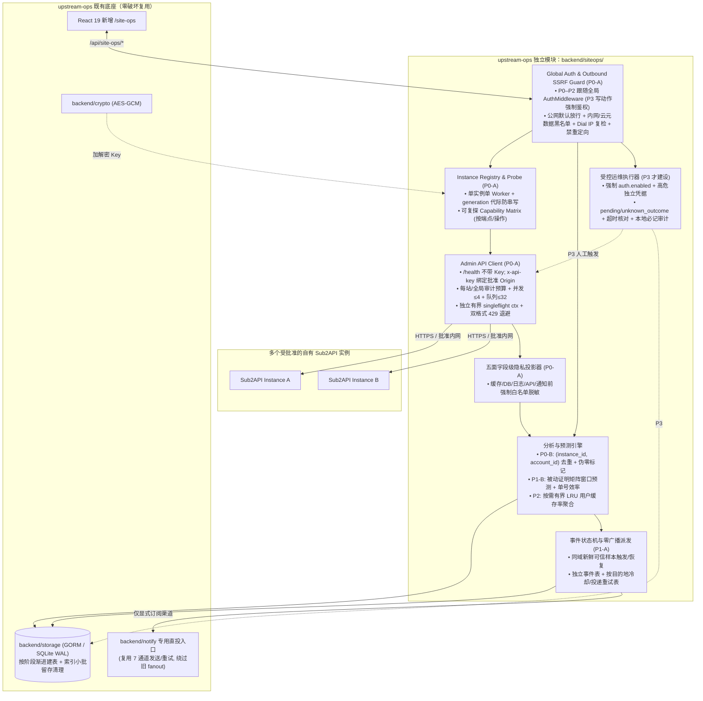

# Sub2API 自有站点运维与经营分析模块（`siteops`）最终设计与分优先级实施计划（v3 定稿）

> **所属仓库**：`D:\AI\upstream-ops`  
> **文档状态**：**最终定稿（v3）** — 已完成「原设计稿 + Codex 初版架构分析 → 融合草案 v2 → Codex 源码级评审 → Neon 终审裁决」全流程闭环  
> **创建 / 修订日期**：2026-11-24  
> **核验基线**：本地工作区 `D:\AI\upstream-ops` + 上游 `Wei-Shaw/sub2api` `v0.2.24`（提交 `5c2982a81b46e2142d0143d2f83c1ce9c4da1d24`）；**目标线上实例的实际版本、授权范围、运行开关与返回样本须经 M0 契约核验后再接入**  
> **初期数据源范围**：**P0–P3 全程严格采用「纯 Sub2API Admin API（`/api/v1/admin/*` + `/health`）+ `upstream-ops` 本地库留存闭环」**，零远端 PostgreSQL / Redis 依赖  
> **技术栈**：沿用现有 Go 1.23+（Gin + GORM + SQLite WAL / 兼容 MySQL & PostgreSQL）+ React 19 + TypeScript + Tailwind CSS v4 + Recharts

---

## 0. 项目定位、范围边界与终审决策记录（Decision Record）

### 0.1 独立模块定位与零侵入既有模块
- `upstream-ops` 既有 4 个核心模块（`backend/monitor` 外部上游余额/倍率、`backend/intelligence` 外部测活与降智、`backend/embed` 零 JS 公开嵌入、`backend/gateway` 转发网关）均站在**外部上游视角**。
- 本计划新增第 5 个独立一级模块 **`backend/siteops/`**（API 前缀 `/api/site-ops/*`，前端一级导航 **`/site-ops`「站点运维」**），站在**自有 Sub2API 站点管理员视角**，提供多实例站点可观测、号池去重容量、告警闭环、号池周期消耗预测、单号效率、经营与大客户缓存率分析，并在后期按需开放受控运维操作与三端故障定界。
- **零侵入既有模块红线**：
  1. 严禁修改 `backend/connector/sub2api/sub2api.go` 的普通用户端登录逻辑；
  2. 严禁重做凭据加密，直接复用现有 `backend/crypto.Cipher`（AES-GCM）；
  3. 严禁破坏既有通知渠道订阅行为、`notification_cooldowns` 表数据或上游监控/智力监测/公开嵌入页逻辑。

### 0.2 数据源边界（纯 Admin API + 本地留存闭环）
1. **P0–P3 仅接 Admin API**：全部数据来自目标 Sub2API 实例的 `/health` 与 `/api/v1/admin/*`，采样快照与状态历史落入 `upstream-ops` 自身数据库并由本地留存策略滚动清理。
2. **Future（Phase X，当前范围外）**：仅当后续确实出现超出 Admin API 窗口/留存的强需求（如接入前 30–90 天历史回填、超大跨度聚合）且目标环境具备**独立只读 PostgreSQL 副本 + 脱敏只读视图/预聚合表**时，再单独评审扩展可选只读 DB 插件。届时必须遵守**单指标单一主源**，禁止同一指标混拼 API 与 DB 口径。
3. **永久禁止直读 Redis 内部键**：Sub2API 的并发槽位、限流与过载窗口语义由应用层解释，直连读取 Redis 键会引入强版本耦合与口径误算。

### 0.3 `AGENTS.md` 边界处理
- 已核对当前工作区 `D:\AI\upstream-ops\AGENTS.md`：早先笼统的收入/大客户禁令已被移除（工作区存在未提交改动，实施时必须保留）。
- **P0 启动首步**：在 `D:\AI\upstream-ops\AGENTS.md` 增补显式模块边界说明——收入、消耗、大客户与用户缓存率分析**仅允许存在于 `siteops` 自有站点模块**，既有外部上游监控模块依然不涉及 `/api/log/stat` 或外部站销售分析；且 `siteops` 必须执行全输出面字段级隐私白名单。

### 0.4 Sub2API `/metrics` 与 `/health` 源码核实
- 核对 `Wei-Shaw/sub2api` `v0.2.24`（`5c2982a8`）源码确认：**无 Prometheus `/metrics` 端点**，通用路由仅暴露 `GET /health` 与 `GET /setup/status`。
- `GET /health` 固定返回 `ok`，**仅证明进程 HTTP 可达**，不代表 DB、Redis 或业务正常；主机与中间件运行指标来自 `/api/v1/admin/ops/dashboard/overview`（及 `snapshot-v2`）中的 `system_metrics`（原始采集分辨率为 60s）。

### 0.5 Neon 终审关键架构裁决（对 Codex 源码评审的定稿收口）

| 序号 | 评审发现（Blocker / High） | Neon 终审定稿裁决 | 生效阶段 |
| :--- | :--- | :--- | :--- |
| **D1** | `auth.enabled` 默认关闭，同时自有站常通过公网 HTTPS 接入，后期也可能同机/内网共部署 | **P0–P2 跟随全局鉴权 + 出站公网默认放行与内网黑名单门禁（P3 写动作强制开启鉴权）**：P0–P2 `/api/site-ops/*` 沿用现有全局 `AuthMiddleware`（未开 `auth.enabled` 也可正常查看、增删与轮询）；出站默认放行公网 `http`/`https` 域名与公网 IP，默认拦截全部私网/回环/`localhost`/保留/链路本地/云元数据地址（如 `169.254.169.254`、`100.100.100.200`、`fd00:ec2::254`），Dial 阶段复验实连 IP 防 DNS Rebinding，全局禁重定向，`/health` 禁带 Key；同机或内网共部署通过可选 `siteOps.allowLoopback`、`siteOps.allowedOrigins`、`siteOps.allowedCIDRs` 显式豁免（云元数据/链路本地/未指定地址永久硬拦截）。P3 所有写/有副作用动作仍强制 `auth.enabled == true`。 | **P0-A** |
| **D2** | `/health`、`OPS_DISABLED`（404 或 `200 enabled:false`）、真 404、`401/403` 与 Redis 批读吞错返回 `0` 混为一谈 | **三态解耦（HTTP 可达性 / 可复探端点能力 / 域级样本可信度）**：先识别业务语义再触发版本回退，所有回退与能力均可复探；`403` 按端点降级，`401` 仅按同凭据代际累计；疑似 Redis 吞错的零值标为 `unverified_zero`，**严禁用于健康绿灯、归零告警或自动恢复**；告警恢复须由对应规则所依赖域的新鲜可信样本驱动。 | **P0-A / P0-B / P1-A** |
| **D3** | 现有 `notify.Dispatcher.fanout` 对空/坏订阅默认放行，且 `Channels.Delete(id)` 会直接删除同数值 `channel_id` 的 `notification_cooldowns` 并按名 `LIKE` 误删 `NotificationLog` | **彻底隔离通知路由与状态存储**：为通知渠道增加显式 `site_ops` 订阅配置（**空或解析失败一律拒绝，默认零广播**）；在 `backend/notify` 增加专用直投方法复用加解密/发送器/重试但绕过旧 `fanout`；严禁复用 `notification_cooldowns`；用独立表 `site_ops_events` + `site_ops_alert_deliveries` 解耦状态跃迁、持久化冷却与按目的地投递重试。 | **P1-A** |
| **D4** | P0 范围偏重（原稿含 6 表 + 动作骨架 + 会话/RPM + 经营字段），且“值班可观测 vs 叫醒人”边界不清 | **严格瘦身 P0**：P0 定位于**值班可观测与安全底座**，拆为 **P0-A（2 表：鉴权/出站门禁 + 多实例 + 探活 + 核心 Ops + 留存）** 与 **P0-B（+1 表：最小去重并发与分组容量矩阵）**；将完整「零广播通知 + 独立告警状态机」作为 **P1-A 首项任务**一次做扎实，杜绝 P0 临时补丁与死表；P3 才建动作表与写开关。 | **P0 → P3** |
| **D5** | `accounts/usage/batch` 的 `force:false` 在非 Anthropic 平台遇缓存未命中时仍可能发起主动上游请求甚至清除可恢复错误 | **M4 引入被动只读证明矩阵**：P1-B 首批仅对 M0 实测确认「零上游主动请求、零写副作用」的 `平台 × 账号类型`（基线预期为 Anthropic OAuth/SetupToken）开启后台周期拉取；其他平台待目标版本证实被动路径（如 `source=passive`）后再启用。 | **M0 / P1-B** |
| **D6** | `today-stats/batch` 在 `5c2982a8` 中存在先读仅含 account ID 的共享缓存、后做逐账号鉴权的路径 | **M5 暂缓将该批量接口作为受限 Key 默认数据源**：须经 M0/M5 核验目标部署版本在缓存命中前完成逐账号授权，否则在请求预算内退用已验证逐账号鉴权的统计接口或仅按需查看。 | **M0 / P1-B** |
| **D7** | `ApplyFromFile` 双跑风险、SQLite `MaxOpenConns(1)` 锁争用、留存漏挂接、`audit_logs` 计费误解（304 也记审计） | **工程底座四项硬规范**：DB CRUD 驱动单实例单 worker（带 `generation` 校验防迟到写回），文件热重载仅更新白名单运行参数，单一关闭责任方；事务外完成 HTTP/计算、单短事务批量提交 + 索引小批分块留存清理并三处挂入 `scheduler`；建立按真实调用量计算的每站/全局审计预算，ETag 仅作带宽优化。 | **P0-A** |
| **D8** | 指标口径偏差（1m 切号除以 1h 请求、日报 1h SLA 平均、现金 ROI、支付当净现金流、错误分布缺说明、代理/错误隐私泄漏） | **全面修正公式与文案，实行五面隐私白名单**：修正 M2/M3/M4/M5/M7/M8 所有公式与展示标签；代理密码、原始错误正文、未脱敏用户 PII 禁止进入缓存、DB、日志、API 与默认日报。 | **P0–P2** |

---

## 1. 优先级总览与分阶段功能矩阵（M0 → P3）

按「**先过契约门禁 → 先稳安全与可观测底座 → 再打通零广播告警闭环 → 再上线被动预测与效率 → 再补经营分析与排障 → 最后开放受控控制面与三端联动**」原则，分为 **M0 前置门禁 + 4 个优先级（6 个可独立交付批次）+ Future 冻结位**：

| 优先级 / 批次 | 模块编号 | 定位与核心交付 | 新增/变更数据表 | 依赖的 Sub2API 端点与权限范围 |
| :--- | :--- | :--- | :--- | :--- |
| **M0（前置门禁）** 契约核验 | **M0** | 对目标线上实例做只读契约核验：确认版本/镜像、逐端点最小 `adm_sc_` Scope、关闭/404 语义、脱敏样本 Fixture、单站调用预算、M4 被动只读矩阵、M5 `today-stats/batch` 授权顺序；同步更新 `AGENTS.md` 模块边界说明。*（线上接入与验收必须过 M0；基于固定版本确认的基础骨架可先用脱敏样本并行开发）* | 无 | 人工/脚本只读探测一次 |
| **P0-A（必须先落地）** 安全底座 + 核心 SRE 可观测 | **M1, M2** | 1. 鉴权跟随全局 `AuthMiddleware` + 出站公网默认放行与内网/云元数据黑名单、Dial IP 复检、禁重定向、可选同机/内网例外（`allowLoopback` / `allowedOrigins` / `allowedCIDRs`）； 2. 多实例 CRUD、AES-GCM 加密 Key、可复探 Capability Probe、单实例单 worker 生命周期（`generation` 校验）与白名单热重载； 3. L0 `/health` + L1 核心 Ops 总览（`ops/dashboard/snapshot-v2` 及确认路由缺失后的兼容回退）； 4. 字段级质量（`field_quality`）、审计调用预算、SQLite 短事务批写与 `scheduler` 分块留存清理； 5. 前端 `/site-ops` 顶栏多实例切换 + Tab 1 核心 Ops 与本地历史趋势。 | **+2 表**： `site_ops_instances` `site_ops_snapshots` | `GET /health`（无 Key） `GET /ops/dashboard/snapshot-v2`（404 路由缺失回退 `/ops/dashboard/overview`） `GET /system/version`（可选） Scope：`ops.read`、`system.read` |
| **P0-B（P0 第二批）** 最小去重并发与分组容量矩阵 | **M3** | 1. 按 `(instance_id, account_id)` 去重计算全站/平台真实并发与号池状态； 2. 服务端分组聚合容量矩阵（显式标「Ops 判定可用」「配置并发容量」）； 3. Redis 批读吞错伪零识别与 `unverified_zero` 警示（严禁伪零报绿）。 *（会话/RPM、异常号明细表、经营消耗后移，保持 P0 极简可验收）* | **+1 表**： `site_ops_group_snapshots`（核心并发与 Ops 可用度列） | `GET /ops/concurrency` `GET /ops/account-availability` `GET /groups/all` Scope：`ops.read`、`groups.read` |
| **P1-A（首项高优）** 零广播告警闭环 + 运维日报 | **M6** | 1. 通知渠道显式 `site_ops` 订阅（默认零广播）+ `backend/notify` 专用直投通道（绕过旧 `fanout`，不碰 `notification_cooldowns`）； 2. 状态跃迁 + 持久化冷却占位 + 按目的地投递重试（支持部分失败与重启续发）； 3. P0/P1 核心告警与同域新鲜可信样本自动恢复； 4. 每日运维简报（仅消费 P0/P1 运维指标，24h 同窗聚合，默认纯聚合零 PII）； 5. 补齐异常/限流/过载账号状态面板与事件时间轴。 | **+2 表**： `site_ops_events` `site_ops_alert_deliveries` | 复用 P0 采集 + `GET /ops/alert-events`、`GET /ops/ingress-rejections/health`、`GET /ops/auth-cache-invalidation/health`、`GET /accounts`（基础目录） Scope：`ops.alerts.read`、`accounts.read` |
| **P1-B（核心差异化）** 被动号池周期预测 + 单号效率 | **M4, M5** | 1. **M4 被动预测引擎**：仅对 M0 证实为纯被动的 `平台 × 账号类型` 周期拉取窗口利用率，双速融合 + 回落新基线 + 严格边界校验，预测能否支撑到重置与分组断档风险； 2. **M5 单号成本效率**：三口径成本、当前容量归一化产出、同窗满额撬动价值与可选「账面扣费 / 参考月租」（`today-stats/batch` 须过授权缓存核验门禁）； 3. 补齐分组会话/RPM 容量条与前端 Tab 2。 | **+2 表 + 1 表扩列**： `site_ops_account_window_samples` `site_ops_account_costs` 扩展 `site_ops_group_snapshots`（sessions/rpm/risk） | `POST /accounts/usage/batch`（仅限被动矩阵，批 ≤80 + 速率限制） `GET /groups/capacity-summary` `POST /accounts/today-stats/batch`（过 M0/M5 授权门禁后）或单号统计 Scope：`accounts.usage.read`、`groups.capacity.read`、`accounts.stats.read` |
| **P2（经营与排障）** 收入、大客户缓存率 + 错误安全代理 | **M7, M8** | 1. **M7 经营与大客户缓存率**：已支付订单金额（按币种）、今日/累计消耗与日活快照、Top N 排行 + CR5/CR10（同窗分母）、两段式按需每用户 Token 缓存读取命中率/写入占比/读写比、7 完整日余额扣费续航（全走有界 LRU 内存缓存，**零用户 PII 落盘**）； 2. **M8 错误与代理排障**：延迟直方图、Top 20 错误码分布（精确口径标注）、按需脱敏请求/上游错误链、入口拒绝热点、脱敏代理池列表（跳过占位 `/proxies/:id/stats`）； 3. 日报扩展昨日消耗与已支付订单聚合摘要（默认仍零 PII）；交付前端 Tab 3 & Tab 4。 | **0 新表**（`site_ops_snapshots` 增少量全站聚合列；用户缓存率全走有界内存 LRU） | `GET /dashboard/snapshot-v2`（真 404 回退 `/dashboard/stats`） `GET /payment/dashboard`、`GET /dashboard/users-ranking`、`GET /usage/stats?user_id=`、`GET /users` `GET /ops/dashboard/latency-histogram`、`/error-distribution`、`/ingress-rejections`、`/request-errors`、`/upstream-errors`、`GET /proxies/all` Scope：`dashboard.read`、`payment.read`、`usage.read`、`users.read`、`ops.errors.read`、`proxies.read` |
| **P3（控制面与联动）** 受控一键运维 + 三端定界 | **M9, M10** | 1. **M9 受控运维操作**：此时才新增写开关、高危独立凭据槽位、`site_ops_action_logs` 与执行器；要求 `auth.enabled == true`（禁逃生阀）、全部有副作用动作统一纳管、执行前基线捕获、幂等键、`pending/unknown_outcome` 状态机与超时后只读核对、本地必记 + 远端审计可关联核验； 2. **M10 三端联动定界**：自有站分组 ↔ `probe_targets` / `channels` 双向关联视图。 | **+1 表 + 1 表扩列**： `site_ops_action_logs` `site_ops_instances` 增写开关与映射列 | 写操作按需授权（独立高危 Key 或对应写 Scope）；M10 复用本地 `intelligence` / `monitor` |
| **Future（冻结）** 可选只读 DB 历史源 | — | 仅在超 API 历史窗口强需求且具备独立只读 PG 副本 + 脱敏视图时再单独立项；单指标单一主源；**永久禁止直读 Redis**。 | 待后续单独立项 | 独立只读 PG 副本 |

---

## 2. 安全底座、鉴权门禁与多实例架构（P0-A 核心）

### 2.1 总体架构图

### 2.2 鉴权策略与出站内网黑名单门禁（P0-A 强制生效）
1. **P0–P2 跟随全局鉴权，P3 写动作强制鉴权**：
   - P0–P2（只读观测、实例管理、能力探测与轮询）统一挂载在 `/api/site-ops/*` 下，**沿用现有全局 `runtimeconfig.Manager.AuthMiddleware()`**，与既有上游监控、智力监测体验一致：开启 `auth.enabled: true` 时强制登录鉴权；未开启时开箱可用、后台轮询正常运行。
   - **P3 控制面写操作硬门禁**：所有会产生远端写/副作用的 P3 操作仍强制要求 `auth.enabled == true`（由 `siteops.RequireAccessMiddleware` 守护，永久不开放免鉴权逃生阀）。
2. **出站公网默认放行 + 内网/云元数据默认黑名单 + 可选同机/内网豁免**：
   - **默认策略（零配置即可接入公网 Sub2API）**：
     1. 放行合法公网 `http`/`https` 域名与公网 IP（规范化 `base_url`、去尾 `/`、禁止 URL 内嵌 `userinfo`/query/fragment）；
     2. **默认拦截全部非公网地址**：回环（`127.0.0.0/8`、`::1`、`localhost` / `*.localhost`）、私网 RFC1918 / ULA（`10.0.0.0/8`、`172.16.0.0/12`、`192.168.0.0/16`、`fc00::/7`）、CGNAT 及保留网段（`100.64.0.0/10`、`192.0.0.0/24`、`198.18.0.0/15`、`240.0.0.0/4` 等）、无点号单标签内部主机名（如 `sub2api`、`metadata`），以及云元数据与链路本地地址；
     3. **永久硬拦截（任何配置均不可豁免）**：链路本地与云元数据（`169.254.0.0/16`、`100.100.100.200/32`、`fe80::/10`、`fd00:ec2::254/128`）、未指定地址（`0.0.0.0/8`、`::/128`）、广播与组播地址；
     4. **Dial 阶段实连 IP 复检与代理 IP 固定**：通过自定义 `DialContext` 在 DNS 解析后校验实际连接的 IP（代理模式下解析后将核验通过的公网 IP 固定到 CONNECT / SOCKS5 目标），彻底防御 DNS Rebinding。
   - **同机 / 内网共部署可选豁免（默认全部关闭/留空）**：
     - `siteOps.allowLoopback: true`（可选环境变量 `SITEOPS_ALLOW_LOOPBACK=true`）：仅放行 `127.0.0.0/8`、`::1` 与 `localhost`（要求目标主机本身即为回环/localhost，禁止外部域名 DNS Rebinding 至 `127.0.0.1`），仍拦截私网与云元数据；
     - `siteOps.allowedOrigins`（如 `["http://sub2api:8080"]`）与 `siteOps.allowedCIDRs`（如 `["172.18.0.0/16"]`）：定向豁免 Docker Compose / 局域网内部 Sub2API，仍永久硬拦截云元数据与链路本地地址。
   - **全局禁用 HTTP 重定向**：`http.Client.CheckRedirect` 一律返回 `ErrRedirectBlocked`，杜绝 301/302 将 `x-api-key` 转发至未批准或内网目标。
   - **凭据发送范围硬绑定**：
     - `GET /health` 严禁附带 `x-api-key`；
     - `x-api-key` 仅发送到该实例绑定的 `BaseURL` 目标。

### 2.3 三态解耦：HTTP 可达性 / 可复探能力矩阵 / 域级样本可信度
严禁将“站活着”“接口支持”“数字为 0”混为单一布尔或整站状态：

1. **层 1 · HTTP 可达性（`reachability`）**：
   - 由 L0 `GET /health` 判定：`reachable` / `unreachable`（记录 `probe_latency_ms`）。仅表示 HTTP 进程响应，不代表 DB/Redis/Ops 健康。
2. **层 2 · 端点/操作能力矩阵（`capabilities_json`，可复探）**：
   - 粒度精确到**具体端点或动作**（非粗粒度整站），状态枚举：`supported` / `forbidden` (403) / `ops_disabled` / `unsupported` (404 路由缺失) / `error` / `unknown`。
   - **语义识别优先于版本回退**：
     - 收到 `404` 且响应体包含 `reason == "OPS_DISABLED"`（或对应业务禁用码）→ 记为 `ops_disabled`，**不触发版本回退**；
     - 实时接口返回 `200` 且载荷为 `enabled: false` / 空对象 → 记为 `ops_disabled`，**严禁解析为 `0` 值样本**；
     - 仅当确认为**路由不存在的真正 404**（无业务禁用语义）时，才标记该端点 `unsupported` 并回退到兼容路径（如 `ops/dashboard/snapshot-v2` → `ops/dashboard/overview`、`dashboard/snapshot-v2` → `dashboard/stats`）。
   - **所有能力与回退标记均可重新探测**：每项能力记录 `checked_at` 与 `fallback_target`，绝不永久写死；支持管理员点击「重新探测」或在低频复探窗口（如每 6 小时 1 次，受审计预算约束）重检 `ops_disabled`/`unsupported` 端点，确保目标站点升级或打开 Ops 开关后自动恢复。
   - **`403` vs `401` 严格分离**：
     - `403`：仅将该**单个端点/操作**标为 `forbidden` 并跳过后续轮询，绝不拖垮整站其他域，也不触发整站 `auth_invalid`；
     - `401`：按实例的 `cred_gen`（凭据代际，每次保存新 Key 递增）分别累计。只有属于**当前 `cred_gen`** 的有效鉴权 401 连续达到 2 次，才暂停该实例 L1–L3 轮询并标为 `auth_error`（旧 `cred_gen` 飞行中返回的迟到 401 自动忽略）。恢复路径：① 更新 Key（递增 `cred_gen` 并立即复探）；② 管理员手动点击复探；③ 低频探测（如每 15 分钟 1 次轻量鉴权探针，受审计预算约束）。
3. **层 3 · 域级样本可信度（`field_quality`）与 Redis 伪零防线**：
   - 每个数据域独立记录可信状态：`ops_overview`、`infra_metrics`、`concurrency`、`account_availability`、`group_capacity`、`dashboard_stats`，取值：`trusted` / `unverified_zero` / `stale` / `disabled` / `unauthorized` / `unavailable`。
   - **Redis 批读吞错伪零防线**（针对 Sub2API `ops_concurrency.go:92` 与 `group_capacity_service.go:197` 吞掉 Redis 错误返回 `200` + `0` 的真实行为）：
     - 由于 `redis_ok == true` 来自独立的 60s `system_metrics` 采样，无法证明当次并发/容量批读没有发生 Redis 错误；
     - 以下任一条件命中时，将当次 `concurrency` / `group_capacity` 零值标为 **`unverified_zero`**：
       1. 最近一份 `infra_metrics` 中 `redis_ok == false` 或 `infra_metrics` 已过期（> 180s）；
       2. 在账号池总数未发生骤变的前提下，并发从非零突降至全站 `0`，而同期 1h/实时 QPS 或最近可信窗口仍显活跃；
       3. 分组/实时接口返回空集合但上一次可信样本存在活跃分组且 `enabled` 未明确为 `true`。
     - **铁律**：`unverified_zero` 与 `stale` 样本**严禁**用于渲染“健康绿灯”、**严禁**触发“归零”P0 告警、**严禁**作为告警自动恢复证据。UI 必须用中性警示徽章标注「实时计数未证实」。

### 2.4 多实例生命周期、热重载与 SQLite 单连接写入纪律
1. **单实例单 Worker 与代际防串写**：
   - 严禁照搬 `backend/runtimeconfig/runtime.go:145` 中旧 scheduler“先启动新实例再停旧实例”的双跑模式。
   - **实例变更归 DB CRUD 驱动**：每个 `instance_id` 在 `siteops.Poller` 中严格对应至多 1 个运行中 worker，并持有单调递增的 `instance_generation`（与 `cred_gen`）。
   - 编辑 URL/Key、停用或删除实例时：先原子递增 `generation` 并 `cancel` 旧 worker 的 `ctx`，等待或隔离旧飞行中请求；任何采集结果落库前，在事务内校验该 `instance_id` 仍存在、仍启用且 `generation` 匹配，杜绝换 Key/改地址/删实例后旧请求迟到写回。
2. **`runtimeconfig.ApplyFromFile` 白名单热更新**：
   - 配置文件热重载仅通知 `siteops.Service.ApplyRuntimeConfig(...)` 更新显式列出的全局参数：`auth.enabled`、`siteOps.allowLoopback`、`siteOps.allowedOrigins` / `allowedCIDRs`、全局代理配置、默认请求超时/UA、全局并发上限与审计调用预算。不重建整个 poller 树。
   - 进程退出由 `cmd/server/main.go` 作为**唯一关闭责任方**调用 `defer siteOpsSvc.Stop()`。
3. **留存清理三处完整挂接**：
   - `siteops` 数据留存必须同时接入 `backend/scheduler/scheduler.go` 的三处位置：`schedulerFactory`（确保每次热重载重建 scheduler 时注入 `siteops` 留存钩子）、`hasRetention()` 与 `runRetention()`。
4. **SQLite `MaxOpenConns(1)` 写入与留存纪律**：
   - **事务外 I/O 与计算**：所有 HTTP 请求、脱敏投影、去重聚合与预测计算必须在事务外完成；
   - **短事务原子批写**：单实例一轮采集产出的主快照 + 分组快照（或窗口样本）在**同一个短事务**内使用 `CreateInBatches` 原子提交，配合幂等唯一键（如 `(instance_id, observed_at)` 或 `(instance_id, group_id, observed_at)`）防重；
   - **小批分块留存清理**：`runRetention` 按 `(observed_at)` 索引分批删除（单批 ≤ 500 行、独立短事务，单轮总上限 ≤ 10,000 行且总耗时 ≤ 2s，未删完留待下一轮），防止长时间持锁饿死写入。
5. **本地存储容量预算（显式估算）**：
   - 以 1 个实例为例：
     - `site_ops_snapshots`（60s，保留 14 天）：`1,440 × 14 ≈ 20,160` 行/站；
     - `site_ops_group_snapshots`（P0-B 60s 或 P1-B 5m，保留 7 天）：若每 5m 采 10 个分组 → `288 × 7 × 10 ≈ 20,160` 行/站（约 `2,016` 行/组/周）；若按 60s 仅对有变化或降频至 5m 落盘则可控；**定稿规定分组快照默认 5m 落盘（内存保留最新 60s 实时态供前端秒看，5m 归档历史）**，避免 1 分钟落盘导致每组每周膨胀到 10,080 行；
     - `site_ops_account_window_samples`（P1-B 5m，保留 7 天）：50 个被动订阅号 × 2 窗口 → `288 × 7 × 100 ≈ 201,600` 行/站；若订阅号 > 100，默认将 L2 周期上调至 10m（减半至 ~10 万行/站）。

### 2.5 五输出面字段级隐私白名单
针对 Sub2API 源码中已确认的敏感字段（如 `dto/types.go:480` 代理 DTO 可含明文密码、`ops_account_availability.go:120` 含 `error_message`、错误详情可含请求/响应正文与关联标识），执行**入口即投影**原则：

| 输出面 | 白名单策略 | 明确禁止内容 |
| :--- | :--- | :--- |
| **1. 内存缓存** | 上游 JSON 解析后立即投影到 `siteops` 专用脱敏结构体再入缓存；逐用户缓存使用有界 LRU（单实例上限 200 条、TTL 10m），实例变更/换 Key/降权时立刻清空 | 严禁缓存原始响应体、代理密码、账号凭证、未脱敏 Header |
| **2. 数据库落盘** | 仅存聚合数值、状态枚举、受控白名单元数据（`name`, `platform`, `status` 等）与清洗截断后的错误分类码/短摘要（≤200 字符，正则剥离 `Bearer`/`sk-`/`adm_`/URL 凭据） | 严禁落盘代理密码、账号密文、原始错误正文、全站用户 PII 明细 |
| **3. 应用日志** | 仅记录 `instance_id`、端点模板、HTTP 状态码、耗时、错误分类 | 严禁打印 `x-api-key`、上游响应体、用户邮箱或错误正文 |
| **4. 前端 API 响应** | 凭据字段只返 `api_key_hint`（如 `adm_sc_ab...89`）与 `api_key_set: bool`；错误明细仅 P2 按需脱敏展示；大客户信息按前端权限开关展示 | 严禁原始透传上游响应或原始报错文本 |
| **5. 告警与每日简报** | 告警仅带站点名、受影响资源 ID/名称、指标值与脱敏分类；**每日简报默认仅含全站聚合指标** | 默认严禁在简报/告警中输出用户邮箱、用户名或错误正文（除非管理员显式开启脱敏摘要项） |

---

## 3. 分级采集调度与审计调用预算（防打爆与 `audit_logs` 控量）

### 3.1 核心事实：ETag 不减少 `audit_logs` 写入
核查 Sub2API `middleware/admin_auth.go:233` 与 `ops_snapshot_v2_handler.go:67` 确认：
- 受限密钥（`adm_sc_`）的 **`304 Not Modified`** 以及**通过鉴权后的拒绝响应（403 等）**都会记入 Sub2API `audit_logs`；
- `ops/dashboard/snapshot-v2` 服务端缓存仅 30 秒且缓存键含绝对时间窗口，实际 304 命中率有限。
- **定稿原则**：**审计成本必须按真实鉴权 HTTP 调用总次数做预算控制**；ETag (`If-None-Match`) 仅作为带宽与反序列化优化手段。命中 `304` 时仅更新内存/快照的 `last_verified_at`（鲜度验证时间），**保留原始 `observed_at`**，不伪造新样本时间戳。

### 3.2 分期对齐的 5 级采集调度与预算账本

| 级别 | 生效阶段 | 默认周期（可配） | 调用端点 | 单站每日鉴权调用估算（默认 / 低审计模式） | 保护措施 |
| :--- | :--- | :--- | :--- | :--- | :--- |
| **L0 探活** | **P0-A** | 60s（≥30s） | `GET /health` | **0 次**（不走 Admin 鉴权） | 严禁带 `x-api-key`；只判 HTTP 可达性 |
| **L1 核心实时** | **P0-A / P0-B** | 60s（低审计模式 120s / 180s） | **P0-A**：`ops/dashboard/snapshot-v2`（1 次） **P0-B**：+ `ops/concurrency`、`ops/account-availability`（+2 次） | P0-A：1,440 / 480 次 P0-A+B：4,320 / 1,440 次 | ETag 仅优化带宽；`ops_disabled`/`403` 自动跳过；分组历史按 5m 节流落盘 |
| **L2 深度与预测** | **P1-A / P1-B / P2** | 5m（大池自动放宽至 10m） | **P1-A**：`ops/alert-events`、`ops/ingress-rejections/health`、`ops/auth-cache-invalidation/health` **P1-B**：`groups/capacity-summary`、`accounts/usage/batch`（仅被动矩阵，分批 ≤80） **P2**：`dashboard/snapshot-v2`、`ops/dashboard/error-distribution`、`ops/dashboard/latency-histogram` | P1-A：~864 次 P1-B（以 1 批计）：+576 次 P2：+864 次 | 批接口加**每实例批次速率限制**（间隔 ≥500ms）；`today-stats/batch` 须过 M0/M5 授权门禁后才可启用 |
| **L3 资产与经营** | **P0-B / P1-A / P2** | 15m~30m（默认 30m） | **P0-B**：`groups/all`、`system/version` **P1-A**：`accounts`（目录分页 ≤10 页） **P2**：`proxies/all`、`payment/dashboard?days=30` | P0-B：96 次 P1-A：+48~240 次 P2：+96 次 | `dashboard/users-ranking` **不再常驻高频轮询**，改为 P2 打开经营页按需拉取（10m 本地缓存）或 30m 可选刷新 |
| **On-Demand 按需** | **P2** | 仅用户点击/打开抽屉时 | `dashboard/users-ranking?limit=20`、Top N `usage/stats?user_id=`（并发 ≤3，10m 内存 LRU）、单用户详情、`accounts/:id/stats`、`ops/request-errors`、`/upstream-errors`、`/ingress-rejections` | 按人工访问计，受每站预算封顶 | 经过共享 `singleflight` 与预算闸门，禁止前台穿透打爆主站 |

### 3.3 客户端统一工程护栏
1. **双层请求预算（Per-Instance + Global）**：为每个实例配置每分钟/每日请求上限（默认如 `12 req/min`、`8,000 req/day`，可按 M0 结果调整），以及 `siteops` 全局并发与速率上限；预算耗尽时优先保障 L0/L1，降级延迟 L2/L3 与非紧急按需钻取。
2. **错峰与合并**：多实例启动与每轮调度加随机抖动（jitter，0~15s）；同周期同端点请求合并。
3. **并发、队列与截止时间**：每实例上游最大并发 `4`，等待队列上限 `32`，并设显式**排队等待截止时间**（如 `3s`），排队超时直接返回可重试降级态而非无限挂起。
4. **超时与响应体上限**：常规请求 `8s`，分页/批接口 `15s`；响应体硬上限 `8 MiB`。
5. **共享 `singleflight` 独立有界 `ctx`**：多个前端请求合并到同一上游调用时，上游使用独立有界 `ctx`（受总超时约束）；单个调用方取消仅退出自身等待，**只有最后一个等待者离开时才取消上游请求**，避免单个页面关闭连累其他等待者失败。
6. **`429 Too Many Requests` 处理**：同时兼容**整数秒**与 **HTTP-Date** 两种 `Retry-After` 格式；遇到 429 暂停该实例受影响的 Admin 域请求（不硬重试），无头时按指数退避（30s → 60s → 120s，上限 10m），并在实例态中标明退避截止时间。

---

## 4. 核心指标、精确计算口径与边界约束

### 4.1 M2 / M3：实时 SRE、切号口径与跨分组去重（P0-A / P0-B）

| 指标 / 视图 | 源字段与精确口径 | 必须遵守的约束与展示标签 |
| :--- | :--- | :--- |
| **综合健康分 / Uptime** | `overview.health_score`、`overview.uptime_seconds` | 无样本或 `ops_disabled` 时显示 `无数据`，绝不显示 `0`。 |
| **1h SLA 与错误率** | `overview.sla`、`overview.error_rate`、`overview.upstream_error_rate`、独立拆解 `upstream_429_count`、`upstream_529_count`、`upstream_error_count_excl_429_529` | 显式标注 Sub2API `sla` 基于其上游请求分母定义与排除项（按 M0 核验记录）；不同分组 P95 严禁算术平均，全站 P95 直接读全站聚合。 |
| **切号观测（修正原稿跨窗错误）** | `system_metrics.account_switch_count` 对应 **1 分钟窗口**（`ops_metrics_collector.go:263`），**严禁除以 1h `overview.request_count_total`**！ | 主指标展示「**近 1 分钟切号次数**」；若需切号率，仅当存在同 1m 窗口请求估算（如 `qps_current * 60 ≥ 20`）时计算并显式标为「**近 1m 估算切号率**」，低流量显示 `-`。 |
| **主机与中间件健康** | `cpu_percent`、`mem_percent`、`db_conn_active / db_max_open_conns`、`db_conn_waiting`、`(redis_conn_total - redis_conn_idle) / redis_pool_size`、`goroutine_count`、`queue_depth`、`job_heartbeats` | 明确标注 `system_metrics` 原始采集分辨率为 **60s**，避免前端折线图误导为秒级采样。 |
| **全站/平台真实并发与可用度** | 按 **`(instance_id, account_id)` 去重**后聚合 `ops/concurrency` 与 `ops/account-availability` 的 `account` 字典 | 账号明细上的单个 `group_id` 仅作展示用，**不用于反推分组成员**；单个 401/403/`has_error` 仅展示已知状态与脱敏原因，**严禁武断标「封号」**。 |
| **分组容量矩阵（P0-B）** | 直接采用服务端分组聚合（或完整账号-分组成员映射） | 显式标注两个关键标签： 1. **「Ops 判定可用」**（tooltip 注明：不等同于调度器 `IsSchedulable()`，后者还会校验账号过期与账号级配额）； 2. **「配置并发容量」**（tooltip 注明：账号跨组共享，**各分组容量不可直接相加**）。 |

### 4.2 M4：被动只读证明矩阵与号池重置周期预测引擎（P1-B）

#### 1) 平台 × 账号类型 × 端点 × 副作用 支持矩阵（M0 实测准入）
`POST /api/v1/admin/accounts/usage/batch` 在 `5c2982a8`（`account_usage_service.go:387, 559`）中并非所有平台都纯被动。P1-B 实施**白名单准入制**：

| 平台 × 账号类型 | 源码核查状态（`5c2982a8`） | P1-B 后台周期采集策略 |
| :--- | :--- | :--- |
| **Anthropic OAuth / SetupToken** | 走被动缓存/状态路径，无主动上游探测 | **首批启用**（M0 确认目标版本一致且单批 ≤80 + 批次速率受控） |
| **OpenAI OAuth / Gemini / Antigravity / Grok** | 进入各自实现；`force:false` 允许复用缓存，但缓存未命中时部分路径仍会主动请求上游并尝试清除可恢复错误 | **P1-B 默认关闭后台自动拉取**；仅当 M0 核验目标版本提供且证实无副作用的纯被动来源（如 `source=passive`）后逐项解锁 |
| **API Key / Upstream 按量转发号** | 无订阅重置周期 | **永久排除出周期预测分母**（仅进入单号成本效率视图） |

#### 2) 标准化预测算法与边界约束（按 `instance_id × account_id × window_key × source` 计算）
1. **样本前置准入校验**（任一不满足直接输出 `insufficient_data`）：
   - 属于已启用的被动来源；
   - `utilization_unknown == false`；
   - 窗口总时长 $T_W > 0$（排除未知周期）；
   - `resets_at != nil` 且 `resets_at > observed_at`（排除过期重置点）；
   - $0 < R \le T_W + 120\text{s}$（排除异常剩余时长）。
2. **严格判定顺序**：
   - **步骤 1（先判已耗尽）**：若 $U \ge 100\%$ 或该窗口明确处于限流/耗尽态 → `forecast_status = "exhausted"`、`eta_seconds = 0`、`margin_hours = -R_hours`（已耗尽且距重置仍余 $R$ 小时）。
   - **步骤 2（计算双速燃烧率，判数据不足与闲置）**：
     - 窗口均值速率 $v_{\text{avg}} = U / E_{\text{hours}}$（仅当已过时长 $E = T_W - R \ge E_{\min}$：5h 取 15m，24h 取 1h，7d 取 3h，30d 取 12h）。
     - 近期瞬时速率 $v_{\text{recent}}$：从 `site_ops_account_window_samples` 匹配**同一 `(instance_id, account_id, window_key, source)`** 且 `|resets_at - resets_at_0| <= 120s` 的基线点 $(t_0, U_0)$，并满足：
       - **验证上游实际采样时间递增**：跳过 `304` 或上游缓存重放导致的未推进样本，要求有效采样间隔 $\Delta t \ge \Delta t_{\min}$（5h ≥ 10m，24h ≥ 30m，7d/30d ≥ 1h）且在最大回看窗内；
       - **利用率回落开启新基线**：按时间倒序寻找基线时，一旦遇到相邻样本利用率下降（$U_k < U_{k-1}$），**立即以该回落点作为新基线起点，绝不越过回落点去拼接更早的高点**；若当前 $U < U_{\text{prev}}$，本轮仅建立新基线，暂不产出 $v_{\text{recent}}$。
       - 满足上述条件后计算 $v_{\text{recent}} = (U - U_0) / \Delta t_{\text{hours}}$。
     - 融合有效速率 $v_{\text{eff}}$：
       - 两者皆有效：$v_{\text{raw}} = 0.6 \cdot v_{\text{recent}} + 0.4 \cdot v_{\text{avg}}$；若出现短暂低谷（$v_{\text{recent}} < v_{\text{avg}}$），采用保守下界 $v_{\text{eff}} = \max(v_{\text{raw}}, 0.8 \cdot v_{\text{avg}})$，置信度 `high`；
       - 仅有 $v_{\text{avg}}$：$v_{\text{eff}} = v_{\text{avg}}$（置信度 `medium`）；
       - 仅有 $v_{\text{recent}}$：$v_{\text{eff}} = v_{\text{recent}}$（置信度 `low`）；
       - 两者皆无效：输出 `forecast_status = "insufficient_data"`，其余预测数值字段均为 `null`。
     - **零速率表达（JSON 严格可序列化，严禁 `+Inf` / `NaN`）**：当 $v_{\text{eff}} \le 0.001$ 时，`burn_rate_per_hour = 0`、`eta_seconds = null`、`margin_hours = null`、`predicted_end_util = U`；若 $U < 5\%$ 判 `idle`，否则判 `safe`。
   - **步骤 3（最后判 `ETA < R` 与分级）**：当 $v_{\text{eff}} > 0.001$ 时：
     - $\text{ETA}_{\text{hours}} = (100 - U) / v_{\text{eff}}$，`eta_seconds = round(ETA_hours * 3600)`；
     - $\hat{U}_{\text{end}} = U + v_{\text{eff}} \cdot R_{\text{hours}}$，$\Delta_{\text{margin}} = \text{ETA}_{\text{hours}} - R_{\text{hours}}$；
     - 状态分级（区分“预计提前耗尽”与“高危告警阈值”）：
       - `will_exhaust_high`（高危 · 触发告警）：$\hat{U}_{\text{end}} \ge 105\%$（显著提前打满）；
       - `will_exhaust`（预计提前耗尽 · 临界预警）：$100\% \le \hat{U}_{\text{end}} < 105\%$（$\text{ETA} \le R$，仍可能提前打满，界面明确警示，不归入安全）；
       - `tight`（偏紧）：$85\% \le \hat{U}_{\text{end}} < 100\%$；
       - `safe`（安全）：$\hat{U}_{\text{end}} < 85\%$。
3. **多窗口账号汇总口径**：
   - 一个账号若同时有 `five_hour`、`seven_day` 等多个有效窗口，账号级预测取**最早有效阻塞窗口**（`exhausted` 最优先，其次最小有效 `eta_seconds`）。
   - 界面与分组容量预测明确说明：**单个窗口到点重置只代表该项约束可能解除**，不保证账号一定恢复可用（仍可能受更长周期窗口或账号状态约束）。
4. **有效期字段分离**：明确区分账号本身 `expires_at`（来自 `/accounts`）与 OAuth access token 到期时间（仅在 M0 确认目标平台脱敏返回该字段时单独展示，不混用）。

### 4.3 M5：单号成本效率评估（P1-B）
- **数据源前置门禁（重要）**：在 `5c2982a8` 中，`POST /api/v1/admin/accounts/today-stats/batch` 先查仅按 account ID 构成的共享缓存、后做逐账号授权（`account_handler.go:2698` vs `account_usage_service.go:1547`）。因此**暂缓将其作为受限 Key 的默认自动轮询源**；M0/M5 须先核验目标线上版本是否在缓存命中前完成逐账号授权，未确认前仅在请求预算内使用已验证逐账号鉴权的统计接口（或仅在详情抽屉按需查看）。
- **精确口径与命名修正**：
  - 保留 Sub2API 三口径各自语义：`standard_cost`（官方标价参考）、`cost`（站内账号折算成本）、`user_cost`（用户账面扣费）；
  - **账号变现倍率比**：`user_cost / cost`（`cost <= 0` 返回 `null`）；
  - **当前容量归一化产出**（原“单位并发日产出”更名，避免中途调并发槽位时误读）：`today_user_cost / current_concurrency`、`today_requests / current_concurrency`（`current_concurrency <= 0` 返回 `null`）；
  - **同窗满额撬动价值**：仅对**同一窗口、同一费用口径且样本充足**（如 `utilization ≥ 10%` 且 `window_requests ≥ 20` 且 `window_stats` 与当前窗口一致）计算 `window_stats.standard_cost / (utilization / 100)`，否则返回 `null`；
  - **账面扣费 / 参考月租**（原“现金 ROI”更名，因真实 ROI 另需实际收款与分摊成本）：用户可选在 `site_ops_account_costs` 录入 `monthly_cost_usd`；当 `monthly_cost_usd > 0` 时展示 `30d_standard_cost / monthly_cost_usd`（标准价杠杆）与 `30d_user_cost / monthly_cost_usd`（账面扣费／参考月租），为 0 或未录入一律返回 `null`。

### 4.4 M7：经营、大客户排行与两段式每用户缓存率（P2）
1. **已支付订单金额（非净现金流）**：
   - 来源 `GET /api/v1/admin/payment/dashboard?days=30`（`payment.read`），按币种分组展示，所有文案统一使用**「已支付订单金额」**；严禁直接称为「净现金流」（净现金流另需退款、渠道手续费与汇率折算依据）。
   - `GET /api/v1/admin/redeem-codes/stats` 若无权限则标为 `unavailable` 优雅降级。
2. **大客户排行与 CR5 / CR10**：
   - `dashboard/users-ranking` 与按需拉取的 `usage/stats?user_id=` **必须显式传递完全一致的 `start_date`、`end_date`、`timezone` 及过滤参数**；
   - `user_id` 强制校验为正整数（`> 0`）；
   - **CR5 / CR10 分母**：强制取同一次排行响应同窗口返回的全站 `total_actual_cost`（`dashboard_handler.go:544`），分母 `<= 0` 返回 `null`。
3. **两段式按需每用户 Token 缓存率（默认不常驻后台遍历）**：
   - 打开「经营与大客户」Tab 时按需触发 Top N（默认 20，上限 50）排行，通过有界并发池（≤ 3）+ 10 分钟有界 LRU 内存缓存（≤ 200 条）+ `singleflight` 补拉 `GET /api/v1/admin/usage/stats?user_id=<id>&...`；
   - **明确标注为 Token 占比**，并在 M0/P2 验证各支持平台 `input_tokens` 归一化语义（确认是否已扣除或叠加 cache token，避免重复计算总输入）：
     - $I_{\text{all}} = \text{normalized\_total\_input\_tokens}$
     - 缓存读取命中率 = `cache_read_tokens / I_all * 100%`（$I_{\text{all}} = 0$ 时返 `null` 并显示「不可计算」）
     - 缓存写入占比 = `cache_creation_tokens / I_all * 100%`（零分母返 `null`）
     - 缓存读写比 = `cache_read_tokens / cache_creation_tokens`（分母为 0 返 `null`）
   - 任意非 Top N 用户在搜索/详情抽屉点击时单次按需查询，同样走内存 LRU + 预算控制，**绝不持久化用户 PII 到 SQLite**。
4. **余额续航估算**：
   - 仅当存在**近 7 个完整自然日**的**纯余额扣费口径**消耗且日均余额扣费 `> 0` 时，估算 `balance / avg_daily_balance_deduction_7d`；
   - 若混入订阅套餐扣费无法拆分，或近 7 日余额扣费为 0，一律返回 `null` 并展示「**不可估算**」。

### 4.5 M8：错误分布、入口安全与代理体检（P2）
- **错误码分布**：文案明确标注「**入口状态码 ≥ 400 的错误，按上游优先状态码分组（Top 20）；所示合计仅覆盖这 20 桶**」（对应 `ops_repo_trends.go:548` SQL 语义）。
- **请求/上游错误明细**：默认不后台拉取、不落盘；仅在具备 `ops.errors.read` 且管理员打开排障抽屉时按需分页查询，并经隐私投影剥离敏感头与正文。
- **代理池列表**：调用 `GET /api/v1/admin/proxies/all` 后立即投影为白名单字段（ID、名称、协议、脱敏 Host:Port、状态、到期、关联账号数），**强制丢弃密码字段**；继续跳过 `v0.2.24` 占位接口 `/proxies/:id/stats`。

---

## 5. 事件状态机、零广播通知闭环与分期日报（M6 · P1-A 起）

### 5.1 显式零广播订阅与专用直投（彻底消除误广播与删渠道串扰）
经实查本地 `backend/notify/dispatcher.go:104, 211`、`backend/notify/subscription.go:74` 与 `backend/storage/channels.go:17-51`：
- 现有 `fanout` 对空 `Subscriptions` 和 JSON 解析失败均默认放行，且 `ChannelID == 0` 会跳过渠道匹配；
- `Channels.Delete(id)` 会直接执行 `DELETE FROM notification_cooldowns WHERE channel_id = id`，并按名称 `LIKE` 清理 `upstream_channel_id == 0` 的 `NotificationLog`。

**定稿设计（P1-A 落地）**：
1. **显式零广播订阅（Default Deny）**：
   - 为 `NotifyChannel` 扩展独立的 `site_ops_subscriptions_json`（或订阅 JSON 内独立字段 `site_ops`），结构为：`{ enabled: bool, instance_ids: []uint (空拒绝; ["*"] 为显式全站), events: []string }`。
   - 任何老渠道（该字段为空）、未显式 `enabled: true` 或 JSON 解析失败的渠道，对全部 `siteops` 事件**一律拒绝（零广播）**。
2. **专用直投方法**：
   - 在 `backend/notify` 新增 `SendDirect(ctx, channelID, msg)`（或 `DeliverSiteOps`），仅复用单渠道凭证解密、7 种通道协议发送器与单次网络重试，**完全绕过**既有 `fanout`；
   - 若写入统一通知日志表，设置明确隔离标识避免被 `Channels.Delete` 的 `upstream_channel_id == 0` 清理语句误删（推荐投递明细主记在独立表 `site_ops_alert_deliveries`）。
3. **三层解耦（状态跃迁 × 冷却占位 × 目的地投递）**：
   - `site_ops_events` 仅管**规则状态机**（`firing` / `resolved`、连续命中次数、触发与恢复证据）；
   - `site_ops_alert_deliveries` 管**持久化冷却占位 + 按通知渠道独立投递状态**（`(event_id, notify_channel_id, cooldown_key, cooldown_until, status: pending|sent|failed|skipped, attempts, next_retry_at)`）；
   - 当某事件路由到 3 个渠道且第 2 个渠道网络失败时，第 1、3 个标记 `sent`，仅第 2 个进入指数退避重试；服务重启后扫描 `pending/failed` 续发，绝不重复轰炸已成功渠道，也绝不因删上游渠道丢冷却记录。

### 5.2 内置告警规则与同域新鲜可信恢复原则

**统一恢复铁律**：每条规则明确绑定其**依赖的数据域**。恢复事件必须由对应依赖域的**新鲜且可信（`trusted`）**样本触发——绝不能用 `unverified_zero`、`stale` 触发恢复，也不因无关域缺权（如缺 `payment.read`）阻断核心域恢复。

| 级别 | 事件键 | 触发条件（连续确认防抖） | 依赖数据域（用于触发与恢复证真） | 生效阶段 |
| :--- | :--- | :--- | :--- | :--- |
| **P0** | `site_offline` | L0 `/health` 连续 2 次不可达 | `reachability` | **P1-A** |
| **P0** | `auth_invalid` | 同一 `cred_gen` 下连续 2 次有效 `401`（不含单端点 `403`） | `auth_probe` | **P1-A** |
| **P0** | `infra_down` | `db_ok == false` 或 `redis_ok == false` 连续 2 次 | `infra_metrics` | **P1-A** |
| **P0** | `group_pool_exhausted` | 活跃分组 `accounts_total > 0` 且 `accounts_available == 0` 连续 2 次，**且必须非 `unverified_zero`** | `account_availability` + `infra_metrics.redis_ok` | **P1-A** |
| **P1** | `sla_degraded` | 1h `sla < 95%` 或 `upstream_error_rate > 10%`（样本 ≥ 20）连续 2 次 | `ops_overview` | **P1-A** |
| **P1** | `concurrency_saturated` | 全站或分组并发 ≥ 85% 或 `queue_depth > 0` 连续 3 次 | `concurrency` + `infra_metrics` | **P1-A** |
| **P1** | `high_switch_spike` | 近 1m 切号次数超阈值（或近 1m 估算切号率 > 15% 且 1m 估算请求 ≥ 20）连续 2 次 | `infra_metrics` + `ops_overview` | **P1-A** |
| **P1** | `resource_pressure` | CPU ≥ 85% / 内存 ≥ 85% / DB 连接池 ≥ 85% 或 `db_conn_waiting > 0` 连续 3 次 | `infra_metrics` | **P1-A** |
| **P1** | `job_or_cache_unhealthy` | 任一 `job_heartbeats` 报错或停滞；`auth-cache-invalidation/health` 异常 | `ops_overview` + `auth_cache_health` | **P1-A** |
| **P1** | `account_error_new` | Diff 发现新增 `has_error == true` 账号（**排除纯 429 瞬时限流**；429 仅在全站限流比例 ≥ 50% 持续 5m 时单独告警） | `account_availability` | **P1-A** |
| **P1** | `pool_cannot_sustain_reset` | 某分组内被动证实样本中 `will_exhaust_high`（$\hat{U}_{\text{end}} \ge 105\%$）占比 ≥ 40% 或剩余可稳撑号 ≤ 1（置信度 ≥ `medium`） | `pool_forecast` | **P1-B** |
| **P2** | `ingress_reject_spike` / `version_update` | 入口拒绝突增 / 检测到新版本（不发恢复通知） | `ingress_health` / `system_version` | **P2** |

### 5.3 每日简报分期演进（默认纯聚合、零 PII）
默认次日 `09:00 UTC+8` 推送，**只消费当期已有数据，不引入未落地模块字段**：
- **P1-A 版（运维日报）**：
  - 昨日 **24h 窗口聚合 SLA**（严禁对 1h SLA 求平均）、昨日 **24h 上游统计 P95 TTFT / 总耗时**（若上游 24h 接口未采或无数据则明确显示「缺失」）、昨日最高并发水位（仅计 `trusted` 样本）、昨日累计切号次数与峰值、当前异常账号数、未恢复告警列表。
- **P1-B 增补**：
  - 被动证实号池的 5h/7d `will_exhaust_high` / `will_exhaust` 账号数与高危分组摘要。
- **P2 增补**：
  - 昨日全站实际消耗、账号成本、已支付订单金额（按币种）、日活/新增用户数、全站 Token 缓存命中率、版本更新提示；**默认不输出任何用户邮箱/用户名 PII**（管理员显式勾选“附带脱敏 Top N 摘要”后方可包含脱敏标识）。

---

## 6. P3 控制面操作安全框架与三端联动（M9 / M10 · P3 才落地）

为避免 P0–P2 产生未使用的死表、死代码与无谓安全面，**写开关、高危独立凭据槽位、`site_ops_action_logs` 与执行器全部推迟至 P3 再建设**。

### 6.1 统一门禁与动作分级
- **全量纳管原则**：P3 中**所有会产生上游请求或状态副作用的操作**（包括 `account.test`、`account.refresh_token`、`proxy.test`、`accounts/usage/batch` `force:true`，以及 L2 恢复动作和 L3 高危动作）**全部**必须通过以下门禁：
  1. `auth.enabled == true`（**严禁走本地免鉴权逃生阀**）；
  2. 通过出站内网黑名单与 Dial IP 校验（公网默认放行，内网/回环须显式豁免，云元数据永久硬拦截）；
  3. 仅允许管理员手动点击触发，**绝不自动执行写操作**；
  4. 429 限流账号行隐藏“停止调度”快捷入口并提示 Sub2API 自动回池机制，防止误关 `schedulable`。
- **动作三级划分**：
  - **L1（有副作用的诊断/主动刷新）**：`account.test`、`account.refresh_token`、`account.refresh_usage`（`force:true`）、`proxy.test` — 需实例 `allow_write_actions = true` + 单目标 30s 冷却 + 审计落库；
  - **L2（常规状态恢复）**：`account.clear_error`、`account.clear_rate_limit`、`account.clear_temp_unschedulable`、`account.recover_state`、`ops.error.resolve`、`ops.alert.update_status` — 需 `allow_write_actions = true` + 弹窗确认 + 操作前抓取只读基线；
  - **L3（高影响控制操作）**：`account.set_schedulable`、`account.openai_reset_quota`、`account.claude_redeem_reset`、`system.restart` — 需 `allow_high_risk_actions = true` + **独立高风险凭据槽位**（与日常只读 Key 分离，按需配置）+ 强二次确认（输入确认词并展示影响面）+ 操作前强制基线 + 幂等键防重。

### 6.2 执行状态机、超时核对与审计准确表述
- **显式状态机**：每条操作记录经历 `pending`（申请中/已发出）→ `succeeded` / `failed` / `rejected` / **`unknown_outcome`**（上游超时、断连或 5xx 导致无法确认远端是否已生效）。
- **超时后只读核对策略**：进入 `unknown_outcome` 后禁止盲目自动重试；后台或管理员触发一次对应的**只读状态查询**（如回查 `schedulable` / 账号错误态 / 配额状态）比对操作前基线，向操作人明确展示“远端已变化（疑似生效）/ 未变化 / 仍不确定”。
- **审计表述修正**：Sub2API 远端 `audit_log_service.go:69` 存在异步队列满时丢弃日志的机制，因此双边留痕严格定义为：**「本地 `site_ops_action_logs` 强制必记，远端 Sub2API `audit_logs` 可关联核验（不假设远端 100% 不丢）」**。

### 6.3 M10：三端联动故障定界（P3）
在 `site_ops_instances`（P3 增列 `target_links_json`）中建立可选映射：`sub2api_group_id` ↔ `probe_targets.id`（`backend/intelligence` 外部主动拨测/降智）与 `channels.id`（`backend/monitor` 外部上游供应态），在 `/site-ops` 分组行与 `/intelligence` 异常抽屉之间提供双向跳转与同屏对照，实现“外部拨测 × 自有站内部态 × 上游供应态”快速定界。

---

## 7. 数据库表结构分期演进（零死表设计）

遵循 `backend/storage/model.go` 规范（显式 `TableName()`、跨方言 GORM 索引、UTC 存储、大字段列表查询 `Select` 排除）。**严格按期建表，绝不在 P0 预建未使用的死表**：

### P0-A 新增（2 张核心表）

#### 1. `site_ops_instances`（自有站点实例表）
- 核心列：`id` (PK), `name` (unique, varchar 128), `slug` (unique, varchar 64), `base_url` (varchar 512), `api_key_cipher` (text, AES-GCM), `api_key_hint` (varchar 64), `key_kind` (`scoped`/`full`), `cred_gen` (`int64`, 每次换 Key 递增), `generation` (`int64`, 每次配置变更递增), `proxy_enabled` (bool), `enabled` (bool, index), `sort_order` (int), `poll_interval_seconds` (int, 默认 60, 最小 30), `audit_budget_per_day` (int), `capabilities_json` (text, 含端点状态/回退目标/`checked_at`), `last_reachability` (`reachable`/`unreachable`/`unknown`), `last_status` (`online`/`degraded`/`offline`/`auth_error`/`paused_no_auth`/`pending`), `last_health_score` (`*int`), `last_version` (varchar 64), `last_observed_at` (`*time.Time`), `last_verified_at` (`*time.Time`), `backoff_until` (`*time.Time`), `last_error_code` (varchar 64), `last_error_summary` (varchar 256, 脱敏), `created_at` / `updated_at`。
- *后续分期扩列*：P1-A 增 `alert_config_json`；P3 增 `allow_write_actions` (default `false`)、`allow_high_risk_actions` (default `false`)、`high_risk_api_key_cipher` (text)、`high_risk_api_key_hint` (varchar 64)、`target_links_json` (text)。

#### 2. `site_ops_snapshots`（站点级时序快照，默认保留 14 天）
- 索引：`idx_site_ops_snap_inst_time (instance_id, observed_at)`（唯一键防重）、`idx_site_ops_snap_observed (observed_at)`（供小批分块清理）。
- **P0-A 列**：`id`, `instance_id`, `observed_at` (UTC), `verified_at` (UTC, 304 时更新), `reachable` (bool), `probe_latency_ms` (int64), `field_quality_json` (text, 各域 `trusted`/`unverified_zero`/`stale`/`disabled`/`unauthorized`/`unavailable`), `health_score` (`*int`), `uptime_seconds` (`*int64`), `cpu_percent` / `mem_percent` / `mem_used_mb`, `db_ok` / `db_conn_active` / `db_conn_waiting` / `db_max_open_conns`, `redis_ok` / `redis_conn_total` / `redis_conn_idle` / `redis_pool_size`, `goroutine_count` / `queue_depth` / `account_switch_count_1m` (`*int64`), `sla_percent_1h` / `error_rate_percent_1h` / `upstream_error_rate_percent_1h`, `req_total_1h` / `err_total_1h` / `upstream_429_1h` / `upstream_529_1h`, `qps_current` / `qps_peak` / `tps_current` / `rpm_5m` / `tpm_5m`, `ttft_p50_ms` / `ttft_p95_ms` / `duration_p95_ms` / `output_tps_p50`, `detail_json`（存 `job_heartbeats` 等，趋势查询排除）。
- **P0-B 扩列**：`conc_used` / `conc_max` / `conc_waiting` / `conc_trust_state`, `accounts_total` / `accounts_available` / `accounts_rate_limited` / `accounts_overloaded` / `accounts_error`。
- **P2 扩列（纯全站聚合，零用户 PII）**：`today_requests` / `today_tokens` / `today_actual_cost` / `today_account_cost` / `today_cost` / `total_actual_cost` / `total_account_cost` / `active_users` / `hourly_active_users` / `today_new_users` / `today_cache_hit_rate` / `payment_paid_json`（按币种已支付订单金额）。

### P0-B 新增（+1 张表）

#### 3. `site_ops_group_snapshots`（分组级容量与 Ops 可用度快照，默认 5m 归档、保留 7 天）
- 索引：`uniq_site_ops_grp_snap (instance_id, group_id, observed_at)`、`idx_site_ops_grp_observed (observed_at)`。
- **P0-B 列**：`id`, `instance_id`, `group_id`, `group_name`, `platform`, `observed_at`, `trust_state` (`trusted`/`unverified_zero`/`stale`), `accounts_total`, `accounts_ops_available`, `accounts_rate_limited`, `accounts_overloaded`, `accounts_error`, `conc_used`, `conc_max`, `conc_waiting`。
- **P1-B 扩列**：`sessions_used`, `sessions_max`, `rpm_used`, `rpm_max`, `pool_exhaust_risk_count`。

### P1-A 新增（+2 张独立事件与投递表）

#### 4. `site_ops_events`（状态跃迁事件流，默认保留 30 天）
- 索引：`idx_site_ops_evt_inst_created (instance_id, created_at)`、`idx_site_ops_evt_active (instance_id, rule_key, resource_key, state)`、`idx_site_ops_evt_created (created_at)`。
- 列：`id`, `instance_id`, `severity` (`critical`/`warning`/`info`), `rule_key`, `resource_key`（如 `site` / `group:5` / `account:42:seven_day` / `job:agg`）, `required_domains_json`, `state` (`firing`/`resolved`), `consecutive_hits`, `title`, `summary`（脱敏）, `detail_json`（脱敏证据）, `fired_at`, `resolved_at`, `created_at` / `updated_at`。

#### 5. `site_ops_alert_deliveries`（独立冷却占位与按目的地投递状态表，默认保留 30 天）
- 索引：`idx_site_ops_deliv_cooldown (instance_id, notify_channel_id, cooldown_key, cooldown_until)`、`idx_site_ops_deliv_retry (status, next_retry_at)`、`idx_site_ops_deliv_created (created_at)`。
- 列：`id`, `event_id` (index), `instance_id`, `notify_channel_id`, `delivery_kind` (`alert`/`recovery`/`daily_report`), `cooldown_key` (varchar 128), `cooldown_until` (`*time.Time`), `status` (`pending`/`sent`/`failed`/`skipped_cooldown`), `attempts`, `next_retry_at` (`*time.Time`), `last_error` (varchar 256, 脱敏), `sent_at` (`*time.Time`), `created_at` / `updated_at`。

### P1-B 新增（+2 张预测与可选月租表）

#### 6. `site_ops_account_window_samples`（被动证实窗口采样表，默认保留 7 天）
- 索引：`uniq_site_ops_win (instance_id, account_id, window_key, source, upstream_observed_at)`、`idx_site_ops_win_lookup (instance_id, account_id, window_key, source, observed_at)`、`idx_site_ops_win_observed (observed_at)`。
- 列：`id`, `instance_id`, `account_id`, `account_name`, `platform`, `account_type`, `source`（如 `passive_cache`）, `window_key`, `window_duration_sec`, `utilization`, `resets_at` (`*time.Time`), `remaining_seconds`, `upstream_observed_at` (`time.Time`, 用于去重放与递增校验), `window_standard_cost` / `window_user_cost` / `window_requests`, `burn_rate_per_hour` (`*float64`), `eta_seconds` (`*int64`, 零速率为 `NULL`), `predicted_end_util` (`*float64`), `margin_hours` (`*float64`), `forecast_status` (`safe`/`tight`/`will_exhaust`/`will_exhaust_high`/`exhausted`/`idle`/`insufficient_data`), `confidence` (`high`/`medium`/`low`), `observed_at`。

#### 7. `site_ops_account_costs`（可选本地参考月租表）
- 索引：`uniq_site_ops_acc_cost (instance_id, account_id)`。
- 列：`id`, `instance_id`, `account_id`, `monthly_cost_usd` (`float64`), `note` (`varchar 256`), `updated_at`。

### P2 新增（0 张新表）
- 全站经营聚合写入 `site_ops_snapshots` P2 扩列；Top N 大客户与逐用户精确缓存率全部走**有界内存 LRU（10m TTL，权限/实例变更即清）+ 按需拉取**，不新增持久化 PII 表。

### P3 新增（+1 张控制面审计表）

#### 8. `site_ops_action_logs`（受控运维操作与基线审计表，默认保留 90 天）
- 索引：`uniq_site_ops_action_idem (idempotency_key)`、`idx_site_ops_action_inst_created (instance_id, created_at)`、`idx_site_ops_action_created (created_at)`。
- 列：`id`, `instance_id`, `operator` (varchar 128), `action_key`, `risk_level` (`L1`/`L2`/`L3`), `target_type`, `target_id`, `request_params_json`（脱敏）, `baseline_json`（操作前只读基线）, `status` (`pending`/`succeeded`/`failed`/`rejected`/`unknown_outcome`), `http_status`, `reconcile_status` (`none`/`confirmed`/`unchanged`/`inconclusive`), `reconcile_summary`, `result_summary`（脱敏）, `duration_ms`, `idempotency_key`, `created_at` / `updated_at`。

---

## 8. 后端分期路由与前端 `/site-ops` 信息架构

### 8.1 后端目录规划（`backend/siteops/`）与分期 API 路由（统一挂载 `/api/site-ops/*`）
P0–P2 统一沿用全局 `AuthMiddleware`；P3 高危写操作端点额外前置 `RequireAccessMiddleware` 强制鉴权中间件：

| 分期 | 新增/扩展后端文件 | 新增 API 路由 |
| :--- | :--- | :--- |
| **P0-A** | `guard.go`（鉴权/Origin/CIDR/Dial）、`client.go`、`probe.go`、`poller.go`、`sanitizer.go`、`service.go`、`backend/api/site_ops.go`、`backend/storage/site_ops.go` | `GET/POST/PUT/DELETE /api/site-ops/instances` `POST /api/site-ops/instances/:id/probe` `POST /api/site-ops/instances/:id/refresh` `GET /api/site-ops/summary` `GET /api/site-ops/instances/:id/overview` `GET /api/site-ops/instances/:id/trends?range=1h\|6h\|24h\|7d\|14d` |
| **P0-B** | `analyzer.go`（去重聚合 + 伪零识别） | `GET /api/site-ops/instances/:id/groups` |
| **P1-A** | `events.go`、`alerts.go`、`report.go`；`backend/notify` 显式订阅与直投 | `GET /api/site-ops/instances/:id/events` `GET /api/site-ops/instances/:id/accounts?view=status`（脱敏状态面板） `POST /api/site-ops/instances/:id/report/preview`（可选预览日报） |
| **P1-B** | `forecast.go`、`efficiency.go` | `GET /api/site-ops/instances/:id/pool-forecast` `GET /api/site-ops/instances/:id/accounts?view=efficiency` `PUT /api/site-ops/instances/:id/accounts/:account_id/cost` |
| **P2** | `customers.go`（有界 LRU + 两段式按需缓存率）、`diagnostics.go` | `GET /api/site-ops/instances/:id/revenue?days=30` `GET /api/site-ops/instances/:id/customers/ranking?range=today\|7d\|30d&limit=20` `GET /api/site-ops/instances/:id/customers/:user_id/cache-stats?range=today\|7d\|30d` `GET /api/site-ops/instances/:id/errors`（按需脱敏） `GET /api/site-ops/instances/:id/proxies`（脱敏白名单） |
| **P3** | `actions.go`（动作注册、基线、状态机、超时核对）、`correlate.go` | `GET /api/site-ops/instances/:id/actions/catalog` `POST /api/site-ops/instances/:id/actions/execute` `POST /api/site-ops/instances/:id/actions/:log_id/reconcile` `GET /api/site-ops/instances/:id/actions/logs` `PUT /api/site-ops/instances/:id/target-links` |

### 8.2 前端 `/site-ops` 信息架构（按期渐进点亮）
- **通用 UI 展示纪律**：
  - 任何 `unauthorized` / `disabled` / `unavailable` / `stale` / `unverified_zero` 字段**严禁渲染为 `0` 或健康绿灯**，统一展示明确状态徽章与最近观测/验证时间；
  - 管理台默认读取本地快照，仅在明确按需操作（抽屉/手动刷新）时经后端受控预算与 `singleflight` 请求上游。
- **顶部常驻栏（P0-A）**：单实例显示健康摘要条 +「+ 添加站点」；≥2 实例显示紧凑切换栏 +「全部实例对比」折叠条 + 能力诊断/权限矩阵抽屉 + 审计调用预算消耗指示。
- **Tab 1 · 实时总览与基础设施（P0-A + P0-B）**：核心 KPI 带（健康分、1h SLA 含口径提示、近 1m 切号次数、QPS/TPS、P95 TTFT/总耗时）、主机与 DB/Redis 连接池条（标 60s 分辨率）、`job_heartbeats`、本地历史趋势图；P0-B 增加去重全站并发与最小分组容量矩阵（标「Ops 判定可用」「配置并发容量」及伪零警示）。
- **Tab 2 · 号池预测与单号效率（P1-B）**：顶部被动号池断档预警横幅（区分 `will_exhaust_high` / `will_exhaust` / `tight` / `safe` / `insufficient_data`）、扩展分组容量条（会话/RPM）、自有订阅号窗口预测明细表（含来源被动标签、余量小时、最早阻塞窗）、单号效率与可选「账面扣费 / 参考月租」（P3 右侧才点亮运维操作菜单）。
- **Tab 3 · 经营、大客户与缓存率（P2）**：已支付订单金额（按币种）与消耗对照、Top N 大客户排行 + CR5/CR10、按需每用户 Token 缓存读取命中率 / 写入占比 / 读写比、7 完整日余额扣费续航、单用户按需下钻抽屉。
- **Tab 4 · 错误排障、代理与事件时间轴（P1-A 先上线事件轴 → P2 补错误/代理 → P3 补操作审计）**：状态跃迁事件与按渠道投递状态、Top 20 错误码分布（带口径说明）、按需脱敏错误链、入口拒绝热点、脱敏代理池列表、P3 操作审计与超时核对页。

---

## 9. M0 契约核验清单、分阶段实施路线图与验收标准（Roadmap & DoD）

### 9.1 M0 前置契约核验交付物（阻塞线上接入与最终验收）
在接入真实线上 Sub2API 站点前，必须完成并沉淀一份脱敏契约记录（存放于 `docs/plans/` 或测试 fixture 目录，严禁含真实密钥/PII）：
1. **目标版本 / 镜像标识**：确认线上运行版本与 `v0.2.24`（`5c2982a8`）的差异；
2. **逐端点最小 `adm_sc_` Scope 矩阵**：实测哪些端点可用受限 Key、哪些必须全权 Key；
3. **状态码与响应语义样本**：实测 `ops` 关闭时返回 `404 + OPS_DISABLED` 还是 `200 + enabled:false`、确认真 `404` 样本、确认 `401`/`403`/`429` 形态；
4. **单站审计调用预算确认**：结合目标站 `audit_logs` 留存策略敲定默认 L1 周期（60s 还是 120s 低审计模式）与每站日调用配额；
5. **M4 被动只读证明矩阵实测**：验证目标版本 `accounts/usage/batch` 在各活跃平台上 `force:false`（或 `source=passive`）是否零主动上游请求、零清错副作用；
6. **M5 `today-stats/batch` 授权缓存顺序核验**：确认目标版本是否在缓存命中前做逐账号授权；
7. **平台输入 Token 归一化确认**（为 P2 缓存率公式准备）与 **`AGENTS.md` 边界条款更新**。

### 9.2 分阶段实施计划与硬验收标准（DoD）

| 阶段 | 核心交付 | 必须通过的自动化单测与验收边界（DoD） |
| :--- | :--- | :--- |
| **Phase 1-A（P0-A）** 安全底座 + 核心 SRE | 1. 更新 `AGENTS.md` 明确 `siteops` 边界； 2. 实现 P0–P2 全局鉴权对齐 + 出站公网放行与内网/云元数据黑名单、可选同机/内网豁免（`allowLoopback`/`allowedOrigins`/`allowedCIDRs`）、Dial IP 校验、禁重定向、`/health` 不带 Key； 3. 建 `site_ops_instances`、`site_ops_snapshots` + `scheduler` 三处挂接分块留存； 4. 实现多实例单 worker（`generation` 校验）、白名单热重载、可复探 Capability Probe、审计调用预算、双格式 `Retry-After`、独立有界 `singleflight ctx`、`304` 保留 `observed_at`； 5. 交付前端 `/site-ops` 顶栏 + Tab 1 核心 Ops 与趋势。 | **单测必须覆盖**： • `auth.enabled=false` 下 P0–P2 接口与轮询开箱可用；公网域名与公网 IP 无需白名单即可放行；默认拦截 `localhost`/回环/私网/保留/云元数据 IP 及 DNS Rebinding；`allowLoopback` 仅放行本机回环且禁外部域名 Rebinding；`allowedOrigins`/`allowedCIDRs` 豁免内网时仍永久硬拦截云元数据与链路本地 IP；302 重定向被拦截； • `OPS_DISABLED`（404 与 `200 enabled:false`）不误触发回退；真 404 回退且可复探恢复；`403` 单端点降级；`401` 按同 `cred_gen` 累计且旧代际 401 被丢弃； • **换 Key / 改 URL / 删实例后旧 worker 迟到响应不可写回 DB**； • **SQLite `MaxOpenConns(1)` 下采集并发写与分块留存清理无锁死/超时**； • `304` 更新 `verified_at` 且不覆盖 `observed_at`； • Go 测试、前端 `tsc`/`lint`/`build` 全绿；值班可观测达标。 |
| **Phase 1-B（P0-B）** 最小去重与分组矩阵 | 1. 建 `site_ops_group_snapshots`（5m 归档）； 2. 实现 `(instance_id, account_id)` 去重并发/可用度聚合与服务端分组矩阵； 3. 实现 Redis 吞错伪零检测与 `unverified_zero` 标注； 4. Tab 1 接入最小分组容量矩阵与口径提示。 | **单测必须覆盖**： • 跨多分组共享账号去重正确，全站并发不重复累加； • **实时接口空样本 / `redis_ok=false` / 活跃流量下突发全站跌零被标为 `unverified_zero`**，不渲染绿灯； • 缺失权限或禁用态不显示 `0`。 |
| **Phase 2-A（P1-A）** 零广播告警 + 运维日报 | 1. 通知渠道新增显式 `site_ops` 订阅 + `backend/notify` 专用直投； 2. 建 `site_ops_events`、`site_ops_alert_deliveries`； 3. 实现 P0/P1 告警状态机与同域新鲜可信恢复； 4. 实现 P1 运维日报（24h 同窗聚合 SLA、24h P95、零 PII）； 5. 前端异常号状态面板与事件/投递时间轴。 | **单测必须覆盖**： • **空订阅、老渠道、坏 JSON 订阅一律拒绝站点事件（零广播）**； • 删除同数值 ID 上游渠道不影响 `site_ops_alert_deliveries` 冷却记录； • 多渠道部分失败 + 重启后仅补发失败目的地，不重发已成功渠道； • `unverified_zero` / `stale` 样本既不触发归零告警也不触发自动恢复；非相关域缺权不阻断核心域恢复；纯 429 不误报单号错误； • 日报 24h SLA 非 1h 平均，缺失 24h P95 明确标缺失。 |
| **Phase 2-B（P1-B）** 被动预测 + 单号效率 | 1. 建 `site_ops_account_window_samples`、`site_ops_account_costs`，扩 `site_ops_group_snapshots`； 2. 实现仅限被动矩阵准入的 `forecast.go`（回落新基线、递增校验、零速率 `null`、最早阻塞窗）； 3. 过授权缓存门禁后实现 `efficiency.go`； 4. 前端 Tab 2 完整上线。 | **单测必须覆盖**： • 非被动矩阵平台不进入后台批次；单批 ≤80 且速率受限； • **M4 边界表驱动**：窗口刚重置样本不足、缓存重放不递增跳过、过期重置点/异常剩余时长丢弃、**利用率回落开启新基线**、零速率序列化 `eta_seconds: null`、`100–105%` 标 `will_exhaust` vs `≥105%` 标 `will_exhaust_high`、多窗取最早阻塞； • M5 零并发/零月租返回 `null`；若 `today-stats/batch` 未过缓存授权核验，默认禁用并降级。 |
| **Phase 3（P2）** 经营缓存率 + 排障代理 | 1. 扩 `site_ops_snapshots` 聚合列； 2. 实现 `customers.go`（有界 LRU + 同日期/时区/过滤口径 + 按需缓存率 + 7 完整日余额扣费续航）； 3. 实现 `diagnostics.go`（Top 20 错误分布口径、按需脱敏错误链、脱敏代理池）； 4. 日报扩展聚合经营摘要（默认零 PII）；前端 Tab 3 & Tab 4。 | **单测必须覆盖**： • **M7 边界**：`user_id <= 0` 拒绝、排行与分项传递一致时间窗/时区、CR5/CR10 分母为同窗全站 `total_actual_cost`、**零分母缓存率返回 `null`**、订阅混入或 0 扣费时余额续航标不可估算； • 逐用户内存缓存超容量淘汰、换 Key/变权限立即清空、无用户 PII 落盘； • 代理 DTO 密码字段在入口即剥离；跳过 `/proxies/:id/stats`。 |
| **Phase 4（P3）** 受控控制面 + 三端联动 | 1. 扩 `site_ops_instances` 写开关/独立高危凭据/联动映射，建 `site_ops_action_logs`； 2. 实现 `actions.go`（全有副作用动作纳管、`auth.enabled` 强门禁、基线、幂等键、`pending/unknown_outcome` 状态机与超时核对）； 3. 实现 M10 分组 ↔ `probe_targets` / `channels` 双向联动视图。 | **单测必须覆盖**： • `auth.enabled=false`（即使开启本地只读逃生阀）或开关关闭均硬拒所有有副作用动作（含 `test`/`refresh`）； • 幂等键防重、基线完整落库、超时进入 `unknown_outcome` 并支持只读核对、本地必记审计不因远端审计不可达而跳过； • 429 限流账号不提供快捷关 `schedulable`；三端联动双向跳转端到端通过。 |

---

## 10. 已知风险与防御速查表

1. **出站 SSRF 与内网/云元数据风险**：P0-A 默认放行公网地址 + 默认拦截全部内网/回环/保留/云元数据地址（云元数据与链路本地永久硬拦截）+ Dial 阶段 IP 复检与代理 IP 固定 + 全局禁重定向 + `/health` 不带 Key；同机或内网共部署通过 `allowLoopback` / `allowedOrigins` / `allowedCIDRs` 显式豁免；P3 写动作强制 `auth.enabled == true`。
2. **Redis 批读吞错伪零**：`unverified_zero` 显式标记，绝不报绿、绝不误报归零告警、绝不驱动自动恢复。
3. **旧通知渠道误广播与删渠道串扰**：默认零广播显式订阅 + 专用直投绕过旧 `fanout` + 独立 `site_ops_events` / `site_ops_alert_deliveries` 表（绝不复用 `notification_cooldowns`）。
4. **`force:false` 隐藏上游副作用**：M4 强制走 M0 证实的被动只读白名单矩阵；未证实平台禁止后台自动拉取。
5. **`today-stats/batch` 缓存跳过逐账号授权**：未核验目标部署版本修复前，暂缓作为受限 Key 默认自动数据源。
6. **`audit_logs` 审计膨胀**：明确 304 与 403 同样写审计，按真实调用量设每站/全局预算 + 错峰 + 默认按需拉排行 + 低审计模式（120s/180s）。
7. **SQLite 单连接锁争用与热重载双跑**：单实例单 worker + `generation` 校验防迟到写回；事务外做 HTTP/计算，短事务批写 + 索引小批分块留存清理。
8. **代理密码 / 错误正文 / 用户 PII 泄漏**：五输出面统一入口投影白名单，逐用户缓存有界 LRU 且不落盘，日报默认纯聚合。
9. **写操作超时结果不明与远端审计丢失**：P3 引入 `pending` / `unknown_outcome` 状态机 + 超时只读核对 + 本地 `site_ops_action_logs` 强制必记。
